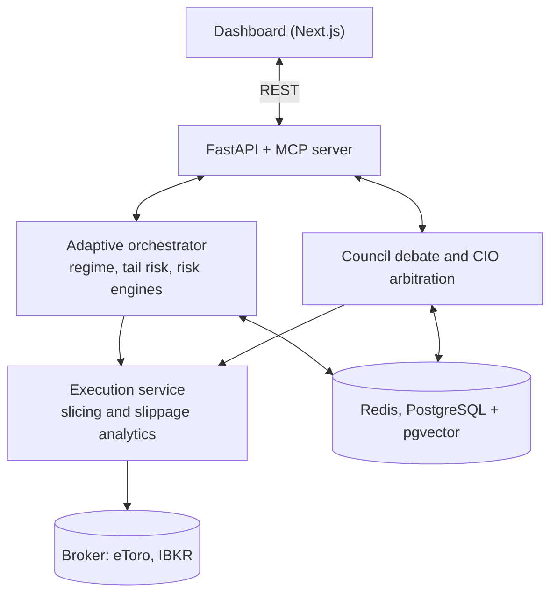

# AI Investment Advisor

<p align="center">
  <a href="https://github.com/neohsiung/AI-Investment-Advisor"></a>
  &nbsp;
  <a href="https://github.com/neohsiung/AI-Investment-Advisor/network/members"></a>
  &nbsp;
  <a href="https://github.com/neohsiung/AI-Investment-Advisor/issues"></a>
  &nbsp;
  <a href="https://github.com/neohsiung/AI-Investment-Advisor/blob/main/LICENSE"></a>
</p>

<p align="center">
  
  
  
</p>

<p align="center">
  
</p>

<p align="center">
  <strong>English</strong> |
  <a href="READMEs/README.zh-TW.md">繁體中文</a> |
  <a href="READMEs/README.ja-JP.md">日本語</a>
</p>

> [!WARNING]
> **Not investment advice. If you connect a funded broker account, it trades real money.** The software places real orders once it has live broker credentials, and it is provided "AS IS" with no warranty (see [LICENSE](LICENSE) and [NOTICE](NOTICE)). In this project `TRADING_MODE=paper` is not a simulation: the eToro token has no demo permission, so every broker call fails with `InsufficientPermissions`. The safe brakes are `ai_trading_enabled=false` and `tradable_capital_pct=0`. Read the code before you connect a funded account.

AI Investment Advisor is a self-hosted quantitative investment system. Several LLM agents evaluate each trade idea, deterministic code decides, and orders can go to a live eToro account. It is for developers who want to study this kind of system and accept the financial risk of running it.

Whether it earns a net excess return over SPY has not been shown. Check `/api/v1/net-alpha` and your own database rather than this text.

## What it does

| Area | Method |
|:-----|:-------|
| Multi-agent debate | A council of LLM agents analyses each ticker in parallel and a CIO agent arbitrates. The roster is defined in [`config/workflows/single_ticker_council.yaml`](config/workflows/single_ticker_council.yaml). |
| Scoring | A weighted ensemble scores buy decisions. Exits are scored separately. LLM output may propose; deterministic code decides. |
| Regime | A 3-state Hidden Markov Model estimates the market regime and adjusts the cash buffer and target beta. |
| Tail risk | Extreme Value Theory (Peaks-Over-Threshold, Generalized Pareto) extrapolates 99.9% VaR and CVaR. |
| Risk engines | Volatility targeting, correlation clustering, an opportunity-cost hurdle, fractional Kelly sizing and a multi-factor alpha blend. |
| Execution | Liquidity limits against average daily volume, randomized TWAP/VWAP slicing, implementation-shortfall attribution and online Almgren-Chriss impact calibration. |
| Strategy search | Simulated annealing over parameter grids, validated out-of-sample with walk-forward optimization. |
| Shadow ledger | A separate paper ledger records what the system would have done, for comparison. |
| Dashboard | The `/adaptive` page shows a five-dimension health radar and marks where each figure comes from. Missing data is shown as missing. |
| Security | Provider keys are encrypted at rest with Fernet; traces go through OpenTelemetry to SigNoz. |

## Architecture



Only the execution service places or closes broker orders. The invariants and budgets are in `config/mission.yaml`; load them with `src.config.mission.load_mission()` instead of copying numbers.

### LLM routing

Calls go through four tiers (`nano`, `fast`, `smart`, `advanced`) resolved by `ResilientLLMPipeline`. Which model sits behind each tier is set in the Settings page (tier bindings), not in code.

### Storage

| Tier | Engine | Holds |
|:-----|:-------|:------|
| Hot | Redis | Semantic cache, rate limits, circuit-breaker flags |
| Warm | PostgreSQL + pgvector | Trade logs, factor weights, embeddings |
| Cold | Encrypted files, JSONL | Backups and walk-forward logs |

## Tech stack

| Category | Technology |
|:---------|:-----------|
| Language | Python 3.10 / 3.11, TypeScript |
| Backend | FastAPI, MCP (Model Context Protocol), Celery Beat, Pydantic |
| Frontend | Next.js (App Router), React, Recharts, Tailwind CSS, SWR |
| Quantitative | NumPy, SciPy, Pandas |
| Data | PostgreSQL + pgvector, Redis, SQLAlchemy, Alembic |
| Infrastructure | Docker Compose, Nginx, SigNoz, OpenTelemetry |
| Brokers | eToro API, Interactive Brokers (IBKR) |
| Market data | Polygon, Tiingo, Finnhub, AlphaVantage, FMP, FRED, Tavily |
| Alerts | Telegram, Slack, Email (SMTP) |
| Quality | Pytest, Vitest, Ruff, Bandit |

Exact versions are in `pyproject.toml`, `uv.lock` and `frontend/package.json`.

## Quick start

Prerequisites: Docker with Compose v2, Python 3.10+ for local development, Node.js 20+ for frontend development.

```bash
git clone https://github.com/neohsiung/AI-Investment-Advisor.git
cd AI-Investment-Advisor
./install.sh
```

`install.sh` checks prerequisites, generates secrets, runs an onboarding wizard for the operating cost profile (Frugal, Balanced or Aggressive), builds the containers, applies migrations, seeds defaults with `ai_trading_enabled=false`, and runs a health check. Keep that setting until you have read the code and decided to trade.

Self-hosting and operations: see the [documentation index](docs/README.md).

| Page | URL |
|:-----|:----|
| Adaptive risk room | [http://127.0.0.1:8088/adaptive](http://127.0.0.1:8088/adaptive) |
| Overview | [http://127.0.0.1:8088/](http://127.0.0.1:8088/) |
| Performance | [http://127.0.0.1:8088/performance](http://127.0.0.1:8088/performance) |
| Backtest | [http://127.0.0.1:8088/backtest](http://127.0.0.1:8088/backtest) |
| Council decisions | [http://127.0.0.1:8088/decisions](http://127.0.0.1:8088/decisions) |
| Health | [http://127.0.0.1:8088/health](http://127.0.0.1:8088/health) |
| Extensions | [http://127.0.0.1:8088/extensions](http://127.0.0.1:8088/extensions) |
| Settings and cost profile | [http://127.0.0.1:8088/settings](http://127.0.0.1:8088/settings) |

## Project structure

```
AI-Investment-Advisor/
├── .agent/              # Agent governance: rules, skills, workflows
├── alembic/             # Database migrations (PostgreSQL)
├── config/              # Model routing, workflows, agent definitions, mission.yaml
├── deployment/          # Helm charts, PostgreSQL manifests
├── docs/                # Documentation
├── frontend/            # Next.js dashboard
├── infra/               # Nginx reverse proxy, SigNoz configuration
├── prompts/             # Agent system prompts
├── scripts/             # Ops scripts: pre-push checks, DB seeds, deployment gates
├── src/                 # Core Python package
│   ├── agents/          #   Agent definitions and skills
│   ├── api/v1/          #   FastAPI route handlers
│   ├── config/          #   App configuration and settings schema
│   ├── domain/          #   Domain models
│   ├── infrastructure/  #   Celery, LLM gateway, OpenTelemetry
│   ├── repositories/    #   Database access
│   └── services/        #   Quantitative and trading services
├── tests/               # Unit, integration, invariant and contract tests
├── AGENTS.md            # Context for AI coding assistants
├── CHANGELOG.md         # Version history
├── SECURITY.md          # Security policy
├── docker-compose.yml   # Development stack
└── install.sh           # Installer
```

## Quality gates

| Gate | Command |
|:-----|:--------|
| Local pre-push checks | `./scripts/pre_push_check.sh` |
| Backend tests | `pytest tests/unit/ -q` |
| Invariants (run before any deploy) | `pytest tests/invariants -q` |
| Frontend tests | `cd frontend && npm test` |
| Frontend types | `cd frontend && npm run typecheck` |
| Lint, new violations only | `python3 scripts/ruff_baseline.py check` |

Coding standards are in [`.agent/rules/engineering-standards.md`](.agent/rules/engineering-standards.md). Commit format is in [`.agent/rules/git-commit-format.md`](.agent/rules/git-commit-format.md).

## Documentation

Architecture, quantitative engine notes and operations guides are in [`docs/`](docs/README.md). Version history is in [`CHANGELOG.md`](CHANGELOG.md).

## License and contact

- Maintainer: Litov. Questions and security reports go to support@litov.app (see [SECURITY.md](SECURITY.md)). Support page: <https://support.litov.app/>.
- Contributing: [CONTRIBUTING.md](CONTRIBUTING.md).
- License: [Apache License 2.0](LICENSE).
- Disclaimer: this system analyses financial markets and can place real trades with real money when configured. It is not financial advice and is provided "AS IS" with no warranty. See [NOTICE](NOTICE).

Apache License 2.0, Copyright Litov and contributors.
