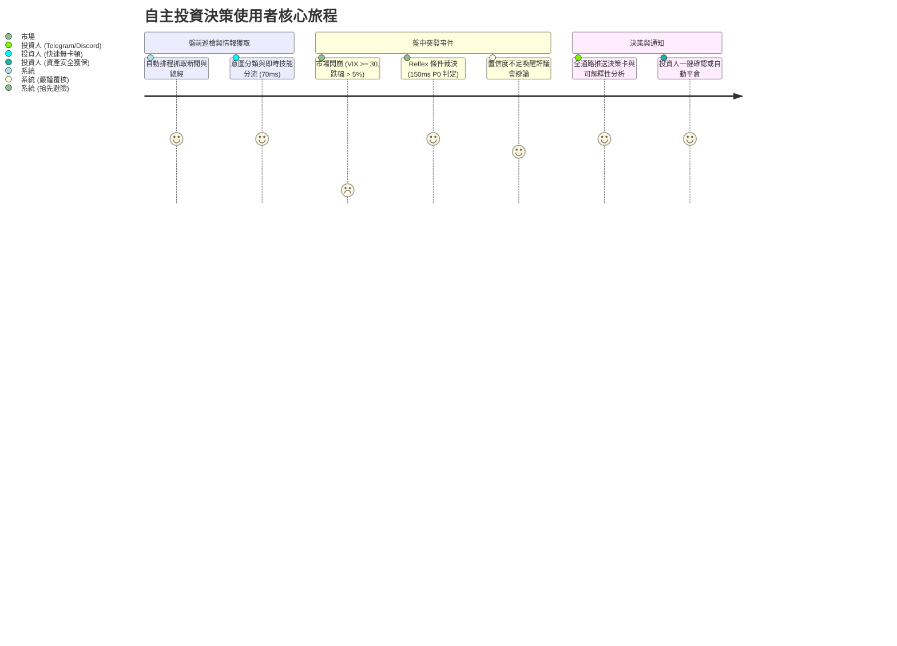

# 產品需求規格總綱 (Master PRD: Autonomous Investment Advisor)

> **導航跳轉 (Navigation)**: [Wiki 首頁 (Home)](../Home.md) | 條件裁決引擎 PRD | [規格內容 (PRD Specs)](#zh)

### 版本紀錄 (Version History)
| 日期 (Date) | 版本 (Version) | 變更說明 (Description) | 作者 (Author) |
| :--- | :--- | :--- | :--- |
| 2026-09-20 | v2.0.0 | 彙整單機低代碼轉型全系統規格，建立支援完整產出 SDD 之 PRD 總綱與架構映射矩陣 | Antigravity |
| 2026-06-01 | v1.0.0 | 初版產品演進規格草案 | Product Team |

---

### 角色導引 (Persona Guide)
- **目標受眾 (Target Audience)**: 👑 **產品經理 (Product Manager) / 系統架構師 (System Architect)**
- **閱讀時間 (Reading Time)**: 約 4~5 分鐘 (Approx. 4-5 mins)
- **文件目的 (Purpose)**: 定義產品全景業務規格、使用者旅程與功能邊界；架構師可直接依據文內「PRD-to-SDD 映射矩陣」產出軟體設計說明書 (SDD) 並完整重現專案。

---

## 🇹🇼 繁體中文 (Traditional Chinese)

### 1. 產品願景與定位 (Vision & Problem Statement)

`investment-advisor` 是一套專為個人投資者與低代碼自架運維者設計的**單機低代碼自主投資決策平台 (Single-Box Low-Code Autonomous Investment Advisor)**。
- **零外部 SaaS 依賴**：全系統運行於私有伺服器或本地機器，使用者完全掌控資產數據與交易主權。
- **宣告式低代碼擴充**：所有工作流、Agent 提示詞、資料來源與通知頻道皆由 YAML 與 Markdown 宣告式定義，無須修改 Python 核心代碼。
- **快思與深思雙軌並行**：透過條件裁決引擎 (Reflex) 提供毫秒級風控避險，結合多智能體評議會 (Council Swarm) 進行深度總經與基本面推論。

### 2. 使用者角色與體驗旅程 (Personas & User Journeys)

1. **獨立投資人 (Individual Investor)**：期望在零個資外洩的前提下，獲取機構級全天候市場巡檢與避險建議。
2. **量化策略師 (Quant Strategist)**：期望透過宣告式 DAG 工作流調整投資邏輯，並以毫秒級延遲執行風控。
3. **自架維運者 (Self-Hosted Operator)**：期望透過一鍵安裝腳本 (`install.sh`) 在本地快速部署，並依運算成本方案 (Frugal/Balanced/Aggressive) 嚴格控制 API 支出。

### 3. 六大功能需求規格 (Functional Requirements)

| 編號 | 功能模組 (Module) | 核心需求規格 (Specifications) |
| :--- | :--- | :--- |
| **FR1** | **宣告式工作流 (Workflow DAG)** | 支援以 YAML 定義有向無環圖 (`config/workflows/*.yaml`)，提供動態 Web 視覺化管理 (`/workflows`)，節點間自動拓撲排序與狀態流轉。 |
| **FR2** | **四層認知模型分層 (Tier Routing)** | 支援四級階層：`reflex` (毫秒快思) $\to$ `fast` (摘要/提取) $\to$ `smart` (多步推論) $\to$ `advanced` (CIO 深思)，依任務複雜度動態綁定模型。 |
| **FR3** | **毫秒級條件裁決 (Reflex Arbiter)** | 採用 TypeSafe Jev 1.13，實現雙門檻風控政策：P0 且置信度 $\ge 0.96 \to$ 自動避險；$0.70 \sim 0.95 \to$ 升級評議會；$< 0.70 \to$ 常態雜訊。 |
| **FR4** | **零資料外洩脫敏 (Data Sanitization)** | 經由 `HighAssuranceSanitizer` 徹底移除帳號與現金絕對值，轉化為無維度權重比例；API Key 替換為 `[REDACTED_SECRET]`；記錄 SHA-256 不可篡改稽核日誌。 |
| **FR5** | **宣告式外掛擴充 (Extensions Center)** | 統一四類外掛清單 (`config/data_providers.yaml`, `channels.yaml`, `tools.yaml`, `agents/*.md`)，前端提供 `/extensions` 集中管理。 |
| **FR6** | **運算成本方案治理 (Cost Profiles)** | 內建 Frugal (< $5/月)、Balanced (< $25/月)、Aggressive (< $60/月) 三大方案，自動調配巡檢頻率與 Token 消耗上限。 |

### 4. 非功能性需求規格 (Non-Functional Requirements)

- **NFR1 (延遲指標)**：Reflex 裁決響應 $\le 200\text{ ms}$；意圖路由 $\le 100\text{ ms}$；端到端警報發出 $\le 300\text{ ms}$。
- **NFR2 (安全與合規)**：所有外發連線強制 TLS 1.3 並附加 ZDR (Zero Data Retention) 隱私標頭；Loopback 本機免密認證，外部 Webhook 實施 `ADMIN_TOKEN` 隔離。
- **NFR3 (交易安全門禁)**：新安裝實例之 `ai_trading_enabled` 硬性預設為 `false`，必須手動切換且具備 800ms 斷路器隔離保護。
- **NFR4 (單機容器資源)**：整合成 7 核心 Docker 容器（UI, API, Beat, Worker, DB, Cache, Gateway），本機記憶體佔用 $\le 4\text{ GB}$。

---

### 5. PRD-to-SDD 架構映射矩陣 (PRD to SDD Derivation Matrix)

架構師設計 SDD 時，可直接參照下表之對應映射：

| PRD 功能需求 | SDD 架構分層 (Layer) | 對應代碼與配置路徑 (Code Assets) | 關鍵類別與介面契約 (Key Interfaces) |
| :--- | :--- | :--- | :--- |
| **FR1: 工作流 DAG** | Infrastructure & API | `src/infrastructure/workflow/`   `src/api/v1/endpoints/workflows.py` | `WorkflowLoader`, `DAGExecutor`, `WorkflowGraph` |
| **FR2: 模型分層路由** | Infrastructure / LLM | `config/llm_tiers.yaml`   `src/infrastructure/llm/budget_aware_model_router.py` | `BudgetAwareModelRouter`, `ITierRouter` |
| **FR3: 條件裁決避險** | Infrastructure / LLM | `src/infrastructure/llm/arbiter_client.py`   `src/services/sentinel_service.py` | `ArbiterClient`, `ArbiterDecision`, `SentinelService` |
| **FR4: 零外洩脫敏** | Security / Compliance | `src/infrastructure/llm/security_sanitizer.py`   `src/infrastructure/llm/audit_trail.py` | `HighAssuranceSanitizer`, `ZeroKnowledgeAuditor` |
| **FR5: 宣告式外掛** | Plugins & Services | `src/plugins/registry.py`   `config/*.yaml`, `config/agents/*.md` | `PluginRegistry`, `ManifestParser`, `/extensions` API |
| **FR6: 成本方案** | Services & CLI | `src/services/cost_profile_service.py`   `scripts/onboarding_wizard.py` | `CostProfileService`, `OnboardingWizard` |
| **NFR2: 本地安全網關** | Gateway / Middleware | `infra/nginx/nginx.conf`   `src/api/v1/dependencies.py` | `get_current_user`, `Nginx Proxy Pass`, `traceparent` map |

---

## 🇬🇧 English

### 1. Product Vision & Scope
`investment-advisor` is an autonomous, privacy-first, low-code investment platform running locally without third-party SaaS dependencies. It marries sub-200ms reflexive hedging (Reflex Arbiter) with multi-agent macroeconomic deliberation (Council Swarm).

### 2. Functional Requirements (FR1–FR6) Summary
- **FR1 (Workflow DAG)**: Declarative YAML pipelines visualized in `/workflows`.
- **FR2 (Cognitive Tiering)**: Dynamic model dispatching across `reflex`, `fast`, `smart`, and `advanced`.
- **FR3 (Reflex Arbiter)**: Calibrated Non-autoregressive classification with dual-threshold risk escalation.
- **FR4 (Zero-Leakage Sanitizer)**: Scrubbing sensitive balances and secrets, accompanied by cryptographic SHA-256 audit trails.
- **FR5 (Extensions Center)**: Declarative plugins registry for data providers, notification channels, and tools.
- **FR6 (Cost Profile Governance)**: Frugal, Balanced, and Aggressive profiles governing monthly expenditures.

---

### 參考資源 (References)
- **相關需求文檔 (Related Specs)**:
  - 條件裁決引擎產品規格 (PRD Reflex Arbiter)
  - [單機轉型路線圖 (Transformation Roadmap M1-M8)](./單機轉型路線圖-Transformation-Roadmap-M1-M8.md)
  - 條件裁決引擎架構決策 (ADR-008)
  - 零外洩資料脫敏架構設計
  - [端到端行為驅動測試規格 (BDD Specs)](../05_Quality_Assurance/端到端行為驅動測試規格-BDD-E2E-Testing-Specs.md)
  - [單機自架維運手冊](../06_SRE_Observability/單機自架手冊-Self-Hosting-Guide.md)
- **代碼庫對照 (Code References)**:
  - 工作流引擎: [src/infrastructure/workflow/](../../src/infrastructure/workflow/)
  - 裁決與防腐層: [src/infrastructure/llm/arbiter_client.py](../../src/infrastructure/llm/arbiter_client.py)
  - 安全脫敏器: [src/infrastructure/llm/security_sanitizer.py](../../src/infrastructure/llm/security_sanitizer.py)
  - 宣告式設定清單: [config/](../../config/)
