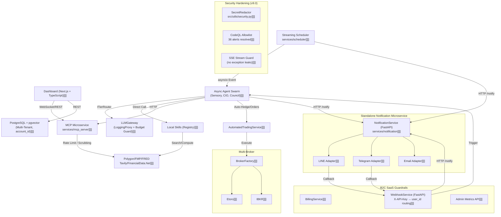
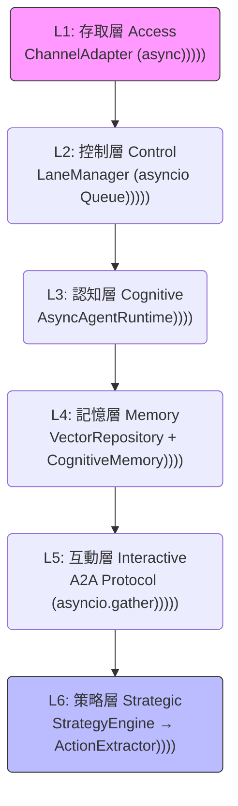
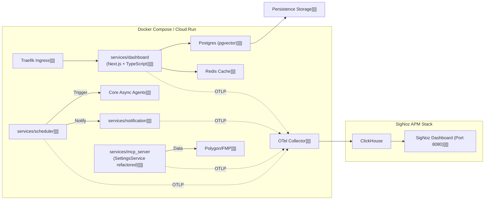

# 系統全景圖 (System Landscape)

> **[繁體中文 (Traditional Chinese)](#zh) | [English](#en)**
> **最新版本 (Latest Version)**: 請參閱文件頂部的版本紀錄 (Iteration Record).

### 版本紀錄 (Version History)
| Date | Version | Description | Author |
| :--- | :--- | :--- | :--- |
| 2026-04-10 | v10.0| **B2C MVP & Decoupling**: 完成 Phase 1/2。API v1 解耦、Next.js 戰術戰車上線、SWR 加上 SSE/WS 即時整合，拋棄 Streamlit 單體。 | Antigravity |
| 2026-04-06 | v9.0 | **v8.x Async Overhaul**: 全系統非同步化完成（964 tests / 0 failures）；Phase 7 認知治理落地；`BudgetAwareModelRouter` 遷移至 infra 層；`ITierRouter` Strategy Pattern；`MCP Server` SettingsService 重構；36 項安全警報修復；Python 3.11 Only 矩陣。 | Antigravity |
| 2026-04-05 | v6.0 | **The B2C SaaS Evolution**: Next.js PWA, BillingService, Secret Scrubbing Middleware. | Antigravity |
| 2026-03-01 | v5.2 | **Tech Stack Modernization**: 移除 futu-api，升級 OTel。 | Antigravity |
| 2026-02-21 | v5.0 | **Microservices Monorepo & Observability**: SigNoz APM, OpenTelemetry, Standalone Notification. | Neo |

---

<a id="zh"></a>

## 🇹🇼 系統架構全景圖 (v9.0 Architect View)

本文件依據 文件框架定義 編寫，提供系統的高層設計、組件關係與運作指標。

### 1. 願景與設計目標 (Problem & Goals)
- **挑戰**: AI 系統通常是黑盒且難以大規模管理。
- **目標**: 構建一個高透明度、具備自我監控與自動化對沖能力的「雲端原生」金融代理。
- **架構原則**: 分離推論、計算與持久化，支援 12-factor 無狀態部署；**非同步優先 (Async-First)**，所有 Agent 與 Infrastructure 全面採用 `asyncio`。

### 2. C4 架構觀點 (C4 Architecture Model)

#### 2.1 系統上下文 (Level 1: System Context)
- **使用者**: 透過 Next.js Dashboard 接收 WebSocket 即時更新。
- **外部 API**: Polygon.io (行情), FMP (財報), FRED (總經), Tavily (搜尋), Groq (Whisper 語音), FinancialData.Net (內線交易), OpenRouter (LLM)。
- **券商 API**: Etoro Bridge, ib_insync (Alpha) *[規劃中]*。
- **通知**: LINE Messaging API / Telegram Bot / Email。
- **資料持久化**: PostgreSQL (pgvector，含 `account_id` 多租戶隔離) / Redis (高速快取)。

#### 2.2 容器視角 (Level 2: Container Diagram)



#### 2.3 組件互動流 (Interaction Flows)
1. **數據攝取**: `Dashboard` 接收用戶輸入 → `DB` 持久化 → `MCP_Serv` 註冊工具。
2. **A2A 研究週期**: `Scheduler` 依時區觸發 `CIO Agent` → `CIO` 透過 `asyncio.gather` 並行發動 `Analysts` → 匯總為具備「證據鏈」的報告 → `ActionExtractorAgent` 轉為結構化交易指令。
3. **混合工具調用**:
    - **Local Strategy**: Agent 優先調用本地 `Skills` (Registry) 進行快速運算。
    - **Scale Strategy**: 若需跨系統資料，透過 `mcp_service` 執行。
4. **LLM 路由**: `CouncilTierRouter`（情境感知）→ `BudgetAwareModelRouter`（預算守衛）→ `LoggingLLMGateway`（成本追蹤）→ `OpenRouter API`。

### 3. 非同步代理人作業系統模型 (Async Agentic OS — v9.0)



| 層次 (Layer) | 角色 (Role) | 核心組件 | v9.0 異動 |
| :--- | :--- | :--- | :--- |
| **L1: 存取層** | 正規化 I/O | `ChannelAdapter` | 全面 async，callback argument 已修正 |
| **L2: 控制層** | 併發與泳道 | `LaneManager` | `asyncio.Queue` 取代同步阻塞 |
| **L3: 認知層** | 執行環境 | `AsyncAgentRuntime` | `BaseAgent.run()` 全面 `async def` |
| **L4: 記憶層** | 混合檢索 | `VectorRepository + CognitiveMemoryManager` | `memory_distillation_service` 透過 `ThreadPoolExecutor` bridge async |
| **L5: 互動層** | 回饋機制 | `A2A Protocol` | `asyncio.gather` 並行 Swarm，`graceful degradation` 完整 cancel+await |
| **L6: 策略層** | 持久化實施 | `StrategyEngine + ActionExtractorAgent` | `ActionExtractorAgent` 解析非結構化文本 → JSON 交易指令 |

### 4. LLM 路由架構 (ITierRouter Strategy Pattern — v9.0)

```mermaid
graph LR
    CS["CouncilService / SentinelService]]]]"] --> CTR["CouncilTierRouter\n("情境感知: VIX, 辯論輪次)))")]]]]"]
    CTR -->|Tier String| BAMR["BudgetAwareModelRouter\n(infra/llm/budget_aware_model_router.py)]]]]"]
    BAMR -->|LLMConfig| LLM["LoggingLLMGateway\n(LoggingProxy)]]]]"]
    LLM -->|usage.total_tokens| DB[("llm_calls\nPostgreSQL")]
    LLM --> OR["OpenRouter API]]]]"]
    DB --> BD["Budget Dashboard]]]]"]
```

> **v9.0 架構異動**: `BudgetAwareModelRouter` 已從 `src/services/` 遷移至 `src/infrastructure/llm/`，完全符合 Clean Architecture 依賴規則。所有路由器必須繼承 `ITierRouter` 抽象介面。

### 5. 基礎設施視角 (Infrastructure View)

#### 5.1 佈署拓撲 (Deployment Topology)
- **Python 版本**: **僅支援 Python 3.11** (v9.0 移除 3.10 CI matrix)。
- **架構**: Microservices Monorepo — `src/` 共享庫 + `services/` 獨立進入點。
- **統一遙測**: OpenTelemetry 1.39.1 → SigNoz APM。



#### 5.2 安全架構 (Security Architecture — v9.0)

全系統執行 36 項 CodeQL / Dependabot 安全警報修復：

| 類別 | 修復措施 |
| :--- | :--- |
| **Secret Redaction** | `src/utils/security.py` 集中化脫敏；log 中禁止出現 API Key / Bearer Token |
| **SSE Stream Safety** | SSE `/stream` endpoint 捕捉所有 exception 後僅回傳 error code，不洩漏 stack trace |
| **Input Validation** | `verify_streaming.py` 加入 allowlist 驗證；`X-API-Key` 為標準 header |
| **依賴版本** | `litellm==1.83.3`, `httpx==0.28.1`, `python-dotenv==1.0.1`, `streamlit>=1.42` |
| **CI Matrix** | 僅保留 Python 3.11；Ubuntu 24.04 Playwright 安裝已修復 |
| **Google Auth** | `google_auth_oauthlib` lazy-load，避免 MCP 測試 collection 失敗 |

#### 5.3 外部事件與 Webhook 架構

```mermaid
graph LR
    Ext["External Alerts\n(TradingView/LINE/Telegram)]]]]"] -->|"Webhook (POST)"| Ngrok["Ngrok Tunnel]]]]"]
    Ngrok -->|"Forward"| WHS["WebhookService (Port 8000)\nX-API-Key → user_id]]]]"]
    WHS -->|"Verify + Route"| Routing["Router Dispatch]]]]"]
    Routing -->|"EventAnalysisWorkflow"| Sentinel["SentinelService\n(async, deduplication)]]]]"]
    Sentinel -->|"CRITICAL DANGER"| ATS["AutomatedTradingService]]]]"]
    ATS -->|"Emergency Hedge"| Broker["BrokerFactory]]]]"]
```



#### 5.4 關鍵配置文件映射 (Infrastructure Registry)
| 組件 | 配置文件 | 說明 |
| :--- | :--- | :--- |
| **容器鏡像** | `Dockerfile` | python:3.11-slim-bookworm，appuser UID 10001 |
| **MCP 鏡像** | `Dockerfile.mcp` | 隔離工具服務輕量化鏡像，含 `.dockerignore` |
| **K8s 定義** | `k8s/` | Deployment, Service, Secret 定義 |
| **自動化** | `docker-compose.yml` | 本地多服務開發環境 |

### 6. 非功能性需求與性能 (NFR & Performance)
- **可擴展性**: 全面 `asyncio`；`asyncio.gather` 支援 50+ 標的並行分析。
- **可靠性**:
    - **Phase 7 認知治理 (Fail-Safe)**: Agent 執行失敗時觸發 fail-safe diagnostics，增強根因定位能力。
    - **Health Check**: MCP 健康檢查透過 `AsyncBaseRepository` mock 確保 DB 依賴可測試。
- **性能**:
    - **非同步 LLM 調用**: `LoggingLLMGateway` 全面 `async def chat()`。
    - **響應時間**: Dashboard 首屏 < 5s；單一 Agent 報告 < 15s。

### 7. 成功指標 (Success Metrics)
- **測試通過率**: 964 tests / 0 failures (v8.x milestone)。
- **覆蓋率**: > 65% (CI 強制門檻)。
- **安全警報**: 0 Active CodeQL/Dependabot alerts。
- **可用性**: > 99.9%。

---

<a id="en"></a>

## 🇺🇸 System Landscape (v9.0)

### 1. Vision & Design Goals
Building a transparent, cloud-native financial agent with 0% hallucination risk through async-first, tiered decoupling of reasoning and math. Full async migration completed in v8.x (964 tests, 0 failures).

### 2. C4 Architecture
- **Context**: Interfacing with Polygon, FRED, OpenRouter, Tavily, Groq, FinancialData.Net.
- **Container**: Next.js (TypeScript) Dashboard + WebSocket; Async Agent Swarm; ITierRouter + BudgetAwareModelRouter in infra layer; MCP Server refactored with SettingsService.

### 3. Security (v9.0)
- 36 CodeQL/Dependabot alerts resolved.
- Centralized `SecretRedactor` (`src/utils/security.py`).
- SSE stream exception leakage closed.
- `X-API-Key` standardized as webhook header.

### 4. NFR & Performance
- **Python**: 3.11 only.
- **Async**: All agents and infrastructure components use `asyncio`.
- **Throughput**: 50+ tickers in parallel via `asyncio.gather`.
- **MTTR**: < 5 minutes via automated fail-safe diagnostics.

## 🔗 Bidirectional Links
- **Communication Protocols**: Agent Mesh Protocols
- **Frontend Architecture**: Frontend UX Layer
- **LLM Routing**: LLM Cost Tracking & Model Tiering
- **Agent Swarm**: [Agent Swarm Protocol](../03_Backend_Intelligence/代理人戰略協定-Agent-Swarm-Protocol.md)
- **Security**: Security and Base Image Standard
- **Memory System**: Memory & Redis Architecture
- **Sentinel & Council**: Sentinel & Council Architecture
- **Developer Guide**: Local Dev Setup
