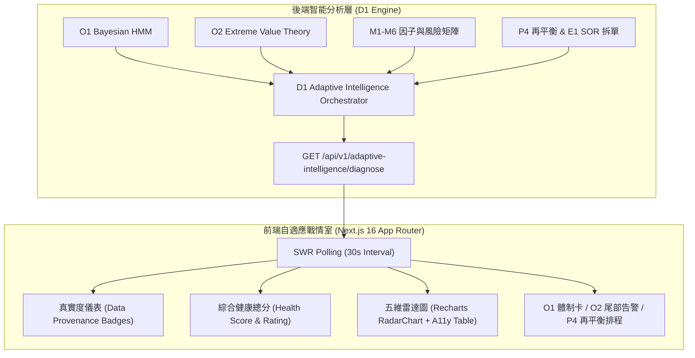

# 自適應戰情室雷達儀表板規格與實裝指南 (Adaptive Intelligence War Room)

## 1. 模組定位與架構全景 (Architecture Overview)

**自適應戰情室雷達儀表板 (UI1)** 是本系統前端的總合風控戰情中樞，建立於 Next.js 16 (React 19) 之上，透過 SWR 高效輪詢 (`/api/v1/adaptive-intelligence/diagnose`)，將後端演算法層的核心智慧無縫可視化：
1. **D1 統一投組自適應智慧聚合服務**：五維量化健康雷達與綜合評分 $[0, 100]$。
2. **O1 貝氏動態體制轉移 (Bayesian HMM)**：體制狀態識別、置信度熵、連續目標現金儲備與目標 Beta。
3. **O2 極值理論尾部風險外推 (EVT)**：黑天鵝預警等級、99.9% 閉式解 VaR / CVaR 與肥尾放大倍數。
4. **P4 策略自動演化與 E1 SOR 拆單**：動態再平衡建言、目標配置權重與執行排程預覽。



---

## 2. 零虛假數據真實性保證 (Zero Fabricated Data Guarantee)

為徹底杜絕「靜默虛假成功」與「未標記之模擬值誤導操作者」，UI1 遵循嚴格的數據來源溯源契約 (Data Provenance)，在戰情室頂部明確標記三大維度的數據產生來源：

| 維度 (Dimension) | 來源標籤 (Badge) | 狀態意涵 (Semantic Meaning) | 觸發條件與後端回退邏輯 |
| :--- | :--- | :--- | :--- |
| **持倉來源 (Holdings)** | `實測持倉 (Live)` | 來自真實經紀商/帳戶活期部位 | 帳戶具備有效持倉且非空 |
| | `範本基準 (Template)` | 系統基準示範投組 (SPY/QQQ/TLT/GLD) | 帳戶為全新無持倉時自動平滑回退 |
| **宏觀行情 (Macro)** | `即時行情 (Live SPY/VIX)` | 來自市場數據服務即時報價與 200MA | 行情介面正常返回 SPY 及 VIX 數值 |
| | `預設常數 (Default)` | 預設市場平衡常數 (SPY 趨勢 1.02, VIX 18.5) | 離線或市場數據異常時平滑回退 |
| **尾部風險 (Tail Risk)** | `實測淨值 (Live Portfolio)` | 來自投組歷史快照實際每日日收益率 | 累積超過 30 個交易日真實淨值紀錄 |
| | `加權行情 (Asset-Weighted)` | 根據當前持倉標的過去 180 日 OHLCV 計算加權 | 真實淨值不足但持倉標的行情健全 |
| | `合成模擬 (Synthetic)` | 幾何布朗運動 (GBM) 蒙地卡羅隨機合成 | 本地離線且無歷史行情數據時啟用 |

---

## 3. 五維健康雷達指標映射 (Health Radar Metrics)

五維健康雷達各軸評分範圍為 $[0.0, 100.0]$，並對應以下評級區間：
- **OPTIMAL (80-100)**：極佳狀態，防禦抗跌與分散化效率皆達標。
- **BALANCED (65-79)**：穩健均衡，結構良好但存在微幅優化空間。
- **CAUTION (50-64)**：警戒狀態，偏離當前體制或尾部風險偏高，建議調整。
- **CRITICAL (<50)**：危殆狀態，面臨極端黑天鵝衝擊或嚴重集中度風險。

各維度量化公式與評估重點如下：

```math
\text{Health Score} = 0.25 \times S_{\text{regime}} + 0.20 \times S_{\text{div}} + 0.20 \times S_{\text{factor}} + 0.20 \times S_{\text{tail}} + 0.15 \times S_{\text{safety}}
```

1. **體制適應度 ($S_{\text{regime}}$)**：評估當前持倉 Beta 與現金水位是否緊密配合 O1 貝氏 HMM 動態體制（牛市追動能、震盪降 Beta、熊市拉升防禦現金）。
2. **分散化效率 ($S_{\text{div}}$)**：以有效資產數 ($N_{\text{eff}} = 1 / \sum w_i^2$) 與 Gini 集中度係數，防範跨資產假分散與個股過度集中。
3. **因子風格平衡 ($S_{\text{factor}}$)**：檢驗多因子暴露是否過度偏向單一風格，在牛市維持動能與主力籌碼、在震盪均衡配置品質與價值。
4. **尾部風險抗跌 ($S_{\text{tail}}$)**：依 O2 極值理論 (EVT) 超額峰值法 (POT)，檢驗投組在 99.9% 閉式解極值條件下之 CVaR 與肥尾放大抗性。
5. **資本安全度 ($S_{\text{safety}}$)**：監控實際槓桿率、融資保證金緩衝邊際與近期自峰值最大回撤幅度。

---

## 4. 無障礙性與現代網頁規範 (A11y & Modern Web Compliance)

依據現代前端無障礙與視覺化規範，戰情室落實以下標準：
- **語意化替代數據表**：在 SVG 雷達圖旁提供 `<table aria-label="五維健康雷達數據表">`，確保螢幕閱讀器與鍵盤導覽使用者可無障礙讀取各維度數值與評語。
- **動態更新通知**：重要分數區塊標註 `aria-live="polite"`，數值因輪詢更新時不造成非預期焦點搶佔。
- **響應式佈局**：採用 Tailwind 彈性格點，在行動裝置上自動堆疊卡片，桌上型螢幕展現完整 12 欄戰情佈局。

---

## 5. 前端實裝與測試驗證

- **主頁面路由**：`frontend/src/app/adaptive/page.tsx`
- **導覽列整合**：`frontend/src/components/layout/Sidebar.tsx` 加入「自適應風控雷達」
- **測試套件**：`frontend/src/app/adaptive/page.test.tsx` (Vitest + React Testing Library)
  - 驗證 SWR 輪詢配置與 `refreshInterval > 0`
  - 驗證明確 Loading 狀態與 Error 錯誤訊息提示
  - 驗證數據真實度來源標籤渲染（Live vs Template, Synthetic）
  - 驗證五維健康雷達無障礙表格結構與各維度單元格內容
  - 驗證兼容 `/diagnose` 深度診斷與 `/health` 簡明摘要回應格式
