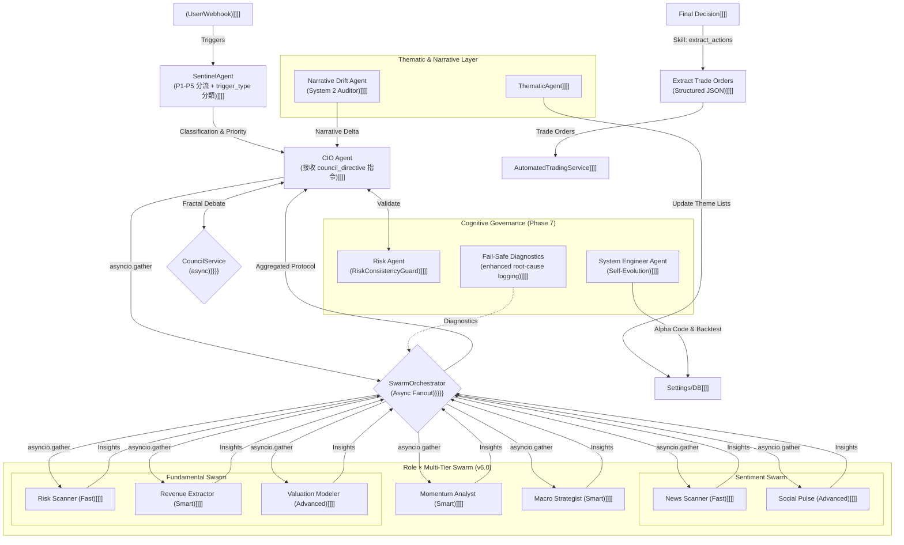
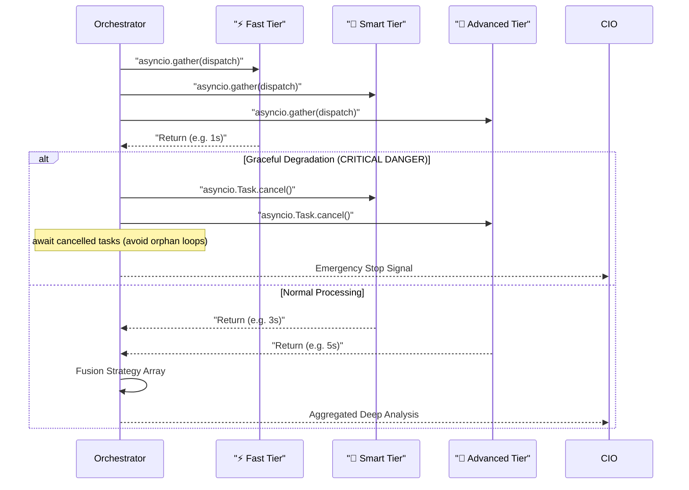

# 代理人戰略協定與認知授權 (Agent Swarm Protocol & Cognitive Mandates)

| Date | Version | Description | Author |
| :--- | :--- | :--- | :--- |
| 2026-04-18 | v6.2 | **Comprehensive Sync (The Great Sync)**: 移除已退役的 `ActionExtractorAgent`（轉為 `extract_actions` Skill）；強化 B2C SaaS `user_id` 強制隔離規範說明。 | Antigravity |
| 2026-04-17 | v6.1 | **Sentinel Context & Push-Down Intelligence** (v9.2): SentinelAgent emits `trigger_type` in JSON. `CouncilService` injects `council_directive` into CIO's `final_context`. | Antigravity |
| 2026-04-06 | v6.0 | **v8.x 全非同步化**：所有 Agent `run()` 均為 `async def`；`CouncilAgentAdapter` 完整 async；`asyncio.Task.cancel()` + `await` 強制執行避免孤兒進程；`ThreadPoolExecutor` bridge for sync context；Phase 7 Cognitive Governance fail-safe diagnostics。 | Antigravity |
| 2026-03-20 | v5.1 | **Phase 4 重構**：可插拔聚合策略、`DegradationChain`、`run_consensus()` 共識 API。 | Antigravity |
| 2026-03-12 | v5.0 | **Universal Prioritization**: Integrated `SentinelAgent` as entry gate (P1-P5). | Antigravity |
| 2026-02-28 | v4.3 | **Context Safety & WAL Protocol**: `_check_context_window` + `_perform_silent_flush`. | Agent |
| 2026-02-21 | v4.1 | **Thematic & Narrative Drift Agents** added. | Neo |
| 2024-01-04 | v1.0 | Initial 4-agent design. | Neo |

> **[繁體中文 (Traditional Chinese)](#zh) | [English](#en)**

---

## 🇹🇼 代理人戰略協定 (v6.0 — Async-First)

**代理人蜂群架構 (Async Agent Swarm)** 將投資顧問從同步線性流程升級為採用 `asyncio.gather` 真並行的協作生態系統。系統全面非同步化（v8.x milestone，964 tests / 0 failures），`BaseAgent.run()` 均為 `async def`。

### 🏛️ 架構圖 (Architecture Diagram — v6.1)

### 1. 代理人建構 (Agent Construction — v6.0)

所有 Agent 繼承 `BaseAgent`，由 `AgentFactory` 統一建構，**所有 `run()` 均為 `async def`**。

- **Factory**: `src/agents/factory.py` → `create_agent(name, tier)` 動態建立。
- **依賴注入**: 自動注入 `feedback_repo`、`market_tools`、`mcp_server`。
- **B2C SaaS 強制隔離 (user_id)**: 所有 Agent 建構**強制要求傳入 `user_id`**。嚴禁建立全域單例 (Global Singleton) 代理人。
- **Tier 系統**: `Fast` (Flash) / `Smart` (Pro) / `Advanced` (Thinking)。
- **LLM 路由**: 透過 `ITierRouter` 介面，由 `CouncilTierRouter` + `BudgetAwareModelRouter` 組合決定。
- **安全上下文管理 (Context Guard & WAL Protocol)**: Token 預留墊 (4,000 tokens)；逼近上限觸發 `_perform_silent_flush` → 保存 `STATE.md` → 截斷歷史。

### 2. 蜂群角色 (Agent Swarm Roles — 11 roles)

> [!TIP]
> 蜂群生態系將專才 Agent 視為微服務節點，各司其職並由 CIO 或 Council 統一整合。

| 角色 (Role) | 認知授權 (Mandate) | 核心職責 | 產出 | 核心檔案 |
| :--- | :--- | :--- | :--- | :--- |
| **CIO** | 綜合者與仲裁者 | 整合多模態輸入，使用衝突解決矩陣 | 最終投資報告、再平衡指令 | `cio.py` |
| **Macro** | 週期架構師 | 識別市場週期、分析利率/通膨/地緣政治 | Risk-On/Off 配置觀點 | `macro.py` |
| **Fundamental** | 由下而上偵探 | 財報分析、估值建模 (DCF/PE) | 個股投資論述 (B/S/H) | `fundamental.py` |
| **Momentum** | 趨勢獵人 | 技術指標分析 (RSI/MACD) | 技術面訊號與進出場時機 | `momentum.py` |
| **Sentiment** | 行為計量分析師 | 新聞情緒、社群輿情、反向訊號偵測 | 情緒分數與行為警示 | `sentiment.py` |
| **Risk** | 認知治理守門人 | 持倉風險評估、`RiskConsistencyGuard` | Risk Score、一致性警報 | `risk.py` |
| **Engineer** | 自我進化工程師 | 分析 Agent 績效、自動生成 Alpha 因子 | 量化策略代碼 | `system_engineer_agent.py` |
| **Thematic** | 供應鏈優化師 | 動態更新主題股票清單與知識圖譜 | 主題清單 (`updated_tickers`) | `thematic.py` |
| **Narrative Drift** | System 2 審計師 | 識別敘事偏離，提供修正建議 | Accuracy Score、修正建議 | `prompts/narrative_drift...` |
| **Council** | 評議會仲裁 | `async def run()` 碎形辯論 | 加權辯論結論 | `council_adapter.py` |
| **Skill: extract_actions** | 結構化翻譯員 | 解析評議文本 → 符合交易規格的 JSON | 結構化交易指令 | `skills/extract_actions/` |

### 2.1 編制對照：三個數字都對，但各指不同子系統 (Roster Reconciliation)

> [!IMPORTANT]
> Wiki 各處出現過「11 roles」「10 個 Debate 代理人」「7-agent swarm」「4 個評分代理人」四種說法，
> `AGENTS.md` 一度把後兩者以外的說法都判為「程式未實作的設計」。**實際上四個數字都對得上程式碼**，
> 只是各自描述不同的子系統。以下為 2026-08-23 直接讀原始碼核對的結果，日後請以本表為準。
>
> Four different agent counts appear across the docs. All four are real — they
> describe different subsystems. Verified against source on 2026-08-23.

| 數字 | 指的是什麼 | 成員 | 依據 |
| :--- | :--- | :--- | :--- |
| **10** | **Council 辯論陣容**（單標的分析 DAG 的 Layer 1，`asyncio` 並行） | Macro、Momentum、Fundamental、Sentiment、Thematic、Risk、Sentinel + 三個買方 Scout（Momentum Scout、Fundamental Scout、Macro Scout） | `src/infrastructure/workflow/portfolio_dag.py` 的 `SingleTickerAnalysisDAG.AGENT_ROSTER`；與 `council_service.py:525` 的 `agent_names` 完全一致 |
| **7** | **分析型 agent**（上表扣掉三個 Scout） | Macro、Momentum、Fundamental、Sentiment、Thematic、Risk、Sentinel | `council_service.py:524` 的程式註解「12 核心 Agents（3 個 Scout + 7 分析 + CIO + Engineer）」 |
| **4** | **買進信心加權評分集成**（與辯論是不同階段） | Fundamental 0.35、Momentum 0.25、Sentiment 0.20、Risk 0.20 | `src/services/confidence_compositor_service.py` 的 `self.agent_weights` |
| **11** | 本頁 §2 的角色表 —— 職能編制，含 CIO、Council、Narrative Drift 與 `extract_actions` skill，不是任何單一執行路徑的參與者名單 | 見 §2 | 本頁 §2 |

**賣出**走的是另一條路：`ExitCompositorService`，因子與買進側不同，不套用上面的 4 個權重
（Exits are scored separately by `ExitCompositorService` on different factors）。

> **為什麼會亂**：辯論陣容（10）與評分集成（4）在文件裡都被叫做「代理人」，但一個是產生
> 論述的並行節點、另一個是把論述壓成單一分數的加權器。引用數字時請一併指明子系統。

### 3. 全非同步編排 (Async Swarm Orchestration — v6.0)

**關鍵 v8.x 修復**:
- `test_council_adapter`: 完整重寫為 `@pytest.mark.asyncio`，`CouncilAgentAdapter.run()` 現為純 async。
- `test_antigravity_workflow`: 使用 `AsyncMock` 替換 `agent.run`、`check_contradictions`、`summarize`。
- `memory_distillation_service.py`: sync context 中透過 `ThreadPoolExecutor` bridge async `chat()` 調用。
- `risk_keyword_service.py`: 同上模式（`ThreadPoolExecutor` bridge）。

**編排模式**:
- **Broadcast**: 單一任務並行發送至所有 Tier。
- **Batch Run**: `RoleSwarm` 針對不同股票指派動態叢集。
- **Graceful Degradation**: Emergency Stop 時嚴密執行 `cancel()` + `await` → 避免 `Event loop is closed` 例外。

**動態歸因機制**: `AttributionAnalyzer` 掃描歷史推薦與市場表現，自動 Reward/Penalty Agent 信任權重。

### 4. Phase 7 認知治理 (Cognitive Governance — v7.x+)

Phase 7 在現有 Swarm 上新增「認知層防護」：

| 組件 | 職責 | 狀態 |
| :--- | :--- | :--- |
| **RiskConsistencyGuard** | 確保 Risk Agent 的評估跨週期一致性 | ✅ 生產就緒 |
| **Fail-Safe Diagnostics** | Agent 執行失敗時增強根因定位（traceback + context logging） | ✅ 生產就緒 |
| **Trade Approval Flow** | `AsyncMock` coroutine 正確執行；不再出現未 await 協程 | ✅ CI 穩定 |
| **Python 3.8 Compat** | 移除 `asyncio.to_thread`，改用 `ThreadPoolExecutor` backport | ✅ 已修復 |

### 5. 技能系統整合 (Skills Integration)

Agent 優先調用本地 `Skills` Registry 避免過度 LLM 推理：

| Skill | 功能 | 分類 |
| :--- | :--- | :--- |
| `search_web` | Tavily 金融搜尋 | Runtime |
| `get_market_data` | OHLCV + 技術指標 | Runtime |
| `get_portfolio` | 持倉與槓桿率 | Runtime |
| `position_sizing` | Portfolio-Aware 交易量計算 | Runtime |
| `get_historical_report` | 歷史報告戰略回顧 | Runtime |
| `auto_discover_learning` | 自動發現內容進行 Skill 學習 | Runtime |

詳細說明見 Agent 技能系統。

### 6. 投資委員會協定 (IC Protocol)

#### 衝突解決矩陣 (Conflict Resolution Matrix)
| 體制 (Regime) | 權重排序 |
| :--- | :--- |
| **財報季 (Earnings)** | Fundamental > Momentum > Macro |
| **危機/修正 (Crisis)** | Macro > Momentum > Fundamental |
| **泡沫/狂熱 (Bubble)** | Sentiment > Momentum > Fundamental |

#### 碎形辯論 (Fractal Debate — Council, async)
- **觸發**: Sentinel 偵測異常 或 Agent 意見分歧 > 閾值。
- **上下文傳遞 (Context Propagation)**:
  - SentinelService 產生針對特定觸發類型 (如 news, price_move) 的 `msg_prefix`。
  - CouncilService 取出 `msg_prefix` 並將其封裝為 `council_directive` 注入到 CIO 的 `final_context`，確保指令確實傳達。
- **流程**: `CouncilService.async run()` 對持倉逐一執行正反辯論 → 加權結論 → CIO (根據 `council_directive`) 最終裁決。
- **v8.x 修復**: `workflow_service.py` 中修復缺失 `await` 的 `translator._call_real_llm`。

#### R.P.A. 思維鏈強制
- **推理 (Reasoning)**: 「為什麼會發生？」(因果)
- **計畫 (Plan)**: 「需要什麼資訊？」(工具選擇)
- **行動 (Action)**: 「執行工具/產出。」

---

## 🇺🇸 Agent Swarm Protocol (v6.0)

### v8.x Async-First Migration Summary
| Component | Change |
|:---|:---|
| `BaseAgent.run()` | Now `async def`, all subclasses migrated |
| `CouncilAgentAdapter` | Fully async; tests use `@pytest.mark.asyncio` |
| `WorkflowService` | Fixed missing `await` on `translator._call_real_llm` |
| `memory_distillation_service` | `ThreadPoolExecutor` bridge for sync→async |
| `AgentFactory` | `AsyncMock` used in `test_comprehensive_services` |
| Graceful Degradation | `asyncio.Task.cancel()` + forced `await` prevents orphan loops |

### Agents (11 roles)
| Agent | Mandate | File |
|:---|:---|:---|
| CIO | Synthesizer & Arbitrator | `cio.py` |
| Macro | Cycle Architect | `macro.py` |
| Fundamental | Bottom-Up Detective | `fundamental.py` |
| Momentum | Trend Hunter | `momentum.py` |
| Sentiment | Behavioral Quant | `sentiment.py` |
| Risk | Cognitive Governance | `risk.py` |
| Engineer | Self-Evolution | `system_engineer_agent.py` |
| Thematic | Theme & Supply Chain | `thematic.py` |
| NarrativeDrift | System 2 Auditor | `prompts/narrative_drift_agent.txt` |
| Council | Fractal Debate | `council_adapter.py` |
| extract_actions (Skill) | Structured Translator | `src/agents/skills/extract_actions/` |

### ITierRouter Strategy Pattern
New in v9.0: all LLM routing goes through `ITierRouter` interface:
1. `CouncilTierRouter` — context-aware Tier selection (VIX, debate round).
2. `BudgetAwareModelRouter` — maps Tier → `LLMConfig`, enforces budget limits. Now in `src/infrastructure/llm/`.

## 🔗 Bidirectional Links
- **Architecture**: [System Landscape](../01_System_Architecture/系統全景圖-System-Landscape.md)
- **Communication**: Agent Mesh Protocols
- **LLM Routing**: LLM Cost Tracking & Model Tiering
- **Skills**: Agent Skills System
- **Sentinel & Council**: Sentinel & Council
- **PM Specs**: Core System Specs
