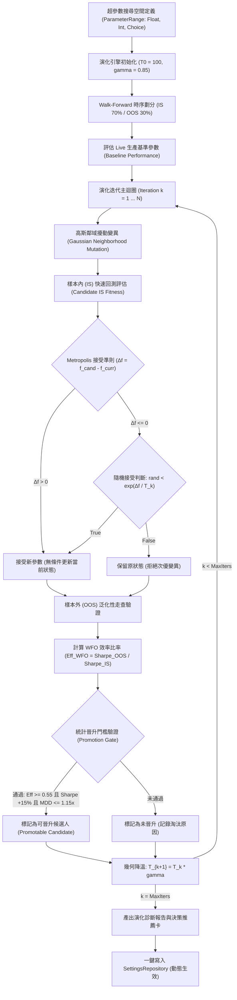

# 策略自動演化回測與參數網格退火 (Strategy Auto-Evolution & Grid Annealing Backtest)

> **版本支援**：v9.6+
> **核心模組**：`StrategyAutoEvolutionService` (`src/services/strategy_auto_evolution_service.py`)
> **關聯模組**：自適應投組回測與凱利部位定價 (Adaptive Backtesting & Kelly Sizing)、[統一投組自適應智慧聚合服務 (Portfolio Adaptive Intelligence)](統一投組自適應智慧聚合服務-Portfolio-Adaptive-Intelligence.md)
> **關聯配置**：`evolution_annealing_enabled`, `evolution_search_method`, `evolution_wfo_min_efficiency`, `evolution_annealing_initial_temp`, `evolution_annealing_cooling_rate`

---

## 1. 架構背景與參數探索困境 (Parametric Dilemma & Overfitting Trap)

在量化資產配置與風險管理體系中，多項核心參數直接決定整體投資組合的報酬與回撤特徵，包括：
- 目標年化波動率 (`alloc_target_volatility`)
- 目標市場 Beta 暴露 (`alloc_target_beta`)
- 相關性分群門檻 (`alloc_correlation_cluster_threshold`)
- 持倉 Alpha 鈍化衰減率 (`holding_decay_rate`)
- 分數凱利倍數 (`kelly_multiplier`)
- 再平衡週期天數 (`rebalance_interval_days`)

然而，傳統參數優化面臨嚴峻的統計陷阱：
1. **曲線擬合與事後諸葛偏差 (Curve Fitting & In-Sample Bias)**：
   - 若僅在全樣本歷史數據上進行參數暴力尋優，極易選出「完美契合歷史噪音」的極端過擬合參數。此類參數一旦進入真實即時行情，往往面臨災難性性能崩塌。
2. **多維維度災難 (Curse of Dimensionality)**：
   - 6 個以上的連續或離散參數若進行高解析度笛卡爾網格搜尋（Grid Search），組合數量將呈指數級爆炸（數萬至數十萬種組合），耗費大量算力且容易在局部極端值停滯。
3. **靜態參數無法適應市場結構轉移 (Regime Shift)**：
   - 牛市適合放大 Kelly 槓桿與波動率目標；高波動或熊市危機則要求提高分群約束與防禦阻尼。固定硬編碼參數無法實現自動動態演化。

**模組 P4 (Strategy Auto-Evolution & Grid Annealing Backtest)** 實裝了具備防過擬合守衛的現代啟發式超參數演化引擎：結合幾何降溫**模擬退火法 (Simulated Annealing, SA)**、**滾動前向走查交叉驗證 (Walk-Forward Optimization, WFO)** 與**決策推薦卡 (Recommendation Card)**，實現安全、高效的閉環參數晉升。

---

## 2. 核心架構與數學建模 (Architecture & Mathematical Formulations)



### A. 參數空間定義與鄰域高斯擾動變異 (Parameter Domain & Mutation)

每個超參數封裝於 `ParameterRange` 中，支援三種型別：連續浮點數 (`float`)、離散整數 (`int`) 與枚舉類別 (`choice`)。

在模擬退火擾動階段，以當前值為中心進行鄰域變異，變異步長隨系統當前溫度 $T_k$ 自適應衰減（高溫時廣域探索，低溫時微調收斂）：
$$\sigma_{\text{mutation}} = \max\left(0.01 \cdot \text{Span}, (\text{Step} \lor 0.1 \cdot \text{Span}) \times \frac{T_k}{T_0}\right)$$
$$x_{\text{mutated}} = \text{Clamp}\Big(x_{\text{current}} + \mathcal{N}(0, \sigma_{\text{mutation}}^2), \text{Min}, \text{Max}\Big)$$

### B. 幾何降溫模擬退火與 Metropolis 接受準則 (Simulated Annealing Engine)

為防止搜尋陷入多峰目標函數的局部極大值（Local Optima），系統引入 Metropolis-Hastings 物理退火準則：
1. **幾何降溫排程 (Geometric Cooling Schedule)**：
   $$T_k = T_0 \cdot \gamma^k, \quad \gamma \in [0.80, 0.95]$$
2. **適應度差值**：$\Delta f = f(\mathbf{x}_{\text{candidate}}) - f(\mathbf{x}_{\text{current}})$
3. **Metropolis 狀態轉移機率**：
   $$P_{\text{accept}}(\mathbf{x}_{\text{candidate}} \mid \mathbf{x}_{\text{current}}) = \begin{cases} 1.0 & \text{if } \Delta f > 0 \\[6pt] \exp\left(\dfrac{\Delta f}{\max(10^{-4}, T_k)}\right) & \text{if } \Delta f \le 0 \end{cases}$$
- 在搜尋初期（$T$ 較高），系統以較高機率接受性能暫時劣化的探索解，以穿越適應度「低谷」；在搜尋後期（$T \to 1.0$），接受次優解的機率趨近於 0，退化為嚴格爬山法（Greedy Hill Climbing）。

### C. 複合適應度函數 (Composite Fitness Formulation)

綜合兼顧風險調整後收益、極端下行風險與絕對報酬：
$$\text{Fitness} = 0.50 \cdot \text{Sharpe} + 0.30 \cdot \min(5.0, \text{Calmar}) + 0.20 \cdot \max(-0.50, \min(1.0, R_{\text{ann}})) - 1.50 \cdot \min(0.50, \text{MDD})$$
- 嚴厲懲罰超過 15% 的最大回撤（MDD 懲罰權重高達 1.50），引導演化演算法在追求高 Sharpe 的同時優先壓縮下行尾部風險。

### D. 滾動前向走查交叉驗證 (Walk-Forward Optimization, WFO)

將時序數據嚴格切割為：
- **樣本內訓練集 (In-Sample, IS, 70%)**：用於退火演算法主導變異方向與 Metropolis 接受決策。
- **樣本外驗證集 (Out-of-Sample, OOS, 30%)**：用於最終性能檢驗與過擬合篩選，確保參數具備跨時段外推泛化能力。

**WFO 效率比率 (Walk-Forward Efficiency Ratio)** 定義為：
$$\text{Eff}_{\text{WFO}} = \frac{\text{Sharpe}_{\text{OOS}}}{\max(0.01, \text{Sharpe}_{\text{IS}})}$$
- 若 $\text{Eff}_{\text{WFO}} < 0.55$：表示樣本外表現嚴重衰減超過 45%，判定為曲線擬合（Overfitted），即使樣本內 Sharpe 達到 3.0+ 亦予以**剛性否決**。

### E. 統計晉升門檻驗證 (Promotion Gate)

候選參數欲進入生產環境，必須同時跨越三重剛性防線：
1. **WFO 泛化門檻**：$\text{Eff}_{\text{WFO}} \ge 0.55$。
2. **Sharpe 增益門檻**：$\text{Sharpe}_{\text{OOS}} \ge \text{Sharpe}_{\text{Baseline}} \times (1 + 15\%)$（要求相對現有生產配置提升至少 15%）。
3. **回撤容忍上限**：$\text{MDD}_{\text{OOS}} \le \text{MDD}_{\text{Baseline}} \times 1.15$（最大回撤擴大不得超過基準之 15%）。

---

## 3. 決策推薦卡與一鍵套用機制 (Recommendation Card & Dynamic Promotion)

當演化運行結束後，系統產出標準化決策卡：
```json
{
  "decision": "PRODUCE_UPDATE_RECOMMENDATION",
  "status": "READY_FOR_PROMOTION",
  "candidate_id": "cand-9f2b8a1c",
  "headline": "Evolved hyperparameter set cleared WFO gates with +22.4% OOS Sharpe edge.",
  "confidence": "HIGH",
  "wfo_efficiency": 0.82,
  "param_diffs": {
    "alloc_target_volatility": {"current": 0.14, "evolved": 0.16},
    "alloc_target_beta": {"current": 0.90, "evolved": 0.95}
  },
  "projected_improvements": {
    "sharpe_edge_pct": 22.4,
    "mdd_delta_pts": -1.2,
    "composite_fitness": 1.582
  },
  "action_required": "Review diffs and approve one-click promotion into SettingsRepository."
}
```
呼叫 `apply_candidate_to_settings(candidate)` 即可一鍵安全寫入 `SettingsRepository`，熱更新全局配置而無需重啟服務。

---

## 4. 系統設定與配置項 (Settings Schema)

| 配置鍵名 (`key`) | 預設值 | 允許範圍 / 列舉 | 說明 |
| :--- | :--- | :--- | :--- |
| `evolution_annealing_enabled` | `true` | `bool` | 是否啟用策略自動演化與網格退火服務 |
| `evolution_search_method` | `simulated_annealing` | `[simulated_annealing, grid, random]` | 參數搜尋演算法模式 |
| `evolution_wfo_min_efficiency` | `0.55` | `0.30 ~ 0.90` | WFO 前向走查最低樣本外效率比率門檻 |
| `evolution_annealing_initial_temp`| `100.0` | `10.0 ~ 500.0` | 模擬退火演算法起始溫度 $T_0$ |
| `evolution_annealing_cooling_rate`| `0.85` | `0.50 ~ 0.99` | 每一演化迭代之幾何降溫衰減因子 $\gamma$ |

---

## 5. 代碼整合與快速調用範例 (Integration Example)

```python
from src.services.strategy_auto_evolution_service import (
    StrategyAutoEvolutionService,
    EvolutionObjective,
)

# 1. 初始化演化服務
service = StrategyAutoEvolutionService(user_id="default_user", settings_repo=settings_repo)

# 2. 執行模擬退火前向演化
report = service.run_simulated_annealing(
    historical_returns=daily_returns_series,
    objective=EvolutionObjective.COMPOSITE_FITNESS,
    iterations=30,
    train_ratio=0.70,
    random_seed=42,
)

# 3. 檢查推薦卡並一鍵晉升
rec_card = report.recommendation_card
if rec_card.get("decision") == "PRODUCE_UPDATE_RECOMMENDATION":
    print(f"🎉 發現更優參數組合：{rec_card['candidate_id']}")
    service.apply_candidate_to_settings(report.best_candidate)
```

---

## 6. 品質與驗證體系 (Verification & Quality Gate)

- **單元測試套件**：`tests/unit/services/test_strategy_auto_evolution.py`（21 個獨立測試，100% 通過）。
- **覆蓋面向**：
  1. `ParameterRange` 連續、離散、類別變異邊界與步長縮放。
  2. 多目標適應度函數（Sharpe、Calmar、Sortino、複合式）與 MDD 懲罰精算。
  3. Walk-Forward 樣本劃分與 WFO 效率比率邊界計算。
  4. 模擬退火幾何降溫與 Metropolis 次優解接受機率驗證。
  5. 網格搜尋與隨機搜尋模式。
  6. 三重晉升門檻驗證（WFO 過擬合攔截、Sharpe 提升不足攔截、MDD 擴大攔截）。
  7. 推薦卡生成與 `SettingsRepository` 安全熱寫入。
