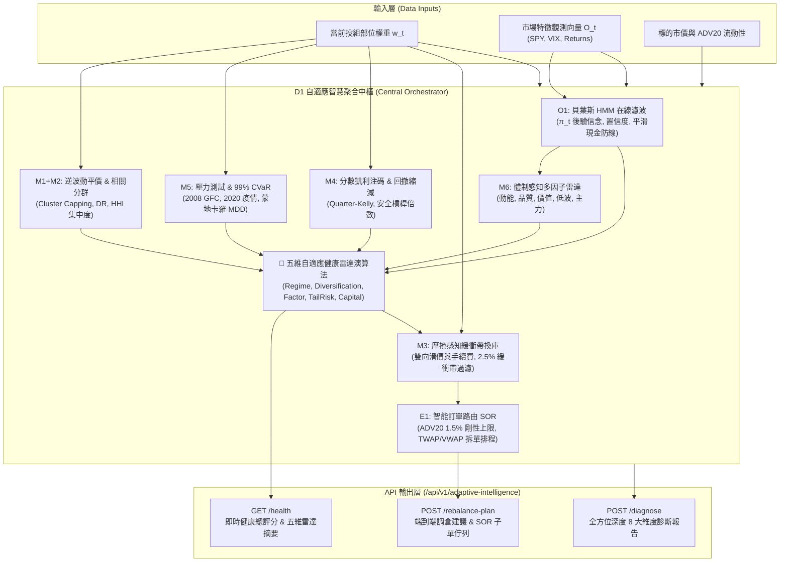

# 統一投組自適應智慧聚合服務 (Portfolio Adaptive Intelligence Orchestrator - D1)

## 1. 系統架構定位與問題意識 (Context & Problem Statement)

在量化投資與風控系統中，我們依序研發了八大核心模型與執行組件：
- **M1**: 波動度平價與逆變異數加權 (`MarketRegimeService` / `ConfidenceRebalanceService`)
- **M2**: 相關分群與市場 Beta 阻尼 (`TickerUniverseService`)
- **M3**: 交易摩擦感知與機會成本換庫 (`OpportunityCostService` / `AlphaDecayService`)
- **M4**: 分數凱利注碼與回撤縮減 (`KellySizingService`)
- **M5**: 極端黑天鵝壓力測試與 99% CVaR 尾部防禦 (`StressTestingService`)
- **M6**: 體制感知動態多因子融合 (`MultiFactorEnsembleService`)
- **E1**: 智能訂單路由與流動性感知分批執行 (`SmartOrderRoutingService`)
- **O1**: 貝葉斯隱馬爾可夫體制轉移與在線現在預測 (`BayesianRegimeHMMService`)

然而，在實際營運與前端呈現層，過去各引擎各自為政，缺乏一個**統一中央大腦 (Central Diagnostic Orchestrator)** 進行高維度協同計算。使用者或自動行控機器人必須分別查詢多個不同端點，容易產生訊息斷層與調倉決策衝突。

**D1 模組（統一投組自適應智慧聚合服務，Portfolio Adaptive Intelligence）** 正式建立中央神經中樞：
1. **一體化跨引擎合流**：單次呼叫即可同步驅動 M1~M6、E1 與 O1 八大演算法。
2. **五維投組健康雷達評分**：將宏觀體制、相關分散化、因子平衡、尾部壓力與資本槓桿精煉為 $[0.0, 100.0]$ 單一綜合健康指數與四大評級 (`OPTIMAL`, `BALANCED`, `CAUTION`, `CRITICAL`)。
3. **端到端閉環調倉與執行排程**：自動從「當前體制 + 推薦權重 + 緩衝帶換庫門檻 + ADV20 流動性審核」推導至「TWAP/VWAP 子訂單排程清單」。
4. **低延遲 REST API 端點**：提供 `/api/v1/adaptive-intelligence/health`、`/diagnose` 與 `/rebalance-plan`，支援 Redis 快取加速與優雅降級。

---

## 2. 核心架構與數據流程圖 (Architecture Flowchart)



---

## 3. 五維健康雷達評分演算法 (Health Radar Mathematics)

綜合自適應健康總分 $S_{\text{overall}} \in [0.0, 100.0]$ 由五大核心構面加權合成：

$$S_{\text{overall}} = 0.25 S_{\text{regime}} + 0.25 S_{\text{div}} + 0.20 S_{\text{factor}} + 0.15 S_{\text{tail}} + 0.15 S_{\text{capital}}$$

### 3.1 體制適應度 ($S_{\text{regime}}$, 權重 25%)
評估當前投組現金留存比例 $w_{\text{cash}}$ 是否貼合 O1 HMM 柔性平滑混合政策建議之 $w_{\text{cash\_target}}$：

$$S_{\text{regime}} = \max\left(10.0, \, \min\left(100.0, \, 100.0 - 140 \times |w_{\text{cash}} - w_{\text{cash\_target}}|\right)\right)$$

### 3.2 分散化效率 ($S_{\text{div}}$, 權重 25%)
依據 M2 分散化比率 ($DR$) 與 Herfindahl-Hirschman 集中度指數 ($HHI = \sum w_i^2$)：

$$S_{\text{div}} = 45.0 + \min\left(55.0, \, \max\left(0.0, \, \frac{DR - 1.0}{0.5} \times 55.0\right)\right) - \mathbb{I}(HHI > 0.35) \times 60 \times (HHI - 0.35)$$

- $DR \ge 1.5$ 且 $HHI \le 0.20$ 獲得滿分（高度正交分散）。
- 單一部位佔比超過 80% 時 $HHI > 0.64$，得分被嚴厲壓制至 60 分以下。

### 3.3 因子風格均衡度 ($S_{\text{factor}}$, 權重 20%)
評估五大風格因子（動能、品質、成長價值、低波動、主力籌碼）之橫截面離散度，並於震盪/熊市體制檢驗防禦因子權重：

$$S_{\text{factor}} = 90.0 - 30.0 \times \sigma_{\text{factors}} + \text{Bonus}_{\text{Quality/LowVol}}$$

### 3.4 尾部風險抗跌力 ($S_{\text{tail}}$, 權重 15%)
由 M5 99% 日度條件在險價值 ($CVaR_{99\%}$) 與歷史最差情境跌幅 ($L_{\text{worst}}$) 共同決定：

$$S_{\text{tail}} = 0.5 \times \left[100.0 - \max\left(0, \frac{CVaR_{99\%} - 0.025}{0.045} \times 70\right)\right] + 0.5 \times \left[100.0 - \max\left(0, \frac{|L_{\text{worst}}| - 0.15}{0.25} \times 60\right)\right]$$

### 3.5 資本安全度 ($S_{\text{capital}}$, 權重 15%)
結合槓桿倍數檢驗與 M4 凱利縮減因子（回撤深幅縮減保護）：

$$S_{\text{capital}} = 0.6 \times \left[100.0 - \max(0, (\text{Leverage} - 1.0) \times 80)\right] + 0.4 \times (\text{ShrinkageFactor} \times 100)$$

---

## 4. 警示等級分類矩陣 (Rating Classification Matrix)

| 綜合評分區間 | 健康評級 | 系統狀態解讀 | 自動行控因應措施 |
| :--- | :--- | :--- | :--- |
| **85.0 ~ 100.0** | `OPTIMAL` | 完美配置，高度貼合宏觀體制，分散化與尾部保護極佳 | 維持現狀，僅作常規監控 |
| **70.0 ~ 84.9** | `BALANCED` | 穩健平衡，各指標處於正常作業容忍區間 | 正常運作，依 M3 換庫週期小幅微調 |
| **50.0 ~ 69.9** | `CAUTION` | 存在局部風險，集中度偏高或體制現金不足 | 儀表板示警，建議檢視再平衡計畫 |
| **< 50.0** | `CRITICAL` | 嚴重失衡，面臨大幅回撤或極端黑天鵝衝擊 | 觸發緊急降險警報，建議立即啟動 E1 執行拆單調倉 |

---

## 5. API 規格與契約範例 (API Specifications)

### 5.1 `GET /api/v1/adaptive-intelligence/health`
獲取即時投組健康總評分與五維雷達摘要（支援 30 秒快取）。

**Response Payload (`200 OK`)**:
```json
{
  "status": "success",
  "health_score": 88.5,
  "health_rating": "OPTIMAL",
  "radar": {
    "regime_alignment": 92.4,
    "diversification_efficiency": 86.1,
    "factor_balance": 88.0,
    "tail_risk_resilience": 85.5,
    "capital_safety": 91.2
  },
  "current_regime": "BULL",
  "regime_confidence": 0.885,
  "needs_rebalance": false,
  "summary_insights": [
    "投組自適應綜合評分 88.5/100（評級：OPTIMAL）。",
    "O1 HMM 在線現在預測：當前市場處於【牛市動能擴張】，置信度達 88.5%。",
    "M3 緩衝帶檢驗：當前持倉處於容忍緩衝區間內，摩擦成本大於再平衡效益，建議維持現狀。"
  ]
}
```

### 5.2 `POST /api/v1/adaptive-intelligence/diagnose`
全方位 8 大維度深度交叉診斷，回傳完整分析數據包。

**Request Payload**:
```json
{
  "current_weights": {
    "AAPL": 0.30,
    "MSFT": 0.25,
    "GOOGL": 0.20,
    "AMZN": 0.15,
    "CASH": 0.10
  },
  "portfolio_value": 250000.0,
  "current_drawdown": 0.04
}
```

### 5.3 `POST /api/v1/adaptive-intelligence/rebalance-plan`
端到端生成調倉決策與 E1 SOR 子訂單排程。

---

## 6. 配置註冊表項 (`config/settings_schema.yaml`)

| 配置鍵名 | 類型 | 預設值 | 範圍 | 說明 |
| :--- | :--- | :--- | :--- | :--- |
| `adaptive_intelligence_enabled` | bool | `true` | - | 啟用統一投組自適應智慧聚合中樞 |
| `adaptive_health_min_score_alert` | float | `60.0` | 30.0 ~ 90.0 | 自適應健康總分最低警報門檻 |
| `adaptive_auto_rebalance_trigger` | bool | `false` | - | 啟用嚴重健康惡化時之自動再平衡觸發 |

---

## 7. 相關鏈結與規格參照 (Related Wiki Documents)

- [Bayesian-HMM-Regime](貝葉斯隱馬爾可夫體制轉移與在線現在預測-Bayesian-HMM-Regime.md)
- Smart-Order-Routing
- Regime-Conditioned-Multi-Factor
- Real-Time-Stress-Testing
- Dynamic-Kelly-Sizing
- Opportunity-Cost-Alpha-Decay
- Volatility-Targeting-Regime-Buffer
- Correlation-Clustering-Beta-Shielder
- [Home](../Home.md)
