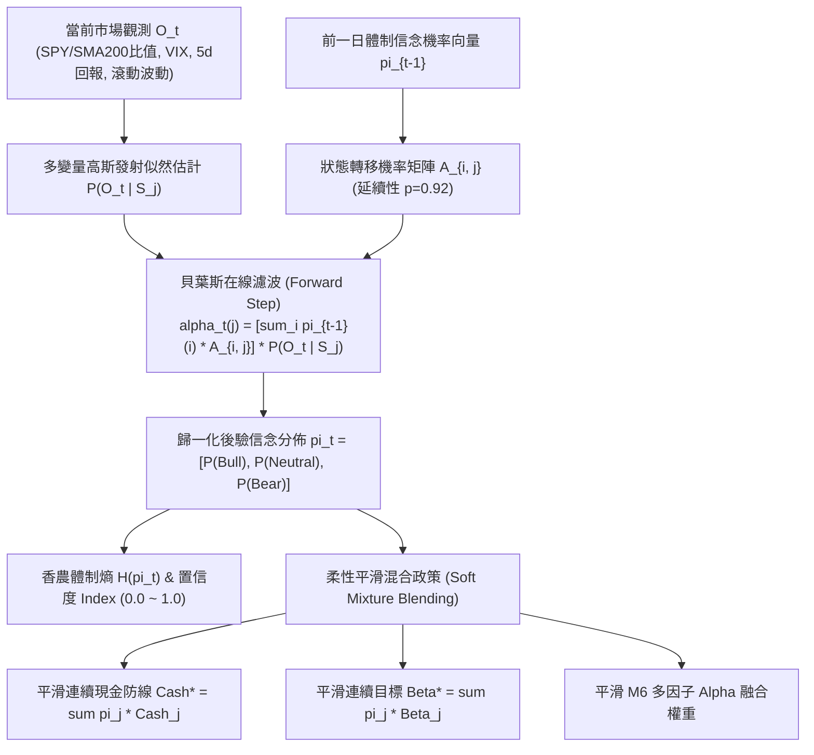

# 貝葉斯隱馬爾可夫體制轉移與在線現在預測 (Bayesian HMM Regime Transition & Online Nowcasting)

> **版本支援**：v9.2+
> **核心模組**：`BayesianRegimeHMMService` (`src/services/regime_hmm_service.py`)
> **關聯配置**：`hmm_regime_enabled`, `hmm_transition_persistence`, `hmm_min_confidence_threshold`, `hmm_vix_bear_threshold`, `hmm_vix_bull_threshold`

---

## 1. 架構背景與離散跳躍痛點 (Context & Problem Statement)

在先前的宏觀體制架構中，市場體制判斷（牛市 `BULL_MOMENTUM`、震盪 `NEUTRAL_RANGE`、熊市 `BEAR_CRISIS`）採用離散階梯式的固定閾值判定：
1. **臨界邊界抖動 (Whipsaw / Boundary Oscillation)**：
   - 當大盤指標在臨界點徘徊時（例如 VIX 在 19.9 與 20.1 間微幅震盪，或 SPY 恰好穿梭於 200MA 上下），離散判定會使體制劇烈跳躍。
2. **階梯式斷崖跳躍造成交易摩擦**：
   - 體制的硬性切換導致現金防線（5% vs 20% vs 50%）、目標 Beta（1.10 vs 0.85 vs 0.40）以及 M6 多因子 Alpha 加權產生不連續跳變，引發非必要的頻繁調倉與摩擦損失。
3. **忽略時序延續性與狀態轉移機率**：
   - 金融市場體制具備顯著的時序黏性與自我增強效應（State Persistence），離散規則缺乏「貝葉斯先驗更新」與「狀態轉移矩陣」的機率建模。

---

## 2. 核心架構與數學建模 (Mathematical Formulation & Architecture)

### A. 三狀態空間與發射機率分佈 (Emission Distribution)

三種隱藏狀態 $S_t \in \{\text{BULL}, \text{NEUTRAL}, \text{BEAR}\}$。
觀測向量 $O_t = [z_{\text{trend}}, V_{\text{vix}}, r_{5d}]^T$，其中 $z_{\text{trend}} = (P_{\text{SPY}} - \text{SMA}_{200}) / \text{SMA}_{200}$。
各狀態遵循多變量條件獨立高斯發射分佈：
$$P(O_t \mid S_t = s) = \prod_{k \in \{\text{trend}, \text{vix}, \text{ret}\}} \frac{1}{\sqrt{2\pi}\sigma_{s, k}} \exp\left(-\frac{(O_{t, k} - \mu_{s, k})^2}{2\sigma_{s, k}^2}\right)$$

- **牛市進攻 (`BULL`)**：$\mu_{\text{trend}} = +5\%, \sigma = 4\%; \quad \mu_{\text{vix}} = 15.0, \sigma = 3.5; \quad \mu_{r} = +1.5\%, \sigma = 2.0\%$
- **震盪輪動 (`NEUTRAL`)**：$\mu_{\text{trend}} = 0\%, \sigma = 3\%; \quad \mu_{\text{vix}} = 21.0, \sigma = 4.0; \quad \mu_{r} = 0\%, \sigma = 2.5\%$
- **熊市危機 (`BEAR`)**：$\mu_{\text{trend}} = -6\%, \sigma = 5\%; \quad \mu_{\text{vix}} = 32.0, \sigma = 7.0; \quad \mu_{r} = -2.5\%, \sigma = 4.0\%$

### B. 狀態轉移機率矩陣 (State Transition Matrix $A$)

矩陣納入市場結構延續性（對角線持久性 $p = 0.92$）：
$$A = \begin{bmatrix}
p & (1-p) \times 0.85 & (1-p) \times 0.15 \\
(1-p) \times 0.50 & p & (1-p) \times 0.50 \\
(1-p) \times 0.15 & (1-p) \times 0.85 & p
\end{bmatrix}$$
- 牛市在惡化時通常先轉為震盪盤整（85% 機率），極少直接斷崖進入恐慌熊市（15% 機率）；
- 恐慌熊市在修復時亦先重返震盪修復期（85% 機率），再重啟牛市。

### C. 貝葉斯在線濾波遞推 (Forward Algorithm)

給定歷史數據與當日新觀測 $O_t$：
$$\alpha_t(j) = \left( \sum_{i=1}^3 \pi_{t-1}(i) \cdot A_{i, j} \right) \cdot P(O_t \mid S_t = j)$$
$$\pi_t(j) = \frac{\alpha_t(j)}{\sum_{k=1}^3 \alpha_t(k)}$$

### D. 香農體制熵與置信度指數 (Confidence Index)

量化市場體制的不確定性程度：
$$H(\pi_t) = -\sum_{j=1}^3 \pi_t(j) \log_2 \pi_t(j)$$
$$\text{Confidence}_t = \max\left(0.0, 1.0 - \frac{H(\pi_t)}{\log_2(3)}\right) \in [0.0, 1.0]$$
- 當某一體制後驗機率高達 $> 95\%$ 時，$H \to 0, \text{Confidence} \to 1.0$；
- 當三者均等處於混沌交界時（各 $33.3\%$），$H = \log_2(3), \text{Confidence} = 0.0$。

### E. 柔性平滑混合政策 (Soft Mixture Blending)

徹底以連續機率加權取代階梯式硬跳躍：
$$\text{Cash}^* = \pi_t(\text{Bull}) \cdot 5\% + \pi_t(\text{Neutral}) \cdot 20\% + \pi_t(\text{Bear}) \cdot 50\%$$
$$\text{Beta}^* = \pi_t(\text{Bull}) \cdot 1.10 + \pi_t(\text{Neutral}) \cdot 0.85 + \pi_t(\text{Bear}) \cdot 0.40$$
$$w_{\text{factor}}^* = \sum_{s \in \{\text{Bull}, \text{Neutral}, \text{Bear}\}} \pi_t(s) \cdot w_{\text{factor}, s}$$

---

## 3. 系統配置參數註冊表

所有關鍵參數均登錄於 `config/settings_schema.yaml`，支援動態熱更新：

| 配置鍵名 | 類型 | 預設值 | 允許範圍 | 業務意涵與設計目的 |
| :--- | :---: | :---: | :---: | :--- |
| `hmm_regime_enabled` | bool | `true` | - | 啟用貝葉斯隱馬爾可夫體制轉移與在線現在預測 |
| `hmm_transition_persistence` | float | `0.92` | `0.50 ~ 0.99` | 狀態轉移矩陣之對角延續機率，控制體制時序記憶與黏性 |
| `hmm_min_confidence_threshold` | float | `0.40` | `0.10 ~ 0.90` | 體制置信度預警下限；低於此值識別市場處於多空未明混沌期 |
| `hmm_vix_bear_threshold` | float | `28.0` | `20.0 ~ 50.0` | 熊市危機體制發射分佈之 VIX 核心錨定門檻 |
| `hmm_vix_bull_threshold` | float | `19.0` | `10.0 ~ 25.0` | 牛市進攻體制發射分佈之 VIX 波動率參考上限 |

---

## 4. 驗證與測試覆蓋

專屬測試套件 `tests/unit/services/test_regime_hmm.py` 提供 10/10 100% 通過之嚴格驗證：
- `test_bull_regime_online_filtering`: 驗證牛市進攻數據產出高置信度後驗 ($P > 90\%$) 與平滑政策。
- `test_bear_crisis_online_filtering`: 驗證熊市崩跌數據產出防禦性後驗 ($P > 90\%$) 與平滑防守現金。
- `test_neutral_transition_state`: 驗證 200MA 震盪過渡區間之柔性後驗評估。
- `test_transition_matrix_row_stochastic_and_persistence`: 驗證轉移矩陣行隨機性 (Row-Stochastic, Sum=1.0) 與對角延續性。
- `test_shannon_entropy_and_confidence`: 驗證極限分佈與混沌狀態之香農熵計算。
- `test_soft_mixture_blend_weights`: 驗證多因子權重連續混合之精準度。
- `test_k_step_forward_regime_prediction`: 驗證多日前瞻預測符合馬爾可夫穩態擴散規律。
- `test_batch_historical_filtering`: 驗證跨天時間序列在線濾波之平滑演進。
- `test_settings_repo_dynamic_overrides`: 驗證自定義持久性與 VIX 門檻動態注入。
- `test_edge_case_zero_or_corrupt_observation`: 驗證數據損壞時安全平滑降級。
