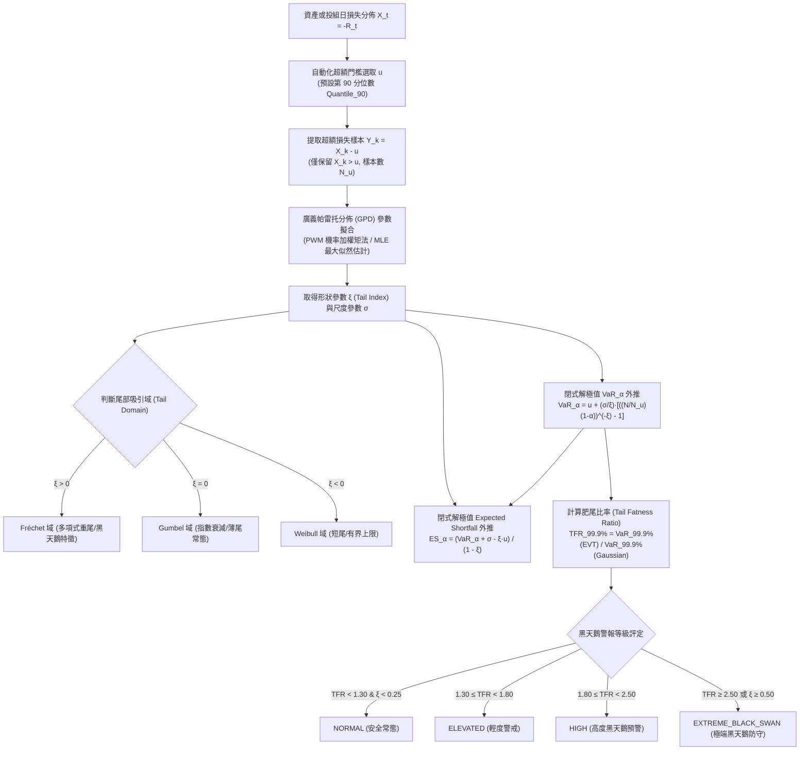
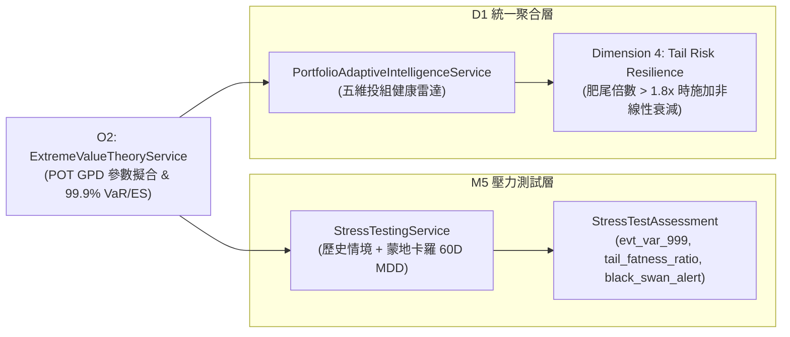

# 黑天鵝極值理論尾部風險外推 (Extreme Value Theory - EVT & POT Tail Risk Engine) 🦅

## 1. 模組定位與設計初衷 (Module Overview)

在量化金融與投資組合理論中，傳統風險計量工具（如常態分佈假設下的 Parametric VaR、Student-t 模擬或歷史經驗分佈 Historical Simulation）面臨三大致命弱點：
1. **常態分佈低估極端厚尾 (Fat-Tail Underestimation)**：金融資產報酬率具備顯著的尖峰厚尾 (Leptokurtic) 與負偏態 (Negative Skewness) 特性。若以常態分佈估計 99.9% 尾端損失（1-in-1000 天極端事件），會將 2008 年金融海嘯、2020 年新冠流動性休克、2024 年日圓套息交易平倉踩踏等 5~10 個標準差事件判定為「宇宙誕生以來都不會發生」，造成嚴重的資本曝險與防禦真空。
2. **歷史經驗分佈樣本邊界受限 (Sample Horizon Truncation)**：歷史模擬法只能觀測到樣本時間窗內出現過的最大損失，無法對「比歷史更糟」的未知極端黑天鵝事件進行外推預測。
3. **無效的線性避險**：極端危機中資產相關性突變趨近於 1.0，一般線性分散化策略瞬間失效。

**O2 模組（Extreme Value Theory Service）** 基於極值理論（Extreme Value Theory, EVT）之核心定理 **Pickands-Balkema-de Haan 定理**，實裝**超額峰值法 (Peaks-Over-Threshold, POT)** 與**廣義帕雷托分佈 (Generalized Pareto Distribution, GPD)**，提供超越經驗資料邊界之高分位數 ($99.0\%, 99.5\%, 99.9\%$) 尾部在險價值 ($VaR_\alpha$) 與預期損失 ($ES_\alpha$ / Expected Shortfall)，精準捕捉金融黑天鵝尾部脆弱性。

---

## 2. 數學模型與極值推導 (Mathematical Foundations)

### 2.1 Pickands-Balkema-de Haan 定理 (POT 核心)
設 $X$ 為連續損失隨機變數，其累積分佈函數為 $F(x)$。對於充分高的極端門檻 $u$，條件超額分佈 $F_u(y) = P(X - u \le y \mid X > u)$ 當 $u \to x_F$ 時，漸近收斂至廣義帕雷托分佈 $G_{\xi, \sigma}(y)$：

$$G_{\xi, \sigma}(y) = \begin{cases}
1 - \left(1 + \frac{\xi y}{\sigma}\right)^{-1/\xi}, & \xi \neq 0 \\
1 - \exp\left(-\frac{y}{\sigma}\right), & \xi = 0
\end{cases}$$

- $\xi$ (形狀參數 / Shape Parameter)：代表尾部的厚度（Tail Heaviness）。金融資產損失通常落在 $\xi \in (0.1, 0.45)$ 之 Fréchet 重尾吸引域。
- $\sigma > 0$ (尺度參數 / Scale Parameter)：代表超額波動幅度。

### 2.2 機率加權矩法 (Probability-Weighted Moments, PWM) 估計
為避免非線性最大似然估計 (MLE) 在中小型樣本（$N_u < 50$）中發散或無解，系統採用 Hosking & Wallis (1987) 的 PWM 閉式解：

$$a_1 = \frac{1}{N_u} \sum_{k=1}^{N_u} \left(\frac{N_u - k}{N_u - 1}\right) y_{(k)}, \quad \bar{y} = \frac{1}{N_u} \sum_{k=1}^{N_u} y_{(k)}$$

$$\hat{\xi} = 2 - \frac{\bar{y}}{\bar{y} - 2 a_1}, \quad \hat{\sigma} = \frac{2 \bar{y} a_1}{\bar{y} - 2 a_1}$$

PWM 具備數值絕對穩定、無迭代循環、執行速度 $<0.5\text{ms}$ 的工業級特性。

### 2.3 閉式解高分位 VaR 與 Expected Shortfall (ES / CVaR)
對於極端置信度 $\alpha$（如 $\alpha = 0.999$，即千分之一極端損失）：

$$VaR_\alpha = u + \frac{\sigma}{\xi} \left[ \left(\frac{N}{N_u} (1 - \alpha)\right)^{-\xi} - 1 \right] \quad (\xi \neq 0)$$

$$ES_\alpha = E[X \mid X > VaR_\alpha] = \frac{VaR_\alpha + \sigma - \xi u}{1 - \xi} \quad (\xi < 1)$$

> [!NOTE]
> 當 $\xi \ge 1.0$ 時，分佈之數學期望值發散為無窮大（極端重尾崩塌）。系統在 $\xi \ge 0.98$ 時會啟用漸近上分位數代理防護，杜絕零除例外與負數失真。

---

## 3. 系統協同與模組融接 (System Integration)

### 3.1 融接 M5 壓力測試服務 (`StressTestingService`)
- 在 `evaluate_portfolio()` 中自動調用 EVT 引擎分析投組歷史或蒙地卡羅模擬損失序列。
- 輸出 `evt_var_999`、`evt_cvar_999`、`tail_fatness_ratio` 與 `black_swan_alert`。
- 若觸發 `is_black_swan_triggered`（等級達 `HIGH` 或 `EXTREME_BLACK_SWAN`），直接列入防禦理由並觸發預防性降險 (`is_defense_triggered = True`)。

### 3.2 融接 D1 投組自適應智慧聚合服務 (`PortfolioAdaptiveIntelligenceService`)
- 在五維健康雷達之第四維度**尾部抗跌力 (Tail Risk Resilience)** 中，將 EVT 肥尾倍數納入扣分項：
  $$\text{if } TFR > 1.80, \quad \text{Penalty} = \min(30.0, (TFR - 1.80) \times 20.0)$$
- 即使投組的 95% CVaR 表面合格，若潛藏劇烈黑天鵝厚尾脆弱性，健康雷達亦會立即降評並向使用者發出警告。

---

## 4. 配置註冊表規範 (`config/settings_schema.yaml`)

| 配置鍵名 (Key) | 型別 | 預設值 | 邊界範圍 | 說明 |
| :--- | :---: | :---: | :---: | :--- |
| `evt_tail_risk_enabled` | bool | `true` | - | 是否啟用黑天鵝極值理論尾部風險外推引擎 |
| `evt_threshold_quantile` | float | `0.90` | $[0.80, 0.98]$ | 超額峰值法 (POT) 超額門檻分位數 $u$ |
| `evt_tail_fatness_alert_threshold` | float | `1.80` | $[1.20, 3.50]$ | 觸發高度黑天鵝預警之肥尾倍數門檻 |
| `evt_max_shape_xi` | float | `0.80` | $[0.30, 1.50]$ | GPD 形狀參數 $\xi$ 數值截斷上限保護 |

---

## 5. 相關模組參照 (Related Modules)

- 極端黑天鵝壓力測試與CVaR尾部防禦-Stress-Testing-CVaR-Defense
- [統一投組自適應智慧聚合服務-Portfolio-Adaptive-Intelligence](統一投組自適應智慧聚合服務-Portfolio-Adaptive-Intelligence.md)
- [貝葉斯隱馬爾可夫體制轉移與在線現在預測-Bayesian-HMM-Regime](貝葉斯隱馬爾可夫體制轉移與在線現在預測-Bayesian-HMM-Regime.md)
- 自適應投組回測與凱利部位定價-Adaptive-Backtesting-Kelly-Sizing
