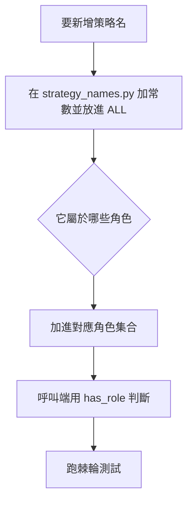

# 策略名單一定義

> 對象：要新增、改名或刪除下單策略名的開發者與 agent。讀完知道名字寫在哪、怎麼判斷角色、哪個測試會擋你。

## 規則

| # | 規則 | 檢查 |
| :--- | :--- | :--- |
| 1 | 決策路徑用的策略名，只在 `src/domain/strategy_names.py` 定義一次，別處只准 import | `test_no_new_hand_copied_lists_or_substring_tests` |
| 2 | 比對一律先 `normalize()` 再完全比對，不對名稱做 `"關鍵字" in x` | 同上 |
| 3 | 送進下單呼叫的字面策略名，必須已在模組定義 | `test_every_literal_strategy_name_sent_to_an_order_call_is_defined` |
| 4 | 舊名（`LEGACY`）不得再有產生端 | `test_legacy_names_are_not_produced_by_any_order_path` |
| 5 | 改名或刪名的 PR 附 grep 結果，指令在〈改名或刪名〉 | PR 描述 |

這份是 `strategy_names.py` 的使用說明，測試與模組的 docstring 才是規格。

## 模組怎麼分

| 區塊 | 用途 |
| :--- | :--- |
| 名稱常數與 `ALL` | 產生端實際送出的名稱 |
| `LEGACY` | 已無產生端、仍留在舊豁免清單的名稱；之後有意識地刪 |
| 角色集合 | 每個集合只回答一個問題，例如「是不是安全出場」「可否略過日內反向單冷卻」 |
| `normalize()`、`has_role()` | 唯一的正規化與比對入口 |

角色集合彼此問的問題不同，成員看似重疊也不合併。要看現有角色，直接讀模組：

```bash
grep -n "FrozenSet\[str\]" src/domain/strategy_names.py
```

## 新增策略名



1. 在 `src/domain/strategy_names.py` 加常數，放進 `ALL`。
2. 逐一問：它該不該進現有角色？加成員等於改行為，要在 PR 說明並由 reviewer 看。
3. 呼叫端寫 `has_role(name, sn.某角色)`。不要在服務檔裡再寫 tuple、set 或 `in` 子字串。
4. 新增 `proposal_<來源>` 類名稱時，改 `PROPOSAL_SOURCES`，不要散寫。
5. 跑下方的驗證指令。

缺值不補成看似真實的值。策略名缺或不認得時，`has_role` 回 `False`；需要記帳標記時用 `UNNAMED_LEDGER_LABEL`，它是標記，不是策略，不在 `ALL`。

## 改名或刪名

PR 描述附這行的輸出，結果只准剩歷史 ADR、DD，以及語意不同的設定鍵：

```bash
grep -rn '<舊名>' src services tests config docs
```

刪除 `LEGACY` 成員前，先確認它不再出現在任何角色集合；移除常數與所有角色成員要放在同一個 PR。

## 棘輪測試

`tests/invariants/test_strategy_name_ssot.py` 用 AST 掃 `src/` 與 `services/`，量三項：手抄名單、子字串比對、非字面策略名。基準存在 `tests/invariants/strategy_name_baseline.json`，**計數只准下降**。

| 情況 | 做法 |
| :--- | :--- |
| 測試因新增而紅 | 改用模組的角色集合與 `has_role`，不要更新基準 |
| 你清掉了舊的違規 | 跑 `--update` 把基準收緊，一併提交 |
| 想放寬基準 | 不行；有理由就在 PR 說明，由人決定 |

## 驗證

```bash
.venv/bin/python -m pytest tests/invariants/test_strategy_name_ssot.py tests/unit/domain/test_strategy_names.py -q
.venv/bin/python -m tests.invariants.test_strategy_name_ssot --check-tight
```

改動 `strategy_names.py` 若影響下單判定，屬 R2 以上；碰到動錢路徑時，依 `AGENTS.md` 的 R3 規則，要人核可並附 ADR。
