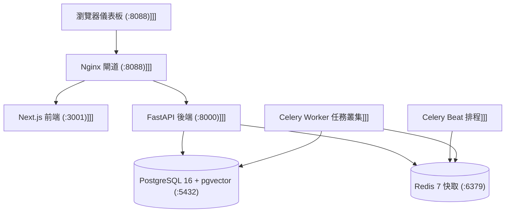

# 單機自架手冊 (Self-Hosting Guide)

> **導航跳轉 (Navigation)**: [Wiki 首頁 (Home)](../Home.md) | [產品需求規格總綱](../00_Product_Strategy/產品需求規格總綱-PRD-Master-System-Specs.md) | [冷備份與可觀測性](./冷備份與可觀測性-Cold-Backup-Observability.md)

### 版本紀錄 (Version History)
| 日期 (Date) | 版本 (Version) | 變更說明 (Description) | 作者 (Author) |
| :--- | :--- | :--- | :--- |
| 2026-10-29 | v2.1.0 | 乾淨安裝：專案名與容器名可設定、同機守衛、排程獨立 profile、補「填金鑰」與「第一份報告」 | M4 |
| 2026-09-20 | v2.0.0 | 整併自 docs/SELF_HOSTING.md，對齊 M1~M8 單機 7 核心架構與開箱安裝流程 | Antigravity |
| 2026-06-01 | v1.0.0 | 初始自架手冊 | DevOps Team |

---

### 角色導引 (Persona Guide)
- **目標受眾 (Target Audience)**: 🔧 **維運與自架工程師 (Self-Hosted SRE / Operator)**
- **閱讀時間 (Reading Time)**: 約 4~5 分鐘 (Approx. 4-5 mins)
- **文件目的 (Purpose)**: 提供單指令安裝 (`install.sh`)、7 核心容器拓撲、環境變數宣告與備份復原操作指引。

---

## 🇹🇼 繁體中文 (Traditional Chinese)

### 1. 系統架構概觀 (Single-Box Architecture)

`investment-advisor` 採單機輕量化容器拓撲，運行於本機 loopback (`127.0.0.1:8088`)，具備零外部 SaaS 依賴特性：



### 2. 系統硬體需求

| 元件 | 最低配置 (Minimum) | 建議配置 (Recommended) |
| :--- | :--- | :--- |
| **CPU** | 2 核心 x86_64 或 Apple Silicon | 4 核心以上 |
| **RAM** | 4 GB | 8 GB 以上 |
| **Disk** | 10 GB SSD 可用空間 | 20 GB NVMe SSD |
| **作業系統** | Linux / macOS / WSL2 | macOS / Ubuntu 22.04 LTS |

### 3. 安裝到第一份報告

```bash
# 1. 安裝：檢查 Docker、建 .env、產生金鑰、建置、migration、種子，最後才起排程
./install.sh

# 2. 開 http://127.0.0.1:8088/settings 填 LLM 金鑰（沒有金鑰就沒有報告）

# 3. 立即排入第一份報告（否則等週一到週五美東 17:00）
./start.sh report
```

報告出現在 `http://127.0.0.1:8088/reports`。查詢報告列表：`curl -s http://127.0.0.1:8088/api/v1/dashboard/reports`。

> [!WARNING]
> **交易安全門禁**：`ai_trading_enabled` 的設定預設值是 `false`（安裝腳本的種子寫入目前不會生效，見 [DD-2026-1029-clean-install-seed-and-brake](../design/DD-2026-1029-clean-install-seed-and-brake.md)）。讀過程式碼、決定要交易之前請維持。真實下單另需券商金鑰與 `etoro_mode=real`。

#### 3.1 專案名與容器名

`.env` 的 `ADVISOR_PROJECT_NAME`（預設 `advisor`）決定 compose 專案名，volume 與網路由它衍生；`ADVISOR_CONTAINER_PREFIX`（預設 `advisor`）決定容器名 `<prefix>_api`、`<prefix>_db` 等。容器之間用服務名（`postgres`、`mcp_server`、`redis`、`nginx`）互連，不依賴容器名。

`install.sh`、`./start.sh up|upgrade|restore` 在建置與啟動之前先查本機，遇到下列任一情況就**拒絕**並說明：同名 compose 專案已被別的目錄使用、要用的容器名已被占用、本機已有正式環境特徵（容器 `advisor_prod_*`、專案 `investment_advisor`、volume `investment_advisor_advisor_db_data`）而這個目錄不是它。

**既有正式環境（改版前就在跑的那一台）** 在自己的 `.env` 釘住舊名字，一次就好；沒釘住時 `./start.sh up|upgrade` 會拒絕並印出要加的兩行：

```bash
ADVISOR_PROJECT_NAME=investment_advisor
ADVISOR_CONTAINER_PREFIX=advisor_prod
```

#### 3.2 排程

`worker` 與 `celery_beat` 是 compose profile `scheduler`，直接 `docker compose up` 不會起。`./start.sh` 預設帶上這個 profile；`ADVISOR_SCHEDULER=0 ./start.sh up` 可不起排程（此時健檢也不要求它們）。`install.sh` 先起核心服務、寫好安全預設值，才起排程。

#### 3.3 開發環境

`docker compose up -d` 使用獨立專案 `advisor_dev`（資料庫與 redis 只綁 `127.0.0.1`），不會動到單機 stack。

### 4. 日常維運指令集

```bash
./start.sh health             # 健檢；不健康時回傳非 0
./start.sh backup             # PostgreSQL 與設定檔備份
./start.sh upgrade            # 備份、拉新版、遷移、健檢
./start.sh wizard             # 重新執行運算成本方案切換
./start.sh report             # 立即排入每日報告
./start.sh down               # 停止所有容器
```

驗證本節的指令（不啟動任何容器）：`.venv/bin/python -m pytest tests/unit/deploy -q`。

---

## 🇬🇧 English

### 1. Turnkey Deployment
`investment-advisor` runs completely within a local Docker network behind an Nginx reverse proxy on `http://127.0.0.1:8088`.

### 2. Quickstart
Run `./install.sh`, add your LLM key in Settings, then `./start.sh report` for the first report (otherwise weekdays 17:00 US Eastern). The installer refuses to run when the machine already has a stack with the same compose project or container names; see section 3.1.

---

### 參考資源 (References)
- **相關維運文檔 (Related Documents)**:
  - [Wiki 首頁 (Home)](../Home.md)
  - [產品需求規格總綱 (Master PRD)](../00_Product_Strategy/產品需求規格總綱-PRD-Master-System-Specs.md)
  - [冷備份與可觀測性](./冷備份與可觀測性-Cold-Backup-Observability.md)
  - [單機轉型路線圖](../00_Product_Strategy/單機轉型路線圖-Transformation-Roadmap-M1-M8.md)
- **部署配置參照 (Deployment Assets)**:
  - 安裝腳本: [install.sh](../../install.sh)
  - 啟動控制腳本: [start.sh](../../start.sh)
  - 閘道設定: [infra/nginx/nginx.conf](../../infra/nginx/nginx.conf)
