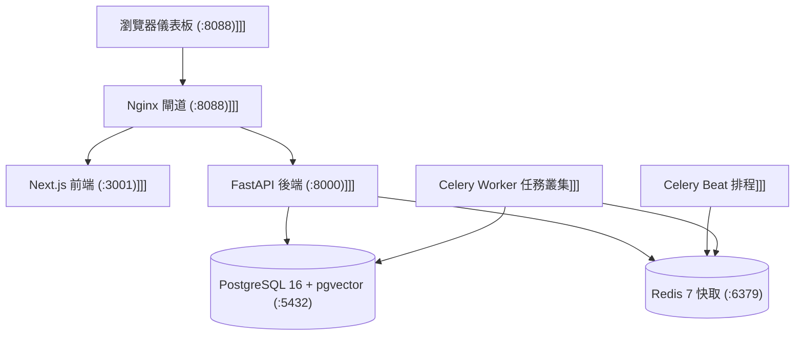

# 單機自架手冊 (Self-Hosting Guide)

> **導航跳轉 (Navigation)**: [Wiki 首頁 (Home)](../Home.md) | [產品需求規格總綱](../00_Product_Strategy/產品需求規格總綱-PRD-Master-System-Specs.md) | [冷備份與可觀測性](./冷備份與可觀測性-Cold-Backup-Observability.md)

### 版本紀錄 (Version History)
| 日期 (Date) | 版本 (Version) | 變更說明 (Description) | 作者 (Author) |
| :--- | :--- | :--- | :--- |
| 2026-09-20 | v2.0.0 | 整併自 docs/SELF_HOSTING.md，對齊 M1~M8 單機 7 核心架構與開箱安裝流程 | Antigravity |
| 2026-06-01 | v1.0.0 | 初始自架手冊 | DevOps Team |

---

### 角色導引 (Persona Guide)
- **目標受眾 (Target Audience)**: 🔧 **維運與自架工程師 (Self-Hosted SRE / Operator)**
- **閱讀時間 (Reading Time)**: 約 4~5 分鐘 (Approx. 4-5 mins)
- **文件目的 (Purpose)**: 提供單指令安裝 (`install.sh`)、7 核心容器拓撲、環境變數宣告與備份復原操作指引。

---

## 🇹🇼 繁體中文 (Traditional Chinese)

### 1. 系統架構概觀 (Single-Box Architecture)

`investment-advisor` 採單機輕量化容器拓撲，運行於本機 loopback (`127.0.0.1:8088`)，具備零外部 SaaS 依賴特性：



### 2. 系統硬體需求

| 元件 | 最低配置 (Minimum) | 建議配置 (Recommended) |
| :--- | :--- | :--- |
| **CPU** | 2 核心 x86_64 或 Apple Silicon | 4 核心以上 |
| **RAM** | 4 GB | 8 GB 以上 |
| **Disk** | 10 GB SSD 可用空間 | 20 GB NVMe SSD |
| **作業系統** | Linux / macOS / WSL2 | macOS / Ubuntu 22.04 LTS |

### 3. 單指令安裝與快速啟動 (One-Line Setup)

本專案支援免手動設定之開箱引導精靈：

```bash
# 1. 執行單指令安裝腳本（自動檢查 Docker、建立 .env 並初始化資料庫）
./install.sh

# 2. 啟動生產模式叢集
./start.sh prod

# 3. 進入瀏覽器儀表板
open http://127.0.0.1:8088
```

> [!WARNING]
> **交易安全門禁**：全新安裝時，`ai_trading_enabled` 硬性預設為 `false`。在未透過 Web 介面深入檢視決策卡與模擬績效前，請勿連線真實入金之券商帳號。

### 4. 日常維運指令集

```bash
./start.sh status             # 檢查 7 大核心容器健康狀態
./start.sh backup             # 執行 PostgreSQL 與 n8n/設定檔本機備份
./start.sh wizard             # 重新執行運算成本方案 (Frugal/Balanced/Aggressive) 切換
./start.sh stop               # 優雅關閉所有背景工作容器
```

---

## 🇬🇧 English

### 1. Turnkey Deployment
`investment-advisor` runs completely within a local Docker network behind an Nginx reverse proxy on `http://127.0.0.1:8088`.

### 2. Quickstart
Execute `./install.sh` to run the initialization wizard, followed by `./start.sh prod` to bring up the 7 core containers.

---

### 參考資源 (References)
- **相關維運文檔 (Related Documents)**:
  - [Wiki 首頁 (Home)](../Home.md)
  - [產品需求規格總綱 (Master PRD)](../00_Product_Strategy/產品需求規格總綱-PRD-Master-System-Specs.md)
  - [冷備份與可觀測性](./冷備份與可觀測性-Cold-Backup-Observability.md)
  - [單機轉型路線圖](../00_Product_Strategy/單機轉型路線圖-Transformation-Roadmap-M1-M8.md)
- **部署配置參照 (Deployment Assets)**:
  - 安裝腳本: [install.sh](../../install.sh)
  - 啟動控制腳本: [start.sh](../../start.sh)
  - 閘道設定: [infra/nginx/nginx.conf](../../infra/nginx/nginx.conf)
