# AI Investment Advisor 文件首頁 🚀

> 舊 GitHub wiki 已退役，保留下來的頁面搬到 `docs/`，分工見 [docs/README.md](README.md)。下方版本紀錄與清單中，沒有連結的條目對應的頁面沒有搬過來，只留文字作歷史索引。

### 版本紀錄 (Version History)
| Date | Version | Description | Author |
| :--- | :--- | :--- | :--- |
| 2026-10-14 | v9.34 | **Trend Hysteresis Lockout, Friction-Aware Tranche Sizing & Modern Sentinel Cards (Phase 63)**: 實裝施密特觸發器遲滯回差帶與大趨勢單向持股鎖定引擎 (`TrendHysteresisLockoutService`)，以雙門檻 (Buy >= 8.0 & +1.5%, Sell <= 5.0 & -1.5%) 與緩衝帶狀態保持 (Hysteresis Memory) 徹底杜絕 MA20 臨界點附近的反覆翻轉磨損 (Flip-Flop Churn)，並在 SMA50 > SMA200 且現價 > SMA50 之宏觀長多通道中全面阻斷常規調倉賣出；實裝做市商摩擦感知與核心/衛星倉位分級隔離引擎 (`FrictionAwareTrancheSizingService`)，精算 Spread/Slippage/Fee 摩擦，要求 Net Alpha >= 0.8% 換手門檻，切分 70% 核心底倉享受長期複利與 30% 衛星波段動態調節；全面升級 Sentinel 現代響應式 HTML 卡片郵件排版 (卡片流、Dark Mode、處置 vs 指南明確分離) 與 5 分鐘滑動時間窗防抖聚合 (Debounce)；無縫收斂至單一真理風控閘門 `UnifiedRiskGatewayService` (Step 10 + Step 11)；註冊 0-LLM `/trend` 與 `/tranche` 快速指令；726 項回歸測試全綠。 | Antigravity |
| 2026-10-14 | v9.33 | **Option Gamma Exposure (GEX) & Kalman Filter Pairs Cointegration (Phase 62)**: 實裝做市商淨伽馬暴露與波動率釘盤預測引擎 (`OptionGammaExposureGEXService`)，精算 Black-Scholes-Merton 伽馬、Dollar GEX、二分網格零翻轉點 S* 與 OpEx Pin Strike 結算釘盤引力，判定 4 級 GEX 體制；實裝卡爾曼濾波動態協整與統計套利配對引擎 (`KalmanPairsCointegrationService`)，2D 線上遞迴狀態空間估計動態對沖比率 β_t 與截距 α_t，結合 Ornstein-Uhlenbeck AR(1) 半衰期 t_1/2 與動態滾動 Z-Score 執行市場中性對沖，並於協整破裂時 (|Z| >= 3.0σ) 觸發單一真理閘門緊急停損；修復 24h 翻轉防抖與 Sentinel 郵件排版；登錄 8 大配置項；註冊 0-LLM `/gex` 與 `/pair` 指令；726 項全套回歸測試全綠。 | Antigravity |
| 2026-10-14 | v9.32 | **Dynamic IV Surface Skew & Microstructure OFI Vacuum Defense (Phase 61)**: 實裝動態隱含波動率曲面偏度與極端尾部避險引擎 (`DynamicIVSurfaceSkewHedgingService`)，度量 25-Delta Put vs Call Skew、期限結構 Term Structure 斜率與綜合尾部風險指數，於黑天鵝恐慌倒掛體制下縮減買單預算至 40% 並向下防禦平移階梯掛單 20~80 bps；實裝 Cont et al. (2014) 微觀訂單流失衡率與做市商流動性真空防禦引擎 (`MicrostructureOrderFlowImbalanceService`)，即時計算 OFI 與做市商撤單價差衝擊 (Spread Shock >= 2.5x)，真空期間主動冷凍買單 120 秒防禦非理性滑點；登錄 8 大配置項；註冊 0-LLM `/ivskew` 與 `/ofi` 指令；707 項全套回歸測試全綠。 | Antigravity |
| 2026-10-13 | v9.28 | **Cross-Sector Momentum Funnel & Workflow Consolidation (Phase 50-52)**: 實裝跨板塊動能注入與 HHI 集中度自癒引擎 (`SectorDriftGuardService.analyze_portfolio_holdings` / `discover_cross_sector_injection_contender`)，在科技股佔比過度擁擠時自動保留 35% 配額注入非科技龍頭，並支援財報避開自動輪替；全面整合工作流節點，收斂開盤建倉為階梯限價優先之單一委託管道，消除 09:35 與 09:36 雙重下單重工衝突；註冊 0-LLM 指令 `/sector`；全套測試全綠。 | Antigravity |
| 2026-10-13 | v9.26 | **Net Alpha & Cash Drag Attribution & Staggered Fill Lifecycle (Phase 44-45)**: 實裝實時淨 Alpha 歸因與現金拖累量化服務 (`NetAlphaAttributionService`)，精算扣除模型調用與 SaaS 訂閱成本後之真實淨 Alpha，量化現金機會成本 (Cash Drag) 與下行防守保護價值 (Cash Put Value)，建立五級現金健康度動態評級；盤中定時 (每 15 分鐘) 執行階梯限價掛單撮合對帳 (`reconcile_staggered_order_fills`)，成交後自動向 `ExitCompositorService` 與 `SentinelService` 交接動態 ATR 保護停損點並發送雙渠道成交捷報；註冊 0-LLM 指令 `/alpha` 與 `/dipbuy reconcile`；全套測試全綠通過。 | Antigravity |
| 2026-10-13 | v9.25 | **Smart Staggered Limit Buying & Adaptive Universe Momentum Pruning (Phase 41-42)**: 實裝主力支撐階梯限價吸籌引擎 (`StaggeredDipBuyingService`)，以 AVWAP, Volume Profile POC, VAL 精算 3-Tier 限價單被動吸籌，盤中甩轎深度折價進場；美股收盤前 15:55 EST 自動安全撤單釋放現金，杜絕留單過夜與盤後跳空風險；建立標的池動能剪枝與換血機制 (`UniverseLifecycleService.prune_universe_momentum`)，淘汰候選池中進駐超過 14 天且相對於 SPY 動能衰竭 (< -2.5%) 之死資本標的，清理過期影子持倉，並嚴格實施單一產業候選上限控管 (Top 3)；註冊 0-LLM `/dipbuy` 與 `/universe prune` 快速指令；通過單元與回歸測試全綠。 | Antigravity |
| 2026-10-13 | v9.24 | **Unified Risk Gateway & Inference Cost-Benefit Hurdle Architecture (Phase 37-39)**: 建立統一中央風控閘門 (`UnifiedRiskGatewayService`)，徹底收斂 `BatchCashDeploymentService` 與 `AutomatedTradingService` 的分散式重複風控檢查，建立事前風控單一來源 (Single Source of Truth)；深度集成開盤價差過濾 (修復 tuple 解包 Bug)、Merton 跳躍擴散、財報黑名單日曆、微觀流動性黑洞與全域回撤連續虧損熔斷 (Circuit Breaker)；嚴格遵循 BUY 買單 Fail-Closed 與 SELL 出場 Fail-Open；打通推理成本收益門檻閘門 (`InferenceHurdleGateService`)，對小額訂單實施 0-LLM 快速通行，杜絕高額 Token 吞噬 Alpha；建立宏觀突發事件因果圖譜 (`MacroEventCausalGraphService`)；統一 Email 與 Telegram 排版規範 (修復 Email 換行折疊 `nl2br` 與雙向 Actionable Alert 按鈕)；615+ 回歸測試全綠通過。 | Antigravity |
| 2026-10-06 | v9.23 | **Dynamic Order Lifecycle Guard & Ghost Order Reconciliation Engine (E5)**: 實裝動態訂單生命週期守衛與非同步對賬引擎 (`OrderReconciliationService`, `OrderInflightLockService`)；徹底終結 eToro 頻繁 `unknown` 幽靈訂單警告，實裝指數退避重試與持倉交叉核驗 (`broker.get_positions()`) 推斷撮合成交或標記 `unresolved` 自動結案；實裝雙層標的在途鎖 (Redis + 本地記憶體互斥降級) 阻斷跨行程重複送單；實裝日內過度交易節流閥 (24h Flip-Flop Cooldown) 與最低調倉權重門檻 (`min_rebalance_hurdle_pct = 3%`)，杜絕頻繁微調倉，將月週轉率從 700% 降回健康之 30%~50%；修復持倉平倉對賬價格回退機制與自癒歷史 8 筆 0 元平倉資料，恢復正確買入成本與損益計算；464 核心測試全綠通過。 | Antigravity |
| 2026-10-05 | v9.22 | **Market Intelligence Resilient JSON Parser & Prompt Hardening**: 修復盤前市場情報簡報在遭遇具備思考鏈或前置論述之推理模型時之解析崩潰；於 `IntelligenceService` 實裝多階強固解析管線（移除 `<think>` 思考標籤、倒序提取 Markdown 程式碼區塊、擷取外層大括號、正則容錯修復尾隨逗號與欄位啟發式救援）；加固 System/User Prompt 約束杜絕英文思考草稿輸出；杜絕將 `We need to produce JSON...` 等底層工程錯誤洩漏至推播頻道；單元測試擴展至 8 項全綠，核心回歸達 447 項通過。 | Antigravity |
| 2026-10-05 | v9.21 | **Cross-Market Contagion & Inter-Asset Transmission (A7)**: 實裝跨市場連鎖傳導與資產外溢分析服務 (`CrossMarketContagionService`)；建模 RATES_YIELD_CURVE（長短端美債利差與折現率）、FX_LIQUIDITY（美元指數 DXY 與離岸流動性）、COMMODITIES_ENERGY（布蘭特原油與通膨成本）及 CREDIT_VOLATILITY（VIX 恐慌與高收益債利差）四大傳導渠道；配置板塊自適應敏感度矩陣（科技、半導體、能源、金融、消費等）；建立 BENIGN、DIVERGENT、ACUTE_SPILLOVER 與 SYSTEMIC_CONTAGION 四級體制狀態機；自動生成 CIO 宏觀對沖避險覆蓋建議與結構化 Markdown 審查卡片；登錄 3 大動態設定項並暴露 `/api/v1/council/contagion/assess` RESTful API 端點。 | Antigravity |
| 2026-10-05 | v9.20 | **Counterfactual Reasoning & Stress Scenario Generation (A6)**: 實裝評議會專家反事實推理與情境壓力假設生成服務 (`CounterfactualReasoningService`)；在共識置信度 $\ge 0.70$ 時自動觸發，針對共識立場 (BUY/SELL/HOLD) 與產業特質生成 3 大極端反事實情境假設（利率突發暴升 +50 bps、雲端巨頭 Capex 砍單、地緣出口許可撤銷、空頭擁擠軋空等）；涵蓋 MACRO, GEOPOLITICAL, LIQUIDITY, IDIOSYNCRATIC 四大維度；自動編譯結構化 Markdown 反事實疫苗卡片與 3 項剛性防守查核點（結構性停損錨定、單日尾部虧損 $\le 2.5\%$、0.25x 分數凱利安全折減）注入 CIO 終審 Prompt；登錄 3 大動態配置項並暴露 `/api/v1/council/counterfactual/inoculate` RESTful API 端點。 | Antigravity |
| 2026-10-05 | v9.19 | **Macro Surprise Index & Liquidity Beta Dampener (M8)**: 實裝動態宏觀經濟驚奇指數與流動性傳導乘數服務 (`MacroSurpriseService`)；追蹤 FRED 宏觀數據（CPI, FedFunds, NFP, GDP, 10Y2Y Spread）相對於市場預期之標準化 Z-Score 驚奇差；合成跨指標綜合宏觀驚奇指數 ($MSI \in [-3.5, +3.5]$)；建立 NORMAL、MODERATE_SURPRISE、HAWKISH_TIGHTENING_SHOCK 與 RECESSIONARY_SHOCK 四級狀態機；嚴重衝擊時動態阻尼壓縮目標 Beta 敞口至 0.40x~0.70x，並閉環向 D1 投組自適應智慧中樞注入 $+10\% \sim +15\%$ 防禦性現金擴增；登錄 4 大動態配置項並暴露 `/api/v1/adaptive-intelligence/macro/surprise` RESTful API 端點。 | Antigravity |
| 2026-10-05 | v9.18 | **Dynamic Debate Termination & Marginal Information Gain (A5)**: 實裝評議會多輪辯論動態收斂提早終止服務 (`DynamicDebateTerminationService`)；計算前後輪次論點雙語（中英文詞元/字元 N-gram）語意 Sørensen–Dice 相似度 $\bar{S}_{\text{semantic}}$ 與專家立場轉變度 $\Delta \text{Stance}$；精算邊際資訊增益 $\Delta I = 0.60 \times (1 - \bar{S}_{\text{semantic}}) + 0.40 \times \min(1.0, 2.0 \times \Delta \text{Stance})$；實裝四級決策狀態機（`CONTINUE_DEBATE`、`CONVERGED_TERMINATION`、`DEADLOCK_TERMINATION`、`MAX_ROUNDS_REACHED`）；精算節省之 Token（每專家-輪 750 tokens）與延遲（每輪 4.5s）；登錄 5 大動態設定項並暴露 `/api/v1/council/debate/terminate-check` RESTful API 端點。 | Antigravity |
| 2026-10-05 | v9.17 | **Intraday Liquidity Hole & Stop-Hunt Guard (E4)**: 實裝日內量價微結構流動性空洞與假突破獵殺防線服務 (`IntradayLiquidityHuntGuardService`)；即時計算盤口總深度相對滾動基準之深度枯竭比率 ($DDR = 1.0 - \text{Depth}_{\text{curr}}/\text{Depth}_{\text{base}}$) 與點差膨脹倍數 ($SER$)，精準鎖定流動性真空 (`LIQUIDITY_HOLE`)；追蹤關鍵技術點位之假突破穿透度、即時均值回歸吞沒比率與暴量倍數 ($VSR$)，精算綜合獵殺評分 ($SHS \in [0.0, 1.0]$) 以識破誘多/誘空掃蕩 (`HUNT_SWEEP_ALERT`)；建立 NORMAL、LIQUIDITY_HOLE、HUNT_SWEEP_ALERT 與 DEFENSIVE_PAUSE 四級防禦狀態機；閉環聯防 E1 智能訂單路由（強制轉為被動限價 `FORCE_PASSIVE_LIMIT` 或放棄假突破追單 `ABORT_BREAKOUT_CHASE`）與 P6 滑價補償器（動態注入 +15~35 bps 逆向選擇保護緩衝）；登錄 5 大動態配置項並暴露 `/api/v1/execution/guard/*` RESTful API 端點。 | Antigravity |
| 2026-10-04 | v9.16 | **Council Diversity Entropy & Groupthink Shielder (A4)**: 實裝評議會專家意見歧異度與群體思維盲區熵值警戒服務 (`CouncilDiversityEntropyService`)；基於資訊理論計算專家投票立場 (BUY/HOLD/SELL) 之標準化香農多樣性熵值 ($H_{\text{norm}} = H(P)/\ln(3)$)；建立 DIVERSE、MODERATE_CONSENSUS 與 GROUPTHINK_WARNING 三級共識狀態機；當偵測到極端同質化回音室 ($H_{\text{norm}} < 0.40$ 且多數集中度 $\ge 80\%$) 時，自動合成魔鬼代言人反向審查卡片 (Devil's Advocate Challenges) 剛性注入 CIO 終審 Prompt，並對部位或置信度施加保護性 25% 安全折減 (Conviction Haircut)；登錄 4 大動態配置項並暴露 `/api/v1/council/diversity/evaluate` RESTful API 端點。 | Antigravity |
| 2026-10-04 | v9.15 | **Order Book Imbalance & VPIN Toxicity Detector (E3)**: 實裝微觀訂單簿深度失衡與毒性流偵測器服務 (`OrderBookToxicityDetectorService`)；突破日曆時間限制，引入成交量時鐘 (Volume Clock) 劃分交易量桶 (Volume Buckets)，以 Tick Rule 分類主動買賣流並精算滑動視窗 VPIN (Volume-Synchronized Probability of Toxicity)；微秒級計算盤口掛單失衡度 ($OBI = (V_{\text{bid}} - V_{\text{ask}}) / (V_{\text{bid}} + V_{\text{ask}})$)；建立 NORMAL、ELEVATED_TOXICITY 與 CRITICAL_TOXICITY 三級前瞻防禦狀態機；閉環前瞻聯動 E1 智能訂單路由（重度毒性提前 3~5 秒前置阻斷 `TOXICITY_HALTED`，中度毒性拉長切片時窗 1.5 倍）與 P6 滑價補償器（動態疊加最高 $+1.0\times$ 額外補償保護）；登錄 7 大配置項並暴露 `/api/v1/execution/orderbook/*` RESTful API 端點。 | Antigravity |
| 2026-10-04 | v9.14 | **Cross-Asset Volatility Spillover & Contagion Shielder (M7)**: 實裝動態跨資產波動率傳染矩陣與防禦防護服務 (`CrossAssetVolatilitySpilloverService`)；建立 P7 盤中流動性熔斷即時監聽訂閱架構 (Observer Pattern)，支援標的級與全域 (GLOBAL) 傳染防護；結合收益率相關係數矩陣與產業板塊權重合成多維傳染強度 ($S_{ij} = \alpha_{\text{corr}} |\rho_{ij}| + (1-\alpha_{\text{corr}}) \mathbb{I}_{\text{same\_sector}}$)；實裝時間指數半衰期平穩衰減 ($t_{1/2}=30$ 分鐘) 與源標的解除熔斷自動復原；雙向閉環聯動 P6 滑價補償器 (調升受波及標的滑價補償乘數 $M_{\text{slip}}$ 至最高 $2.5\times$) 與 M1/D1 投組自適應智慧聚合調度 (動態擴充最高 $+15\%$ 防禦性現金比率)；登錄 6 大動態設定項並暴露 `/api/v1/execution/circuit-breaker/spillover` RESTful API 端點。 | Antigravity |
| 2026-10-04 | v9.13 | **Intraday Liquidity Shock & Adaptive Circuit Breaker (P7)**: 實裝盤中即時流動性衝擊與突發波動緊急熔斷器 (`IntradayLiquidityCircuitBreakerService`)；建立微秒級 (<1μs) 記憶體查表評估；支援四大微觀衝擊偵測模式（買賣點差擴張 `SPREAD_EXPANSION` $\ge 3.0\times$ 且 $\ge 50$ bps、瞬時跳空閃崩 `PRICE_GAP_SHOCK` $\ge 3.5\%$、盤中波動率劇增 `VOLATILITY_SURGE` $\ge 3.0\sigma$ 與手動緊急熔斷 `MANUAL`）；提供標的級與全域級 (GLOBAL) 雙層阻斷；深度整合 E1 智能訂單路由 (`SmartOrderRoutingService`)，熔斷時直接拒絕拆單排程並標記 `CIRCUIT_BREAKER_HALTED`；深度整合 P3 行動推播戰情中心 (`ActionableAlertHubService`)，觸發時派發雙向行動卡片（Telegram / Slack），支援 `[🟢 一鍵解除熔斷 (Resume)]`、`[🛡️ 強制轉入防守現金 (Cash)]`、`[⏸️ 延長冷卻 30 分鐘 (Extend)]`；暴露 `/api/v1/execution/circuit-breaker/*` 五大 RESTful API 端點。 | Antigravity |
| 2026-10-04 | v9.12 | **Council Debate Memory & Vector Retrieval (A3)**: 實裝評議會辯論歷史向量檢索與決策歸因知識庫服務 (`CouncilDebateMemoryService`)；將 `council_minutes` 辯論紀要與 `decision_outcomes` 事後真實實現報酬、基準 Alpha 及因果教訓在線打通；實裝多因子複合重排模型 ($\text{Score} = 0.5 \text{Sim} + 0.2 \text{Recency} + 0.3 \text{Attribution}$) 與 30 天半衰期衰減；將經典前例合成結構化 Markdown 注入評議會專家 System Prompt 與 CIO 終審裁決；支援嵌入模型離線時安全降級至全文檢索；暴露 `/api/v1/council/memory/search` 與 `/api/v1/council/memory/{session_id}` RESTful API。 | Antigravity |
| 2026-10-04 | v9.11 | **Adaptive Execution Slippage Compensator & Feedback Loop (P6)**: 實裝自適應訂單執行滑價補償與成交回報反饋環 (`AdaptiveExecutionSlippageCompensator`)；建立真實成交偏離比率追蹤 ($R_k = S_{\text{realized}} / S_{\text{expected}}$) 與在線 EWMA 滑價補償乘數 ($M_{\text{slip}} \in [0.5, 3.0]$)；當滑價偏高或出現逆向選擇時自動疊加防護緩衝，並閉環反饋至 E1 智能訂單路由（動態細化切片數、擴展時間窗、收緊限價熔斷）；打通 M3 非線性機會成本門檻，將標的真實雙向摩擦 ($F_{\text{roundtrip}}$) 注入換庫評估，徹底阻絕追逐低流動性假 Alpha；無縫整合 P5 影子畢業提拔排程，並暴露 `/api/v1/execution/slippage/*` RESTful API。 | Antigravity |
| 2026-10-04 | v9.10 | **Shadow-to-Live Automated Promotion Loop (P5)**: 實裝外圍影子交易資產畢業提拔與實盤輪轉閉環服務 (`ShadowPromotionOrchestrator`)；打通 P2 影子紙上帳本 (`ShadowLedgerService`)、M3 非線性換庫機會成本門檻 (`OpportunityCostService`)、M3 Alpha 鈍化衰減服務 (`AlphaDecayService`)、E1 智能訂單路由 (`SmartOrderRoutingService`) 與 P3 雙向推播戰情中心 (`ActionableAlertHubService`)；依投組持倉容量與可用資金動態判定直接開倉 (`DIRECT_PROMOTION`) 或利差置換輪轉 (`CAPITAL_ROTATION`)；保護鎖定標的 (Pinned Immunity) 並懲罰衰減死資本；產生 E1 SOR TWAP/VWAP 拆單排程並推播雙向戰情卡 (Telegram / Slack Actionable Alert)；暴露 `/api/v1/ticker-universe/shadow/promotions` RESTful API。 | Antigravity |
| 2026-10-04 | v9.9 | **Cognitive Blindspot Detector & Self-Reflection Alignment (A2)**: 實裝在線認知盲區偵測與自動反省校準服務 (`CognitiveBlindspotService`)，分析歷史 `decision_outcomes` 連續失誤序列 (streak) 與體制勝率；分類 5 大偏誤模式 (`TREND_OVERCONFIDENCE`, `DOWNTREND_DENIAL`, `ANCHORING_BIAS`, `FALSE_ALARM_PARANOIA`, `REGIME_MISMATCH`)；自動生成結構化反省約束引導 (`corrective_guidance`) 並剛性注入至專家 Agent 辯論 System Prompt 及 CIO 終審交叉審查；建立 Alembic 023 資料庫遷移、ORM 模型與 `/api/v1/council/blindspots` REST 端點。 | Antigravity |
| 2026-10-04 | v9.8 | **Adaptive Council Meta-Learning Loop (A1)**: 實裝自適應評議會元學習閉環服務 (`AdaptiveCouncilMetaLearningService`)，將 D1 五維健康總分、O1 貝氏 HMM 動態體制與 O2 EVT 極值黑天鵝預警剛性注入評議會前置先驗 (`prior_context`)；實作歷史決策結算表現事後歸因 (`decision_outcomes`) 與 Laplace 平滑滾動勝率追蹤；依市場體制在線校準專家投票權重 (`meta_weights`)，並在黑天鵝警報觸發時賦予 Risk Agent 一票否決權 (`veto_power`)；暴露 `/api/v1/council/meta-learning/*` REST 端點。 | Antigravity |
| 2026-10-04 | v9.7 | **Adaptive Intelligence War Room & Health Radar (UI1)**: 於 Next.js 16 (React 19) 實裝自適應風控戰情室 (`/adaptive`)，整合 Recharts 五維投組健康雷達視覺化與無障礙語意化表格；落實零虛假數據真實性保證 (Zero Fabricated Data Guarantee)，標註持倉 (Live/Template)、宏觀 (Live/Default) 與尾部風險 (Live/Asset-Weighted/Synthetic) 來源標籤；無縫整合 O1 貝氏動態體制卡、O2 EVT 極值黑天鵝預警卡、P4 演化再平衡與 E1 SOR 拆單排程預覽；實裝 SWR 30 秒即時輪詢與後端 `GET /api/v1/adaptive-intelligence/diagnose` 端點。 | Antigravity |
| 2026-10-03 | v9.6 | **Strategy Auto-Evolution & Grid Annealing Backtest (P4)**: 實裝策略自動演化回測與參數網格退火服務 (`StrategyAutoEvolutionService`)，支援多維超參數空間定義與擾動變異；實裝幾何降溫模擬退火法 (Simulated Annealing) 與 Metropolis 隨機接受準則，跳脫局部次優陷阱；實裝滾動前向走查交叉驗證 (Walk-Forward Optimization, WFO)，精算樣本內 (IS) 與樣本外 (OOS) 效率比率 ($Eff_{\text{WFO}} \ge 0.55$) 嚴格過濾過擬合與曲線擬合；建立決策推薦卡與統計晉升門檻驗證（要求 OOS Sharpe 提升 $\ge 15\%$ 且 MDD 擴大 $\le 10\%$）；支援一鍵無縫寫入 `SettingsRepository` 持久化儲存。 | Antigravity |
| 2026-10-03 | v9.5 | **Order Execution Feedback & Real-Time Slippage Analytics (E2)**: 實裝即時訂單執行監控與成交回報反饋服務 (`OrderExecutionFeedbackService`)，構建微觀結構執行閉環；落實 Perold (1988) 實施缺口 (Implementation Shortfall) 結構化歸因（延遲成本、市場衝擊、時滯波動、顯性佣金與未成交機會成本）；實裝 Almgren-Chriss (2000) 平方根法則在線 EWMA 動態校準市場衝擊參數 $\eta$；提供逆向選擇異常預警與跨場所 (IBKR, eToro, Paper) 綜合品質評分；與 E1 SOR 閉環聯動自適應延展分批窗口。 | Antigravity |
| 2026-10-03 | v9.4 | **Extreme Value Theory Tail Risk Extrapolation (O2)**: 實裝黑天鵝極值理論尾部風險外推服務 (`ExtremeValueTheoryService`)，採用超額峰值法 (POT) 與廣義帕雷托分佈 (GPD)，突破常態與經驗分佈限制；實裝機率加權矩法 (PWM) 與最大似然估計 (MLE)；推導閉式解 $VaR_\alpha$ 與 Expected Shortfall ($ES_\alpha$) 99.9% 尾部外推；計算肥尾比率 (Tail Fatness Ratio) 與黑天鵝預警評級 (`NORMAL`, `ELEVATED`, `HIGH`, `EXTREME_BLACK_SWAN`)；深度融接至 M5 壓力測試與 D1 自適應五維健康雷達。 | Antigravity |
| 2026-10-03 | v9.3 | **Portfolio Adaptive Intelligence Orchestrator (D1)**: 實裝統一投組自適應智慧聚合服務 (`PortfolioAdaptiveIntelligenceService`)，一體化協調與熔接 M1~M6、E1 與 O1 八大核心模組；構建五維投組健康雷達（體制適應度、分散化效率、因子風格均衡度、尾部抗跌力、資本安全度），精算 $[0.0, 100.0]$ 自適應健康總評分與四大預警等級 (`OPTIMAL`, `BALANCED`, `CAUTION`, `CRITICAL`)；端到端閉環推導調倉換庫建議與 E1 SOR TWAP/VWAP 執行排程；提供三組專屬 RESTful API 端點 (`/health`, `/diagnose`, `/rebalance-plan`) 與快取保護。 | Antigravity |
| 2026-10-03 | v9.2 | **Bayesian HMM Regime Transition & Online Nowcasting (O1)**: 實裝貝葉斯隱馬爾可夫體制轉移與在線現在預測服務 (`BayesianRegimeHMMService`)，以三狀態（牛市/震盪/熊市危機）連續後驗機率分佈 $\pi_t$ 取代離散階梯硬門檻，徹底消除臨界抖動與斷崖跳躍；納入狀態轉移機率矩陣 $A$ 與時序延續性 ($p=0.92$)；計算香農體制熵與置信度指數；實裝柔性平滑混合政策 (Soft Mixture Blending)，實現連續現金防線、Beta 阻尼與 M6 因子平滑加權。 | Antigravity |
| 2026-10-03 | v9.1 | **Smart Order Routing & Liquidity-Aware Execution (E1)**: 實裝執行層智能訂單路由服務 (`SmartOrderRoutingService`)，支援 DIRECT_LIMIT、TWAP、VWAP 三大執行路由；實裝 20 日日均成交量 ($ADV_{20}$) 剛性流動性防護限制（預設 1.5%），超額部分轉入待執行 Rollover 隊列；實裝自適應 TWAP 拆單，結合時間間隔與股數雙重隨機微擾 ($\pm 15\%$)，杜絕 HFT 做市商模式識別；實裝 VWAP 日內 U-Curve 典型流動性加權；建立實時滑價監控與異常熔斷機制 (Circuit Breaker)，單筆滑價超過 35 bps 立即熔斷撤銷剩餘子單。 | Antigravity |
| 2026-10-03 | v9.0 | **Regime-Conditioned Dynamic Multi-Factor Alpha Ensemble (M6)**: 實裝體制感知動態多因子融合服務 (`MultiFactorEnsembleService`)，涵蓋動能 ($F_{\text{mom}}$)、品質 ($F_{\text{qual}}$)、成長價值 ($F_{\text{val}}$)、低波動 ($F_{\text{low\_vol}}$) 與主力籌碼 ($F_{\text{smart}}$) 五大因子庫；實裝橫截面 3 個標準差縮尾 (Winsorization) 與百分位標準化；隨宏觀市場體制自動切換因子暴露矩陣（牛市追動能與主力籌碼、震盪重品質與 PEG 價值、熊市危機由低波動與現金流品質主導防守），產出 $[0.10, 1.00]$ 合成 Alpha 信念得分與風格歸因分解。 | Antigravity |
| 2026-10-03 | v8.9 | **Real-Time Stress Testing & CVaR Tail Risk Defense (M5)**: 實裝極端黑天鵝壓力測試與尾部防禦服務 (`StressTestingService`)，內建 2008 GFC、2020 疫情熔斷、2022 激進升息與 2024 科技股踩踏四大歷史情境重演；精算歷史與參數化 VaR (95%/99%) 及條件在險價值 CVaR (Expected Shortfall @ 99%)；實裝 1,000 次蒙地卡羅幾何布朗運動路徑模擬，精算 60 天內跌破 12% MDD 之機率；提供預防性降險機制 (Pre-emptive De-risking)，超標時自動強制拉升防禦現金至 35%~50% 並阻尼壓縮高 Beta / 高 Vol 資產。 | Antigravity |
| 2026-10-03 | v8.8 | **Adaptive Multi-Asset Backtest & Dynamic Fractional Kelly Sizing (M4)**: 實裝動態分數凱利部位定價服務 (`KellySizingService`)，依歷史勝率 $p$ 與盈虧賠率 $b$ 精算 Quarter-Kelly ($0.25 f^*$)，設定 2%~20% 剛性邊界與樣本數門檻平滑回退；實裝多標的自適應投組回測引擎 (`MultiAssetPortfolioBacktestEngine`)，逐日（Bar-by-Bar）貫穿 M1 逆波動平價與體制現金防線、M2 相關分群與 Beta 阻尼、M3 機會成本換庫與 Alpha 衰減，並整合 M4 凱利部位定價；產出直面對比基準 (Baseline 等權 vs. Adaptive) 與參數敏感度分析。 | Antigravity |
| 2026-10-03 | v8.7 | **Dynamic Opportunity Cost Hurdle & Holding Alpha Decay (M3)**: 實裝雙向交易摩擦阻尼 ($F_{\text{roundtrip}} = 2 \times (\text{slippage} + \text{commission})$) 與非線性換庫門檻 ($\Delta \text{ExpectedProfit} > 2.5 \times F_{\text{roundtrip}} + 1.0\%$)，徹底根除微幅利差之無謂換手與摩擦侵蝕；實裝持倉天數追蹤與 Alpha 鈍化衰減機制 (`AlphaDecayService`)，超過 20 交易日若跌破 20MA 或動能鈍化施加指數阻尼，保護強勢贏家複利，同時加速鈍化部位向外圍影子池畢業標的自然釋放資本。 | Antigravity |
| 2026-10-03 | v8.6 | **Dynamic Correlation Clustering & Portfolio Beta Shielder (M2)**: 實裝候選池 60 日滾動日報酬率與 Pearson 相關係數矩陣，以貪婪圖連通分量（Connected Components）自動聚類高相關共振群組，施加複合集群 30% 剛性上限約束（Cluster Cap $\le 30\%$），杜絕跨產業假分散風險；穿透個股相對標普 500 之 60 日市場 Beta，計算投組加權市場預期 Beta，依宏觀體制動態落實目標 Beta 阻尼縮放（牛市 1.10、震盪 0.85、熊市 0.40），系統性風險敞口超標時自動平滑削峰轉化為現金防線。 | Antigravity |
| 2026-10-03 | v8.5 | **Dynamic Volatility Targeting & Regime Cash Buffer (M1)**: 實裝動態體制感知現金防線（牛市 5%、震盪 20%、熊市危機 50%），熊市危機全面阻斷買入開倉防止接飛刀；於 `TickerUniverseService` 引入 60 日歷史年化波動率與逆波動率風險平價加權 (ERC)；實裝投組預期年化波動率估算與目標年化波動率縮放 (Target Volatility Scaling $\le 14\%$)；施加單檔 20% 剛性配置上限，徹底杜絕單一科技股非對稱風險綁架。 | Antigravity |
| 2026-10-03 | v8.4 | **Actionable Alert Hub (P3)**: 實裝即時推播戰情中心 (`ActionableAlertHubService`) 與單鍵行控引擎；支援 Telegram Inline Buttons (`callback_query`) 與 Slack Block Kit 雙向互動；整合主力跌破、連損熔斷、影子考核與大額滑價 4 大核心事件；提供 `/support <TICKER>` 與 `/shadow` 即時對話指令與 HMAC 安全防偽驗證。 | Antigravity |
| 2026-10-02 | v8.3 | **Shadow Ledger & Paper Validation Track (P2)**: 實裝獨立影子交易帳本 (`AlchemyShadowLedgerRepository`) 與虛擬撮合服務 (`ShadowLedgerService`)；模擬 0.05% 滑價與手續費，逐日 MTM 盯市與自峰值最大回撤追蹤；嚴格執行 7~14 天觀察期、正報酬、回撤控制與主力籌碼防線 4 重畢業門檻；於 `UniverseLifecycleService` 新晉標的自動導入影子驗證，並於 `AutomatedTradingService` 攔截未畢業標的之實盤下單，確保實盤資金零風險。 | Antigravity |
| 2026-10-02 | v8.2 | **Smart Money Support & Trailing Stop Loss**: 整合 Anchored VWAP 與 Volume Profile POC 主力平均成本支撐，確立結構性防守線 ($P_{\text{support}}$)；解鎖 eToro 現貨原生移動停損 (TSL)，打造券商撮合即時推升與 Sentinel/ExitCompositor 雙層利潤鎖定防護網。 | Antigravity |
| 2026-09-25 | v8.1 | **Systemic Strategy Lifecycle & Quota Governor**: 實裝通用量化策略契約與註冊中心 (StrategyRegistry)、市場體制總線與認知盲區自我察覺、36 年回測實證與自動滾動演進循環 (Celery Beat)、停損反比保證金定價風控公式、雙軌移動停損與階梯鎖利、外部服務 60% 配額防護 (ExternalQuotaGovernor) 與單元測試隔離機制。 | Antigravity |
| 2026-09-20 | v8.0 | **Docs-to-Wiki & BDD E2E Consolidation**: 整併 docs/ 內容至 wiki/、新增產品需求規格總綱 (Master PRD) 含 PRD-to-SDD 映射矩陣、建立端到端行為驅動測試規格 (BDD Specs) 與可執行測試套件 (test_bdd_e2e_scenarios.py)、修復全站相對路徑斷鏈。 | Antigravity |

---

歡迎來到 **AI Investment Advisor** 的專業知識門戶。本專案不只是一個實驗室原型的投資系統，現已正式進化為具備多租戶計費、即時防護、貝葉斯在線體制轉移與極值理論尾部防禦的企業級 (Enterprise-grade) 自主量化平台。

Welcome to the **AI Investment Advisor** knowledge portal—a production-ready autonomous quantitative hedge fund brain and adaptive swarm intelligence platform.

---

## 🏛️ 系統全域架構拓樸 (Unified Architecture Topology)

```mermaid
flowchart TD
    subgraph UI ["🎨 前端戰情室層 (Next.js 16 + React 19)"]
        WAR["UI1 自適應風控戰情室 (/adaptive)]"]
        RADAR["五維健康雷達視覺化 (Recharts RadarChart + A11y Table)]"]
        PROV["真實度儀表 (Zero Fabricated Data Badges: Holdings/Macro/Tail)]"]
        WAR --> RADAR
        WAR --> PROV
    end

    subgraph Orchestrator ["🧠 自適應調度中樞 (D1, A1~A7)"]
        D1["D1 統一投組自適應智慧聚合服務 (Health Score 0-100)]"]
        HEALTH["健康評級判定 (OPTIMAL / BALANCED / CAUTION / CRITICAL)]"]
        A1["A1 自適應評議會元學習閉環 (Laplace Win-Rate & Black Swan Veto)]"]
        A2["A2 在線認知盲區偵測與反省校準 (Streak Bias & Reflection Constraints)]"]
        A3["A3 評議會辯論記憶與決策歸因 (Vector Retrieval & Alpha Lessons)]"]
        A4["A4 評議會多樣性熵值與群體思維守衛 (Shannon Entropy & Devil's Advocate)]"]
        A5["A5 辯論動態終止與邊際增益 (Marginal Info Gain & 4-Stage State Machine)]"]
        A6["A6 專家反事實推理與情境壓力生成 (Counterfactual Inoculation & Checkpoints)]"]
        A7["A7 跨市場連鎖傳導與資產外溢 (Cross-Market Contagion & Overlays)]"]
        COUNCIL["評議會專家群與 CIO 裁決 (Council Swarm & CIO)]"]
        D1 --> HEALTH
        D1 --> A1
        A1 --> COUNCIL
        A2 --> COUNCIL
        A3 --> COUNCIL
        COUNCIL <-->|熵值檢驗 & 魔鬼代言人| A4
        COUNCIL <-->|邊際增益 & 提早終止/升級| A5
        COUNCIL <-->|反事實假說 & 終審檢驗| A6
        COUNCIL <-->|四維宏觀傳導 & 對沖方案| A7
    end

    subgraph RegimeRisk ["🔮 動態體制與極值防禦 (O1, O2)"]
        O1["O1 貝氏 HMM 動態體制轉移 (Continuous Nowcasting & Soft Blending)]"]
        O2["O2 極值理論黑天鵝外推 (EVT POT + GPD 99.9% VaR/CVaR)]"]
    end

    subgraph QuantEngines ["📊 多維量化分析與演化引擎 (M1~M9, P4)"]
        M1["M1 動態波動率平價 (ERC 14% Cap & 現金防線)]"]
        M2["M2 相關性分群聚類 (30% Cluster Cap) & Beta 阻尼]"]
        M3["M3 換庫機會成本門檻 (2.5x 摩擦) & Alpha 衰減保護]"]
        M4["M4 凱利部位定價 (0.25 f*) & 逐日多資產回測]"]
        M5["M5 四大情境壓力測試 & 1000次 GBM 蒙地卡羅]"]
        M6["M6 體制感知動態五因子 Alpha 融合]"]
        M7["M7 跨資產波動率傳染矩陣 (Cross-Asset Spillover Shielder)]"]
        M8["M8 宏觀驚奇指數與流動性傳導 (Macro Surprise & Beta Dampener)]"]
        M9["M9 宏觀突發事件因果圖譜避險 (Macro Event Causal Graph)]"]
        P4["P4 模擬退火超參數演化 (Walk-Forward WFO >= 0.55)]"]
    end

    subgraph CentralRisk ["🛡️ 統一中央風控與成本收益閘門"]
        HURDLE["推理成本收益門檻閘門 (InferenceHurdleGate: 0-LLM Fast-Path)]"]
        GATEWAY["統一中央風控閘門 (UnifiedRiskGatewayService: Single Source of Truth)]"]
        CIRCUIT["全域回撤連續虧損熔斷 (Circuit Breaker)]"]
        GATEWAY --> CIRCUIT
    end

    subgraph Execution ["⚡ 智能執行與微觀閉環 (E1~E5, P1~P3, P5~P7)"]
        E1["E1 智能訂單路由 (ADV20 1.5% + TWAP/VWAP 隨機拆單)]"]
        E2["E2 實施缺口歸因分解 & 在線 Almgren-Chriss 校準]"]
        E3["E3 訂單簿深度失衡與毒性流偵測 (OBI & VPIN <1μs)]"]
        E4["E4 微結構空洞與獵殺防線 (Liquidity Hole & Hunt Guard)]"]
        E5["E5 訂單生命週期守衛與非同步對賬 (In-Flight Lock & Churn Throttler)]"]
        P1["P1 主力籌碼支撐 (AVWAP/POC) & 券商原生雙軌 TSL]"]
        P2["P2 影子交易紙上驗證軌道 (7-14天實盤緩衝畢業門檻)]"]
        P3["P3 雙向推播戰情中心 (Telegram / Slack 行控按鈕)]"]
        P5["P5 影子畢業提拔與實盤輪轉閉環 (Shadow-to-Live Promotion)]"]
        P6["P6 自適應滑價補償器 (EWMA Multiplier & 閉環微調)]"]
        P7["P7 盤中流動性衝擊與自適應熔斷器 (Intraday Circuit Breaker <1μs)]"]
    end

    subgraph Storage ["💾 記憶與混合資料儲存 (Hybrid Storage)"]
        REDIS[("Redis 7 (語意快取 & 實時行情 & 在途鎖)")]
        PG[("PostgreSQL 16 + pgvector (關聯結構 & 向量檢索)")]
        SHADOW[("Shadow Ledger (影子紙上帳本)")]
    end

    UI <-->|REST API / SWR 30s 輪詢| D1
    D1 <--> O1
    D1 <--> O2
    O1 --> A1
    O2 --> A1
    D1 <--> QuantEngines
    D1 --> HURDLE
    HURDLE -->|高 Alpha 大額標的 喚醒評議會| COUNCIL
    HURDLE -->|小額低 Alpha 標的 0-LLM| GATEWAY
    COUNCIL --> GATEWAY
    GATEWAY -->|風控核可| E1
    GATEWAY -.->|違規阻斷/熔斷推播| P3
    E1 <--> E2
    E1 <--> P6
    P6 <--> M3
    E1 <-->|is_halted 查表阻斷| P7
    E3 -->|前瞻毒性阻斷 & 時窗調節| E1
    E3 -->|額外滑價倍數加成| P6
    E4 -->|流動性真空延遲 & 被動限價| E1
    E4 -->|假突破逆向滑價緩衝加成| P6
    E1 --> E5
    E5 --> Broker[("eToro / IBKR 券商下單介面")]
    E5 <--> Storage
    P7 -.->|熔斷推播戰情卡| P3
    P7 -.->|熔斷事件通知回調| M7
    M7 -->|受波及滑價乘數擴增| P6
    M7 -->|動態擴增防禦現金比率| D1
    QuantEngines --> P2
    P2 --> P5
    P5 --> P6
    P5 --> E1
    D1 <--> Storage
```

---

## 🧭 按角色導引 (Knowledge by Persona)

無論你是決定產品領域的 PM、編寫代碼的開發者、還是規劃系統的架構師，請選擇對應的「降落傘 (Parachute)」進入深度文檔：

### 👑 產品經理 (Product Manager - Vision)
- **跨市場暗池大宗換手與利差回流夏普邊界二次規劃**: 盤前盤後 FINRA ADF 暗池大宗換手印痕度量與 Block VWAP 階梯吸籌底價錨定，結合凸二次規劃 (Convex QP) 於回流現金中精算高 Alpha 標的之邊際夏普最優權重，恪守 $10 起投額與 25% 上限。
- **硬性代幣預算熔斷與零-LLM全閉環守衛**: 建立每日 $0.10 / 每月 $2.50 硬性代幣預算熔斷器，Sentinel 每 10 分鐘巡航與例行調倉 100% 數理化，保衛年化淨超額打贏大盤 10%。
- **盤中動態追單與尾盤動能吸籌接管**: 14:00 EST 盤中多頭標的動態追單貼近均價，15:50 EST 尾盤 MOC 強制接管吸籌，徹底消滅超額現金拖累損耗。
- **實時淨Alpha歸因與現金拖累量化引擎**: 扣除模型花費與 SaaS 訂閱精算淨 Alpha，量化閒置現金機會成本與五級健康度。
- **階梯掛單盤中撮合成交與持倉接管閉環**: 平日盤中每 15 分鐘定時撮合對帳，成交後自動掛載 ATR 停損點並移交 Sentinel 守護。
- **統一中央風控閘門與自適應熔斷架構**: 收斂分散式防護檢查，建立事前風控單一來源 (Single Source of Truth)，涵蓋開盤跳空價差、跳躍擴散、財報黑名單日曆與全域回撤連續虧損熔斷 (Circuit Breaker)。
- **訊息與通知排版規範**: 統一 Telegram HTML 與 Email 雙渠道排版格式相容性 (`nl2br`)，確立雙向行動卡片按鈕與快捷指令規範。
- **宏觀突發事件因果圖譜避險**: 突發地緣政治、非農數據與意外加息等宏觀劇震事件快速因果推演，阻斷高脆弱度標的開倉。
- **推理成本收益門檻閘門**: 0-LLM 數理引擎快速通行，小額訂單阻斷昂貴模型調用，確保年化扣除模型成本打贏大盤 10%。
- **跨市場連鎖傳導與資產外溢分析**: 股債匯與大宗原物料四維傳導渠道建模、板塊自適應衝擊評估、市場外溢體制判定與 CIO 動態避險覆蓋方案。
- **專家反事實推理與情境壓力假設生成**: 評議會共識脆弱點逆向壓力測試、四大維度反事實情境假說合成與 CIO 終審剛性防禦檢查清單。
- **動態宏觀經濟驚奇指數與流動性傳導乘數**: 宏觀數據發布相對於市場預期之標準化驚奇差 (Z-Score)、鷹派緊縮與衰退收縮狀態機、流動性 Beta 阻尼乘數與 D1 現金緩衝動態擴充。
- **跨專家交互辯論輪次動態終止與邊際資訊增益**: 雙語 Dice 論點語意相似度衡量、邊際資訊增益 $\Delta I$ 精算、四級決策狀態機（收斂提前結束/僵局升級 CIO）與 Token/延遲成本即時節省。
- **動態訂單生命週期守衛與非同步對賬引擎**: 徹底根除 eToro/券商端幽靈訂單 (Ghost Orders)、標的級在途鎖 (In-Flight Lock)、日內過度交易節流閥 (24h Churn Throttler)、最低調倉門檻 (3% Hurdle) 與零價格成交歷史自癒修正。
- **[產品需求規格總綱 (Master PRD)](./00_Product_Strategy/產品需求規格總綱-PRD-Master-System-Specs.md)**: 產品願景、使用者旅程、FR1–FR6、NFR1–NFR4 與 **PRD 至 SDD 架構映射矩陣**，可依此產出完全一致的系統設計。
- **盤中流動性衝擊與自適應緊急熔斷器**: 盤中微秒級點差突增、瞬時跳空閃崩與波動率暴增監控，E1 SOR 拆單排程阻斷與 P3 行動卡片一鍵解除/防守現金。
- **動態跨資產波動率傳染矩陣與防禦防護**: 多標的協同防禦、相關性與同產業合成傳染強度、時間指數半衰期平穩衰減、P6 滑價補償乘數提升與 M1/D1 投組防禦現金動態擴充。
- **訂單簿深度失衡與毒性流偵測器**: 交易量時鐘切分、逐筆成交方向分類、滾動 VPIN 知情交易機率、盤口 OBI 掛單失衡監控與 E1 前瞻阻斷防禦。
- **日內量價微結構流動性空洞與假突破獵殺防線**: 盤口深度崩塌真空預警、關鍵價位做市商假突破誘多/誘空獵殺識別、E1 SOR 延遲發單與放棄假突破追單防禦。
- **評議會辯論歷史向量檢索與決策歸因知識庫**: 歷史共識與真實超額歸因在線打通、多因子複合重排模型與提示詞終審經驗教訓注入。
- **專家意見歧異度與群體思維盲區熵值警戒**: 評議會投票分佈香農熵值計算、群體思維盲區狀態機警戒、魔鬼代言人反向質疑剛性注入與置信度/部位安全折減。
- **自適應訂單執行滑價補償與成交回報反饋環**: 實際滑價追蹤、自適應 EWMA 偏離補償乘數、高滑價假 Alpha 防禦與 SOR 自適應細切單。
- **影子交易畢業提拔與實盤輪轉閉環**: 考核合格標的容量診斷、非線性換庫機會成本門檻、Alpha 鈍化持倉淘汰與 E1 SOR 拆單排程。
- **誠實策略實驗室**: 成本與 ETF 宇宙移入 `config/evaluation.yaml`，變體須在 1x 與 2x 成本下 DSR 與 t 值皆通過才可晉升，每個（變體, 成本水準）計入 N。
- **參數登錄檔**: 自治章程的第一塊：事先登記系統日後可自行調整的門檻、格點、回滾值與證據；D 類（判斷變更的機制）永不自行放寬。G0 尚未被任何交易路徑讀取。
- **參數儲存與讀取點**: 自治章程 G2：版本化參數資料表與唯一讀取點 `get_param`（夾進邊界、失敗回 rollback 並帶標記）、人工改設定重置證據時鐘；尚無消費端使用。
- **門檻帶紀錄器**: 自治章程 G1：對每個靠近門檻的訊號（通過或被拒）記下分數與當時門檻，供日後量測邊際帶淨 alpha；只記錄、不改決策。
- **序列證據統計與放寬條件**: 變更引擎用的純函式統計庫：信賴序列、CUSUM、窗口檢查；零效應下放寬率 12/1000，尚無交易路徑呼叫。
- **邊際區間證據**: G5 唯讀評估器，把記錄器資料整理成扣成本、帶方向的淨報酬序列（1 倍與 2 倍成本），供變更引擎使用；目前正式環境證據尚未結算，n=0。
- **無證據不放寬**: M-A0 移除三條無證據放寬路徑（規則 14 天自動晉升、標的池影子自動晉升、元學習寫死名冊），沒有證據就退役、不晉升、不注入。
- **章程端到端測試 harness**: 章程里程碑在一次性 Postgres 上的端到端測試底座與測試時鐘契約。
- **章程變更引擎**: G6+G9 每日 0-LLM 引擎，對每個可調登錄參數判放寬、收緊或不動；dry_run 只記錄、不改任何值；放寬需五條件加預算，已套用的由 CUSUM 監控並可回滾。
- **章程週報**: G8 每週六 10:35 的 0-LLM 章程週報，列出各參數證據進度、額度、K 狀態與引擎命中率；即時通知只限 apply／rollback／freeze／resume／degrade，只讀不寫值。
- **GEX 與 Kalman 護欄不捏造資料**: 沒有真實選擇權鏈或價格歷史時，護欄回報不適用並帶 `fallback_reason`，不再輸出看似真實的數字，也不擋單；GEX 預設停用。
- **章程停機**: K1／K3／K4 違規時 charter_state 進入 frozen，風控閘門拒絕非安全新買單、絕不清倉；人工緊急停止優先，狀態讀不到時 fail-closed。
- **章程啟用條件**: 六個 ADR-003 條件齊備時，啟用檢查器自動把 charter_state 由 dry_run 切到 apply（只切一次）；含停機演練與每日檢查，最早 2027-01-18。
- **停機期間議會閘門**: 章程停機中，對未持有標的的新聞警報不開議會，省下沒有用的 LLM 成本；略過一律留痕，週報顯示次數。
- **標的池影子驗證**: 新標的入場與輪替在要求影子驗證時 fail-closed（設定缺漏或讀不到也算）；輪替不再繞過影子證據。
- **自治章程 ADR-003**: 操作者簽一次：登錄檔內門檻由引擎依五條件檢定自動調整，憲法與 D 類不可自動放寬，停機走獨立 `charter_state`；合併即簽署，G11 前不生效。
- **條件裁決引擎產品規格 (PRD Reflex Arbiter)**: 聚焦低延遲條件裁決、P0 熔斷避險與 System 2 仲裁降級規格。
- **[單機轉型路線圖 (Roadmap M1-M8)](./00_Product_Strategy/單機轉型路線圖-Transformation-Roadmap-M1-M8.md)**: 單機可執行的 8 大里程碑落地規劃與交付檢查點。
- **在線認知盲區偵測與自動反省校準**: 專家連敗序列盲區辨識、5 大偏誤模式分類、自我反省引導剛性約束注入與 CIO 終審交叉審查。
- **自適應評議會元學習閉環**: 專家事後勝率歸因、體制動態投票影響力權重與黑天鵝風控一票否決機制。
- **[自適應戰情室雷達儀表板](./02_Frontend_UX/自適應戰情室雷達儀表板-Adaptive-Radar-Dashboard.md)**: D1 五維健康雷達視覺化、零虛假數據來源保證與 O1/O2/P4 總合風控戰情中心。
- **[統一投組自適應智慧聚合服務](./03_Backend_Intelligence/統一投組自適應智慧聚合服務-Portfolio-Adaptive-Intelligence.md)**: 投組健康度評估、跨演算法協同中樞與端到端再平衡計畫。
- **[策略自動演化回測與參數網格退火](./03_Backend_Intelligence/策略自動演化回測與參數網格退火-Strategy-Auto-Evolution.md)**: 樣本內/樣本外 WFO 效率驗證、模擬退火超參數優化與決策推薦卡發布。
- **產品演進藍圖**: 了解專案從 v1 工具型應用，演化至 v4.0 Agent Swarm Economy 的戰略發展史。
- **核心系統規格 (v5.4.0)**: 深入了解「全域優先級判定 (Universal Prioritization)」與「評議會辯論 (Council)」的具體產品機制與自動化交易觸發條件。
- **未來演進規格 (v4.0)**: 探索下一階段「智慧管家」與「全通路 (Omni-channel)」落地的藍圖。

### 🛠️ 開發者 (Developer - Execution)
*聚焦於快速上手開發、API 整合實踐、以及如何在測試覆蓋率 > 75% 的標準下貢獻代碼。*
- **跨市場暗池大宗換手與利差回流夏普邊界二次規劃**: `CrossMarketDarkPoolPricingService` (4 級暗池體制狀態機、大宗 VWAP、買賣失衡比率、階梯限價錨定與向下防禦平移) 與 `MultiFactorConvexSharpeOptimizerService` (有界單體投影梯度上升、對角正則化協方差收縮、券商起投門檻與 0-LLM `/darkpool` 及 `/convex` 系統指令)。
- **跨板塊注入標的動態出清與微觀獵殺防衛**: 集中度自癒動態收割 (`CrossSectorHarvestRebalanceService`，HHI <= 0.18 且獲利 >= 10% 啟動 50% 減碼鎖利與現金回流) 與訂單簿微觀反欺詐嗅探器 (`MicrostructureSpoofingDetectorService`，CFR >= 3.0 或 DPH < 2.0s 自適應向下平移階梯限價 40 bps 鎖定清洗低點)。
- **跨板塊標的即時波動率相關性動態阻尼**: `IntradayCrossSectorBetaDampingService`、盤中度量與 SPY 滾動 Beta 及 Pearson 相關性，4 級體制狀態機 (DEFENSIVE_DECOUPLED 1.15x / CONTAGION 0.60x~0.85x / MARKET_STRESS 0.50x)，聯動 14:00 盤中追單改價與 15:50 尾盤 MOC 接管縮額防護。
- **開盤建倉前動態利差競標與自適應摩擦抵消**: `AlphaSpreadBiddingService`、09:30 EST 開盤前即時度量候選標的預期毛超額與交易摩擦 (Half-Spread + Toxicity)，5 級階梯自適應調節跨板塊配額 (20% ~ 45%)。
- **跨板塊動能注入與HHI集中度自癒引擎**: `SectorDriftGuardService` 實盤持倉板塊與 HHI 精算、欠配非科技龍頭探測、財報避開自動輪替與 35% 配額注入。
- **工作流節點功能整合與重工消除架構**: 消除開盤建倉重複下單衝突、單一委託管道收斂至階梯限價優先、防禦性解包與 0 調度漂移標準。
- **統一中央風控閘門與自適應熔斷架構**: `UnifiedRiskGatewayService`、`evaluate_trade_risk` 統一入口、BUY 買單 Fail-Closed 與 SELL 出場 Fail-Open、修復開盤價差元組 Truthiness Bug。
- **訊息與通知排版規範**: `EmailNotifier` 之 `nl2br` 擴充套件修復、`ActionableAlertService` 排版模板與快捷指令格式。
- **宏觀突發事件因果圖譜避險**: `MacroEventCausalGraphService`、因果衝擊強度計算與標的脆弱度過濾矩陣。
- **推理成本收益門檻閘門**: `InferenceHurdleGateService`、預期超額收益門檻精算、0-LLM 快速通行與 Token 節省計量。
- **快速啟動與操作指南**: 如何在 5 分鐘內建置環境並透過 Docker Compose 啟動全端點。
- **環境設定與本地開發**: 掌握 Python Async I/O 除錯技巧與本地端 VS Code 配置。
- **跨市場連鎖傳導與資產外溢分析**: `CrossMarketContagionService`、四維資產傳導敏感度計算、Markdown 外溢卡片生成與 `/api/v1/council/contagion/assess` RESTful 端點。
- **專家反事實推理與情境壓力假設生成**: `CounterfactualReasoningService`、共識脆弱度反向假說生成、CIO Prompt 剛性注入與 `/api/v1/council/counterfactual/inoculate` RESTful 端點。
- **動態宏觀經濟驚奇指數與流動性傳導乘數**: `MacroSurpriseService`、FRED 標準化 Z-score 指標計算、四級宏觀衝擊狀態機、Beta 阻尼乘數與 `/api/v1/adaptive-intelligence/macro/surprise` RESTful 端點。
- **跨專家交互辯論輪次動態終止與邊際資訊增益**: `DynamicDebateTerminationService`、中英雙語 Dice 詞元比對、邊際資訊增益 $\Delta I$ 計算、四級決策狀態機與 `/api/v1/council/debate/terminate-check` RESTful 端點。
- **動態訂單生命週期守衛與非同步對賬引擎**: `OrderInFlightLockService`、`OrderReconciliationService`、Redis+本地記憶體雙層標的鎖、24h 翻轉防抖、最低換手門檻 (3%) 與歷史 0 元平倉修復演算法。
- **盤中流動性衝擊與自適應緊急熔斷器**: `IntradayLiquidityCircuitBreakerService`、微秒級記憶體查表、點差/跳空/波動暴增判定、E1 SOR 阻斷集成、P3 雙向回調與 `/api/v1/execution/circuit-breaker/*` RESTful 端點。
- **動態跨資產波動率傳染矩陣與防禦防護**: `CrossAssetVolatilitySpilloverService`、相關性與同產業合成傳染強度、時間指數半衰期平穩衰減、P7 監聽訂閱回調、P6 滑價補償乘數整合、M1/D1 投組防禦現金注入與 `/api/v1/execution/circuit-breaker/spillover` RESTful 端點。
- **主力支撐階梯限價吸籌引擎**: 錨定 AVWAP、Volume Profile POC 與 VAL 價值區低點，3-Tier 階梯限價吸籌、小額預算自動折疊與 15:55 EST 收盤自動安全撤單機制。
- **標的池動能剪枝與換血機制**: 14 天相對大盤動能衰竭剪枝、過期影子部位清理與單一板塊 Top 3 候選上限控管，維護標的池精銳度。
- **訂單簿深度失衡與毒性流偵測器**: `OrderBookToxicityDetectorService`、VPIN 交易量時鐘切分、Tick Rule 買賣方向分類、OBI 盤口掛單失衡計算、E1 前置阻斷 (`TOXICITY_HALTED`) 與 `/api/v1/execution/orderbook/*` RESTful 端點。
- **日內量價微結構流動性空洞與假突破獵殺防線**: `IntradayLiquidityHuntGuardService`、深度枯竭比率 ($DDR$)、均值回歸吞沒比與爆量比率 ($SHS$)、微結構防護狀態機與 `/api/v1/execution/guard/*` RESTful 端點。
- **評議會辯論歷史向量檢索與決策歸因知識庫**: `CouncilDebateMemoryService`、pgvector 餘弦檢索、全文降級備援、多因子重排演算法與 `/api/v1/council/memory/*` RESTful 端點。
- **專家意見歧異度與群體思維盲區熵值警戒**: `CouncilDiversityEntropyService`、離散投票概率標準化熵計算 ($H_{\text{norm}}$)、魔鬼代言人黑天鵝情境合成、CIO 終審 Prompt 剛性約束注入與 `/api/v1/council/diversity/evaluate` RESTful 端點。
- **自適應訂單執行滑價補償與成交回報反饋環**: `AdaptiveExecutionSlippageCompensator`、真實成交偏離比率追蹤、EWMA 滑價補償乘數、逆向選擇懲罰緩衝、SOR 自適應切片與換庫磨擦閉環反饋。
- **影子交易畢業提拔與實盤輪轉閉環**: `ShadowPromotionOrchestrator`、`OpportunityCostService` 利差精算、`AlphaDecayService` 鈍化折減、E1 SOR 拆單與 Telegram/Slack 雙向行動卡片按鈕回調機制。
- **在線認知盲區偵測與自動反省校準**: 歷史決策失誤序列偵測 (Streak Detection)、5 大認知偏誤分類、結構化反省提示詞生成與 System Prompt/CIO 剛性注入機制。
- **自適應評議會元學習閉環**: Laplace 平滑勝率估計、貝氏體制元權重在線校準、黑天鵝一票否決權與 Council/CIO 前置先驗注入。
- **[自適應戰情室雷達儀表板](./02_Frontend_UX/自適應戰情室雷達儀表板-Adaptive-Radar-Dashboard.md)**: Next.js 16 (React 19) + Recharts + SWR 30s 輪詢機制、A11y 語意化表格與數據真實度標籤。
- **[統一投組自適應智慧聚合服務](./03_Backend_Intelligence/統一投組自適應智慧聚合服務-Portfolio-Adaptive-Intelligence.md)**: 一體化協同調度 M1~M6、E1、O1 與 O2，構建五維投組健康雷達評分系統與端到端執行排程。
- **[貝葉斯隱馬爾可夫體制轉移與在線現在預測](./03_Backend_Intelligence/貝葉斯隱馬爾可夫體制轉移與在線現在預測-Bayesian-HMM-Regime.md)**: 3-State HMM、多變量高斯發射似然、貝葉斯在線濾波 (Forward Step)、香農體制熵與置信度、柔性平滑混合政策 (Soft Mixture Blending)。
- **[黑天鵝極值理論尾部風險外推](./03_Backend_Intelligence/黑天鵝極值理論尾部風險外推-Extreme-Value-Theory.md)**: 超額峰值法 (POT) 門檻自適應選取、廣義帕雷托分佈 (GPD) 參數擬合 (PWM/MLE)、閉式解 99.9% VaR/ES 尾部外推、肥尾比率與黑天鵝預警評級。
- **[策略自動演化回測與參數網格退火](./03_Backend_Intelligence/策略自動演化回測與參數網格退火-Strategy-Auto-Evolution.md)**: Walk-Forward 交叉驗證、幾何降溫模擬退火與 SettingsRepository 參數一鍵套用。
- **執行層智能訂單路由與流動性感知分批執行**: 20 日日均成交量 ($ADV_{20}$) 1.5% 上限與 Rollover 隊列、自適應 TWAP (時間/數量微擾 $\pm 15\%$)、VWAP 日內 U-Curve 流動性加權、35 bps 即時滑價監控與 Circuit Breaker 熔斷保護。
- **即時訂單執行監控與成交回報反饋**: Perold 實施缺口 (IS) 結構化歸因分解、Almgren-Chriss (2000) $\eta$ 在線動態校準、逆向選擇與做市商毒性訂單流預警、跨場所品質評估與 E1 SOR 閉環自適應時間窗口調節。
- **動態目標波動率與體制自適應配置**: 體制感知動態現金防線（牛市 5%、震盪 20%、熊市危機 50%）、逆波動率風險平價加權 (ERC)、目標年化波動率縮放 (14%) 與單檔 20% 剛性上限。
- **動態相關性分群與總體Beta穿透**: 60 日滾動相關性矩陣、圖連通分量聚類、複合集群 30% 上限約束、標的市場 Beta 穿透與體制自適應加權 Beta 阻尼縮放架構。
- **非線性換庫機會成本與Alpha衰減**: 雙向摩擦阻尼倍數 ($2.5 \times$)、動態利差門檻 ($\text{Hurdle} = 1.75\%$)、持倉天數追蹤、贏家複利保護與動能鈍化指數衰減 ($\lambda = 0.035$)。
- **自適應投組回測與凱利部位定價**: 動態分數凱利公式 ($0.25 f^*$) 與逐日 Bar-by-Bar 自適應多資產回測。
- **極端黑天鵝壓力測試與CVaR尾部防禦**: 四大歷史黑天鵝情境重演、CVaR 99% Expected Shortfall 與 1000 次 GBM 蒙地卡羅模擬。
- **體制感知動態多因子Alpha融合**: 動能、品質、價值、低波動與主力籌碼五大因子在庫橫截面縮尾與自適應加權。
- **主力籌碼支撐與移動停損**: 錨定 VWAP (AVWAP) 與 Volume Profile POC 主力平均成本支撐，搭配 eToro 原生移動停損 (TSL) 雙層獲利鎖定架構。
- **影子交易與紙上驗證軌道**: 虛擬滑價撮合、逐日 MTM 盯市、高水位與回撤追蹤、主力成本防線檢驗、7~14 天畢業提拔與實盤資金防護架構。
- **即時戰情中心與互動推播**: Telegram / Slack 雙向行動卡片（一鍵平倉、暫停交易、重設熔斷、確認淘汰）、`/support` 與 `/shadow` 即時查詢指令與 Webhook 互動行控架構。
- **[端到端行為驅動測試規格 (BDD E2E Specs)](./05_Quality_Assurance/端到端行為驅動測試規格-BDD-E2E-Testing-Specs.md)**: 採用 Given-When-Then 行為驅動維度之端到端自動化驗測案例規範與測試套件。
- **服務層開發指南**: 學習系統特有的 Service / Repository 模式，以及如何註冊一個新的 Agent 到 Swarm 體系。
- **動態模型分層路由**: 深入了解 Fast/Smart/Advanced 3-Tier 降級引擎與費率控制策略。
- **LLM模型分層最佳化規劃**: NVIDIA NIM 免費額度優先與 Ollama 本機降級架構配置。
- **測試與外部服務整合**: 了解如何模擬 (Mock) LLM 回應以撰寫可靠的單元測試，達成 100% 錯誤路徑覆蓋。

### 📐 架構師 (Architect - Blueprints)
*聚焦於高併發系統設計、微服務邊界劃分、以及為何選擇如此混搭 (PostgreSQL + Redis + pgvector) 的數據庫拓樸。*
- **跨市場多因子極端情境壓力測試與流動性擠壓模擬**: 四大極端宏觀情境衝擊矩陣、相關性收縮、做市商抽單非線性流動性滑點、壓力風險值 (Stressed VaR 99%/CVaR) 與 0-LLM /stresstest 指令直通。
- **戰術因子衰減自適應調倉引擎**: 因子半衰期衰減傾斜乘數融合、凸二次規劃最優夏普比率求解、部位漂移容差帶過濾、25% 換手率上限保護與 0-LLM /rebalance 指令直通。
- **因子正交殘差收益歸因與多因子風險衰減監控**: 施密特循序正交收益歸因分解 (大盤 Beta、風格因子、微觀利差、外匯匯差與特異 Alpha)、一階自相關半衰期精算、三級因子健康體制與 0-LLM /attribution 與 /decay 指令直通。
- **跨市場即時外匯對沖與多幣種保證金流動性緩衝**: 三段式外匯體制判定 (多頭/震盪/破位)、99% 10日 FX VaR 多幣種保證金流動性緩衝精算、中央風控第 12 防線與 0-LLM /fx 指令直通。
- **核心衛星動態漂移自癒做市商點差反饋與階梯吸籌摩擦綁定**: 70% 核心底倉 $\pm 5\%$ 柔性容差自癒帶、實時做市商盤口點差反饋注入、階梯吸籌衛星預算剛性綁定與 0-LLM `/tranche heal` 試算架構。
- **遲滯回差帶過濾做市商摩擦感知與核心衛星倉位分級隔離**: 施密特觸發器雙門檻遲滯帶、大趨勢 Long-Only 鎖定、做市商摩擦成本 Net Alpha 換手門檻 (80 bps) 與 70/30 核心/衛星倉位分級隔離架構。
- **統一中央風控閘門與自適應熔斷架構**: 事前風控單一來源拓樸、消除分散式微服務重工檢查、防禦狀態機與券商防護接口解耦。
- **訊息與通知排版規範**: 跨通訊協議（Telegram Webhook vs SMTP HTML）之樣式標準化與冪等互動行控架構。
- **宏觀突發事件因果圖譜避險**: 宏觀知識圖譜有向無環因果推演、跨資產脆弱性外溢拓樸與事前阻斷機制。
- **推理成本收益門檻閘門**: 成本收益門檻 (Inference ROI Hurdle) 架構、System 1/2 階層分流與資本保護拓樸。
- **跨市場連鎖傳導與資產外溢分析**: 跨資產流動性傳導渠道模型、板塊敏感度矩陣、外溢體制分類與 CIO 動態避險覆蓋架構。
- **專家反事實推理與情境壓力假設生成**: 認知壓力檢驗架構、多維反事實假說編譯引擎與 CIO 決策前反向疫苗剛性注入拓樸。
- **動態宏觀經濟驚奇指數與流動性傳導乘數**: 宏觀數據發布落差 (FRED) 與標準化 Z-Score 統計模型、Beta 阻尼自適應傳導閉環與防禦現金動態接管拓樸。
- **跨專家交互辯論輪次動態終止與邊際資訊增益**: 基於自然語言詞元 Sørensen–Dice 係數與資訊理論之多智能體在線對話收斂控制架構，防範無效循環並自動仲裁死鎖。
- **動態訂單生命週期守衛與非同步對賬引擎**: 雙層分布式在途鎖 (Redis + 本地降級)、未知掛單推斷狀態機、交叉核驗超時降級釋放、與防止持倉雙向高頻摩擦的防抖架構。
- **盤中流動性衝擊與自適應緊急熔斷器**: 微秒級 (<1μs) 記憶體防護查表設計、全域 vs 標的級雙層狀態機、E1 SOR 拆單排程事前阻斷架構與 P3 雙向互動閉環。
- **動態跨資產波動率傳染矩陣與防禦防護**: 跨資產流動性衝擊傳播模型、時間指數半衰期遞減與自適應復原機制、微觀執行層 (P6) 與投組總成層 (M1/D1) 雙重閉環防禦拓樸。
- **訂單簿深度失衡與毒性流偵測器**: 交易量時鐘切分與滑動視窗 VPIN 毒性計算、盤口 OBI 掛單失衡前瞻防禦、微觀執行層事前阻斷 (`TOXICITY_HALTED`) 與閉環滑價補償乘數加成。
- **日內量價微結構流動性空洞與假突破獵殺防線**: 微秒級盤口微結構異常防護拓樸、非線性獵殺評分模型、E1/P6/P7 跨層閉環協同與微結構冷卻狀態機。
- **評議會辯論歷史向量檢索與決策歸因知識庫**: 關聯 `council_minutes` 與 `decision_outcomes` 之零遷移架構、多因子重排評分與情節記憶提示詞合成。
- **專家意見歧異度與群體思維盲區熵值警戒**: 在線信息熵評估與認知偏誤防護拓樸、非破壞性提示詞注入 (Non-destructive Prompt Inoculation) 與微秒級 (<0.01ms) 群體思維阻斷架構。
- **自適應訂單執行滑價補償與成交回報反饋環**: 基於真實市場成交反饋之閉環自適應架構，連接 E1 SOR 微觀執行與 M3 機會成本非線性門檻，防範滑價假 Alpha 侵蝕。
- **影子交易畢業提拔與實盤輪轉閉環**: 串接外圍影子帳本 (P2) 與實盤資產置換 (M3/E1/P3) 之全自動化閉環架構，實裝鎖定標的置換豁免與摩擦損耗換手抑制。
- **自適應評議會元學習閉環**: 專家事後勝率歸因、體制動態權重校準與黑天鵝一票否決權架構。
- **[自適應戰情室雷達儀表板](./02_Frontend_UX/自適應戰情室雷達儀表板-Adaptive-Radar-Dashboard.md)**: 前端 SWR 輪詢與後端 `/diagnose` 零配置查詢之高內聚低耦合架構。
- **[統一投組自適應智慧聚合服務](./03_Backend_Intelligence/統一投組自適應智慧聚合服務-Portfolio-Adaptive-Intelligence.md)**: 跨感知層、風險定價層與執行排程層之頂層自適應協同中樞，提供 RESTful API 診斷與五維健康雷達。
- **[貝葉斯隱馬爾可夫體制轉移與在線現在預測](./03_Backend_Intelligence/貝葉斯隱馬爾可夫體制轉移與在線現在預測-Bayesian-HMM-Regime.md)**: 消除體制判定邊界抖動 (Whipsaw) 的貝葉斯濾波架構，提供連續機率分佈以支援柔性平滑調倉與巨幅回撤防線。
- **[黑天鵝極值理論尾部風險外推](./03_Backend_Intelligence/黑天鵝極值理論尾部風險外推-Extreme-Value-Theory.md)**: 基於 Pickands-Balkema-de Haan 定理之非線性尾部外推架構，突破傳統常態分佈與經驗樣本邊界對千分之一極端崩塌之低估盲區。
- **[策略自動演化回測與參數網格退火](./03_Backend_Intelligence/策略自動演化回測與參數網格退火-Strategy-Auto-Evolution.md)**: 參數搜尋空間封裝、Metropolis 隨機接受準則與過擬合篩選器設計。
- **體制感知動態多因子Alpha融合**: 因子風格暴露動態切換拓樸與多模型柔性權重聚合架構。
- **極端黑天鵝壓力測試與CVaR尾部防禦**: 預防性自動降險機制 (Pre-emptive De-risking) 與現金儲備動態接管架構。
- **執行層智能訂單路由與流動性感知分批執行**: 投組訊號至券商執行層之流動性感知降滑價架構，包含市場衝擊防護、HFT 反掠奪隨機微擾與非同步訂單簿微結構異常熔斷。
- **條件裁決引擎架構 (ADR-008)**: 條件觸發裁決、快思慢想 (System 1/2) 階層與冪等仲裁器架構決策。
- **[系統全景圖](./01_System_Architecture/系統全景圖-System-Landscape.md)**: 系統 C4 模型拓樸，展示 Webhook 觸發、Agent 喚醒與券商下單的全局數據流向。
- **架構哲學**: 探討 Clean Architecture 與 Domain-Driven Design (DDD) 在本專案中的落地權衡與決策 (ADR)。
- **DAG工作流引擎架構**: 剖析並行執行層、多層快取設計與 Map-Reduce 拓樸的技術實作。
- **通知管線重構**: 說明事件分級過濾、噪音抑制與 Telegram / Email 雙通道非同步架構。
- **量化策略契約與演化生命週期**: 通用量化策略契約 (StrategyContract)、市場體制事件感知、認知盲區察覺與 36 年網格回測自學閉環。
- **底層通信協議**: 詳解 Model Context Protocol (MCP) 與 Swarm 內部 Tool Calling 的通訊標準。
- **哨兵與評議會架構**: 剖析 Fast/Smart/Advanced 3-Tier 降級引擎與碎形辯論機制的底層實作。

### 🛡️ 維護者 (Maintainer - Governance)
*確保所有程式碼提交與知識累積符合最高標準，負責資安基線、依賴項審計與效能監控。*
- **Agent 開發與防錯指南**: 建立單一風控真理閘門、防禦性元組解包、跨渠道通知標準化、0-LLM 推理成本門檻與 Wiki 雙向同步五大剛性規範。
- **外部服務配額守衛**: 外部相依服務（Polygon, FRED, Tavily, eToro, LiteLLM）60% 利用率剛性上限與 40% 安全彈性空間治理。
- **[單機自架手冊 (Self-Hosting Guide)](./06_SRE_Observability/單機自架手冊-Self-Hosting-Guide.md)**: 純單機 Docker Compose 離線架設、資源門檻與一鍵部署操作指引。
- **零外洩資料脫敏架構 (Zero-Leakage Sanitizer)**: 零日誌外洩、金融機敏資訊雜湊與雙向密鑰置換防護。
- **文件規範 (Wiki Standard)**: 維護專案知識的「單一真理點」，確保連結扁平化與雙語雙軌並行的高一致性。
- **[冷備份與可觀測性](./06_SRE_Observability/冷備份與可觀測性-Cold-Backup-Observability.md)**: 說明本地日誌冷備份 `workflow_cold_backup.jsonl` 機制與 OTel / SigNoz 的系統指標打點。
- **系統可觀測性與通知規範**: 定義 OTel 打點、SigNoz 集中監控以及通知服務非同步化的標準。
- **資料庫設計與代碼規範**: 嚴格執行 Schema Migration 審查、原子化 Commit (Atomic Commits) 紀律。
- **資安管理與基礎映像檔規範**: 從 Docker Hardened Image 選型到 .env 密鑰隔離的最高指導方針。
- **Agent Playbook**: 針對接手 Agent 的快速上手指南、部署流程與故障排除手冊。

---

## 📊 專案技術指標 (Project Vitals)

- **架構核心 (Quant Core)**: D1 統一調度器 + O1 貝氏 HMM + O2 極值理論 EVT + M1~M9 量化風控矩陣 + E1~E5 智能執行閉環 + P1~P7 策略防禦閉環 + 統一風控閘門 + UI1 戰情室
- **智能體引擎 (AI Engine)**: 7-Agent Swarm (CIO, Sentiment, Fundamental, Valuation, Technical, Risk, Sentinel) + 自適應學習與防護 (A1~A7) + 3-Tier LLM 路由 (Advanced / Smart / Fast)
- **前端技術棧 (Frontend)**: Next.js 16 (React 19) + TypeScript 5.x + Tailwind CSS + Recharts + SWR 30s 輪詢
- **後端技術棧 (Backend)**: FastAPI 0.124 + Model Context Protocol (MCP) + Celery Beat + Pydantic V2
- **資料儲存拓樸 (Data Tier)**: PostgreSQL 16 + pgvector (關聯與向量) + Redis 7 (語意快取與即時狀態) + Shadow Ledger (紙上帳本)
- **交付與測試品質 (QA Gates)**: 100% Dockerized Turnkey Deployment, 615+ 核心測試通過, Vitest 35 項全綠, Bandit SAST 零漏洞

---
*欲瀏覽完整文件清單，請使用左側導引列 (Sidebar)。如有需要查看歷史文檔，請參閱 封存-Archive。*
