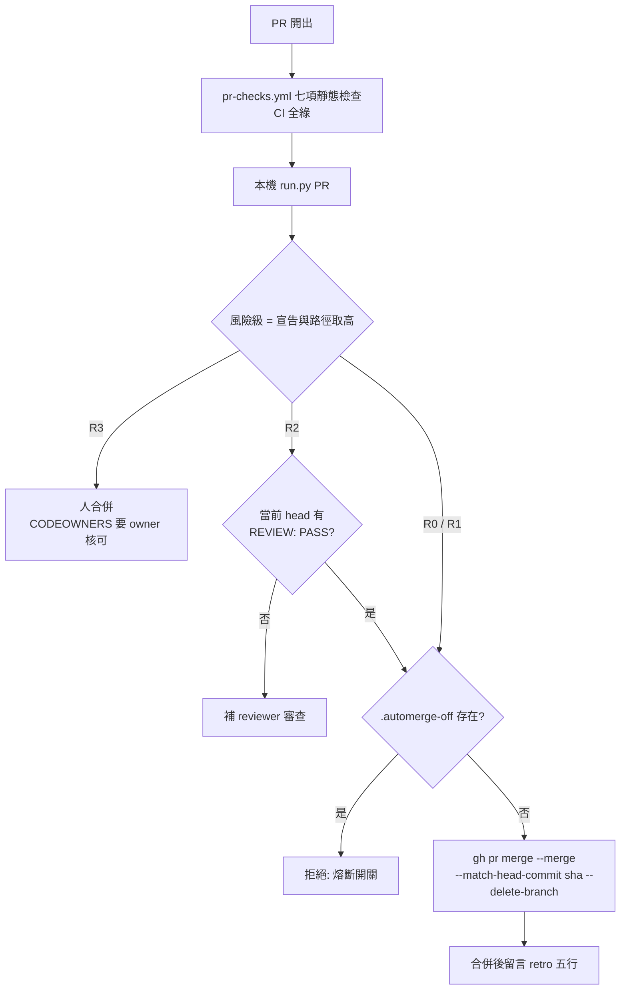

# DD-2026-1032 分級自動合併：沿用 dev-standard 的 pr_checks，依風險級決定誰合併

> 一句話：PR 的合併依風險級分流。R0、R1 在七項檢查與 CI 全過後由腳本合併；R2 另加 `REVIEW: PASS <sha>`；R3 只有人能合併。熔斷開關 `.automerge-off` 在實測通過前維持開著。

**狀態**：已採用，分階段啟用中。導入（#278）與 CODEOWNERS 收斂（#284）已合併，熔斷開關仍開著，進度見第 5 節。
**風險級**：R0。描述的變更已由 #278、#284 實施，兩者碰到 R3 路徑，由人核可並合併。
**取代**：本文件 2026-10-31 的版本（#276）。那版設計自建 GitHub Actions 流程，使用者在同日決定沿用 `pr_checks`，所以不採用，保留在歷史：`git log --follow -p docs/design/DD-2026-1032-tiered-auto-merge.md`。
**已記錄的決定**，使用者於 2026-10-31 至 11-01：
1. 自動合併沿用 dev-standard 的 `pr_checks`，不自建流程。
2. ruleset 的必要核可數改為 0，保留 code owner 審查。
3. CODEOWNERS 只列 R3 路徑。
4. 熔斷開關先開，實測通過後才拿掉。

## 1 為什麼改成沿用 pr_checks

PR 作者與 code owner 是同一個 GitHub 帳號，GitHub 不讓人核可自己的 PR。先前版本要靠 Actions 機器人或自建 App 當第二個核可者，兩條路都有未驗證的前提，也要新增 secrets 與 `.github/` 變更。

`pr_checks` 不模擬第二個核可者。ruleset 的必要核可數降到 0，風險分流由腳本與 CODEOWNERS 承擔。代價是安全邊界從「人看過」變成「路徑風險清單夠不夠完整」，見第 6 節。

| | 先前版本，不採用 | 現行 |
|---|---|---|
| 判斷風險 | 自建腳本加 LLM 審查 | 改動路徑對 `.dev-standard/risk.json`，與宣告取高 |
| 核可 | Actions 機器人或自建 App | 不需要；R3 路徑靠 CODEOWNERS 要 owner 核可 |
| 合併 | `gh pr merge --auto` | 本機 `run.py <PR> --merge`，用 `--match-head-commit` 鎖住 head |
| 新增金鑰與工作流 | 要 | 不要 |

## 2 現況

每一列都附可重跑的指令。

| 事實 | 指令 |
|---|---|
| ruleset 要求 PR、code owner 審查、討論串解決、CodeQL 高風險警示擋合併；必要核可數 0；`update` 規則限制只有繞過名單的身分能更新 `main` | `gh api repos/neohsiung/AI-Investment-Advisor/rulesets/14706385 --jq '.rules[]\|{type,parameters}'` |
| 管理者角色與兩個 Integration 永遠可繞過 | `gh api repos/neohsiung/AI-Investment-Advisor/rulesets/14706385 --jq .bypass_actors` |
| GitHub 的 auto-merge 無法完成合併，本設計不使用。#286 實測檢查全過仍回「Cannot update this protected ref」，因為 `update` 規則只放行繞過名單的身分 | `gh api repos/neohsiung/AI-Investment-Advisor --jq .allow_auto_merge`，並看 PR 頁面的 Merge status |
| CODEOWNERS 只列 R3 路徑，owner 是 `@neohsiung` | `grep -v '^#' .github/CODEOWNERS \| grep -c .` |
| R3、R2 路徑樣式的單一來源是 `risk.json`；CODEOWNERS 的 R3 清單必須與它的 `r3_globs` 一致 | `python3 -c "import json;print(len(json.load(open('.dev-standard/risk.json'))['r3_globs']))"` |
| 熔斷開關在 | `ls .automerge-off` |
| dev-standard 版本與已採用元件 | `head -3 .dev-standard/PINNED.json; cat .dev-standard/config.json` |

## 3 設計

### 3.1 合併表

風險級取 PR 第一行宣告與改動路徑算出的級，兩者較高者。不信任宣告。

| 級 | 誰合併 | 條件 |
|---|---|---|
| R0、R1 | 腳本 | 七項檢查與 CI 全過 |
| R2 | 腳本 | 同上，另加受信任作者在當前 head 留 `REVIEW: PASS <sha>`，head 一變即失效 |
| R3 | 人 | 腳本印「R3：要人合併」並拒絕 |

R3 路徑涵蓋動錢服務、`config/mission.yaml`、`config/parameter_registry.yaml`、`start.sh`、`docker-compose*.yml`、`secrets/*`、`*.env`。完整清單以 `risk.json` 為準，這裡不複製。

### 3.2 腳本拒絕合併的情形

判斷順序固定：

1. 熔斷開關存在。
2. PR 改到檢查工具本身，也就是 `.dev-standard/bin/pr_checks/**`、`risk.json`、classifier、`pr-checks.yml`。這種 PR 一律當 R3，不能用自己版本的規則替自己放行。
3. 算出或宣告 R3。
4. base 不是預設分支、draft、GitHub 回報不可合併。
5. 任一檢查不過。

| 驗證 | 指令 |
|---|---|
| 離線跑靜態項，不碰網路，也不讀熔斷開關 | `python3 .dev-standard/bin/pr_checks/run.py --body-file B --files-file F` |
| 對真的 PR 跑全部檢查，不合併 | `python3 .dev-standard/bin/pr_checks/run.py <PR>` |
| 行為測試：R3 拒絕、熔斷開關拒絕、R2 缺 reviewer 拒絕、合併指令不含 squash 與 auto | 在 dev-standard repo 跑 `python3 -m pytest tests/test_pr_checks.py -q` |

### 3.3 流程

合併固定是 merge commit，不 squash，不用 `--auto`，不用 `--admin`。GitHub 的 auto-merge 在這個 repo 不可用，見第 2 節。

### 3.4 本 repo 的差異

- 主 checkout 是正式環境。`run.py` 非離線模式要求本機 HEAD 等於 base 最新 commit，所以在 worktree 執行，不在正式 checkout 切分支。
- hooks 元件暫不採用。它會設定 `core.hooksPath`，使 `.git/hooks/pre-commit` 的 detect-secrets 與 gitleaks 失效。等 dev-standard 0.7.0 支援 `.githooks/pre-push.d/` 再採用，見 [#281](https://github.com/neohsiung/AI-Investment-Advisor/issues/281)。
- ci 元件等 dev-standard#19，見 [#282](https://github.com/neohsiung/AI-Investment-Advisor/issues/282)。
- `.claude/` 以白名單進版控：`settings.json`、`hooks/`、`agents/`。

## 4 威脅與對策

| 威脅 | 對策 |
|---|---|
| 把動錢變更標成 R1 | 級數由路徑算出；宣告低於算出值就紅燈並點名路徑；合併與 R3 拒絕都看較高者 |
| PR 改掉自己的 R3 樣式或檢查工具 | 設定只讀 base 分支的 `risk.json`；改到檢查工具的 PR 一律 R3 |
| 審查後又推新 commit | `REVIEW: PASS` 與 `--match-head-commit` 都綁 head |
| 自動合併把 `main` 弄壞 | 熔斷開關隨時可停；合併後 CI 失敗由人決定 revert；不自動 reset 或 force `main` |
| 路徑清單漏列新的動錢檔 | 見第 6 節 |
| 金鑰外洩 | 本設計不新增金鑰；`secrets/*`、`*.env` 列在 R3 |

## 5 啟用順序

| 步驟 | 內容 | 狀態 | 驗證 |
|---|---|---|---|
| 1 | 導入 dev-standard 0.6.2，熔斷開關先開，#278 | 已合併 | `ls .automerge-off .dev-standard/bin/pr_checks/run.py` |
| 2 | ruleset 必要核可數改 0，保留 code owner 審查，由使用者在 GitHub 設定頁改 | 已完成 | 第 2 節的 ruleset 指令 |
| 3 | CODEOWNERS 收斂為只列 R3，#284 | 已合併 | 第 2 節的 CODEOWNERS 指令 |
| 4 | 對下一個真的 PR 跑 `run.py <PR>`，確認印出熔斷開關的拒絕，[#279](https://github.com/neohsiung/AI-Investment-Advisor/issues/279) | 等下一個 PR | 該指令的輸出 |
| 5 | 實測 R1 PR 能被 `--merge` 合進去，R3 路徑的 PR 被 GitHub 擋下，並確認使用者帳號在繞過名單，[#280](https://github.com/neohsiung/AI-Investment-Advisor/issues/280) | 待做 | 兩個 PR 的結果加 `bypass_actors` 指令 |
| 6 | 另開 PR 拿掉 `.automerge-off`，屬 R3，由使用者合併 | 步驟 4、5 通過後 | `ls .automerge-off` 應失敗 |

步驟 2 完成後、步驟 3 合併前有一段空窗：必要核可數已是 0，而 CODEOWNERS 仍列著 R2 路徑。#284 合併後空窗已結束。熔斷開關保留到步驟 5 之後，因為實測前不知道真實 PR 上的擋法是否如預期。

## 6 風險與限制

- **`REVIEW: PASS` 不是第二雙眼睛。** agent 與 owner 共用同一個 GitHub 身分，`trusted_authors` 為空，等於 repo owner。標記證明的是 `reviewer` agent 在當前 head 審過。R2 的獨立性來自 `reviewer` 是另一個 agent 與上下文，不來自身分。
- **路徑清單完整度就是安全邊界。** 新增的動錢檔沒列進 `r3_globs`，會被當成 R1 自動合併。計畫中的 `tests/invariants/test_codeowners_covers_money_paths.py` 是補這個洞的測試，建議在步驟 6 之前完成。
- **R1 不是零風險。** R1 含一般程式與測試，看錯的代價小但不為零。合併後留言的 retro 五行用來量這個代價。
- **合併後才失敗的情形只能事後補救。**
- **權限範圍等於使用者本人。** 合併由 agent 在使用者的機器上用使用者的 `gh` 身分執行，沒有機器人身分。熔斷開關與 R3 拒絕是程式層的限制，不是權限層的。

## 7 未驗證

1. `run.py --merge` 能不能更新 `main`。#286 由使用者手動按 Merge 成功，但 `run.py --merge` 用的是 `gh` 權杖，是否同樣被放行尚未實測。屬步驟 5。
2. R3 路徑的 PR 被 GitHub 擋下，是 CODEOWNERS 加 `require_code_owner_review` 的預期行為，尚未用真實 PR 實測。屬步驟 5。
3. 熔斷開關的拒絕訊息在真實 PR 上的樣子。屬步驟 4。

## 8 回滾

- 暫停自動合併：確保根目錄有 `.automerge-off`，空檔即可。
- 還原必要核可數：使用者在 GitHub 設定頁改回 1。
- 移除 pr-checks 元件：從 `.dev-standard/config.json` 的 `components` 拿掉 `pr-checks`，跑 `python3 .dev-standard/sync.py update`。

DERIVED: 通用：是。安全邊界是風險路徑清單的完整度而不是核可數、改到檢查工具本身一律當最高風險、熔斷開關先開實測才拿掉，這三點已在 dev-standard 的 `pr_checks` 實現。本 DD 記錄的是 investment-advisor 採用它的決定與順序。
