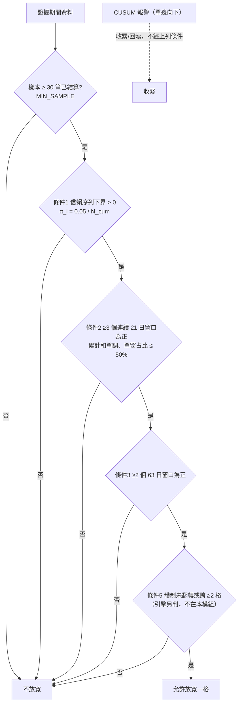

# 序列證據統計與放寬條件（G4）

> **English summary.** `src/evaluation/sequential.py` is a pure-function library (no DB, no settings, no wiring, risk R0) for the
> autonomy-charter Change Engine: an anytime-valid normal-mixture confidence sequence for the mean return, a one-sided CUSUM
> calibrated to ~1 false alarm per 2 years, non-overlapping window checks, and a minimum-sample guard (30).
> Nothing calls it yet; it changes no live behaviour. 目標路徑：`wiki/05_Quality_Assurance/`（wiki 為獨立 submodule，合併後請搬入並更新 `_Sidebar.md`）。

**這一版新增的想法：** 放寬門檻不用「看一次的 p 值」，而用「隨時偷看都有效」的信賴序列，才擋得住每天複查造成的假陽性。

## 放寬的五條件（全部成立才放寬，由程式判定）



條件 4（≥30 筆）即圖中的樣本守門；條件 5 由引擎判定，本模組不含。

## 公式

- 報酬先截尾到 ±20%：`x_i ← clip(x_i, -0.2, 0.2)`。
- 信賴序列（常態混合，Ville 不等式；每步為 σ-次高斯時成立）。令 `S_n = Σx_i`、`V_n = nσ²`：

  `P(∃n: S_n ≥ √((V_n+ρ)·(2 ln(1/α) + ln((V_n+ρ)/ρ)))) ≤ α`

  均值下界 `L_n = (S_n − 邊界)/n`；放寬條件 1 為 `L_n > 0` 且 `n ≥ 30`。`ρ = V*/(a + ln(1+a))`、`a = 2 ln(1/α)`，`V* = target_n·σ²`（預設 target_n = 252）。
  `α_i = 0.05 / N_cum` 由呼叫端提供（`loosening_alpha`）。σ 必須由呼叫端以**偏大**估計提供，低估會使保證失效。
- 單邊 CUSUM（偵測下移）：`S_t = max(0, S_{t-1} + (μ₀ − x_t)/σ − k)`，`k = 0.5`，`S_t > h` 報警。
  `h = 4.42` 由模擬校準到平均每 504 筆（≈2 年日資料）一次誤報。
- 窗口：取最近 n 個**首尾相接且互不重疊**的窗口；重疊、不等長或不連續直接 `ValueError`；序列太短則判不通過。

## 樣本量對照表（最快情境）

由 `required_sample_size(sigma, delta, alpha)` 算出：真實均值恰為 δ（每筆決策）時，下界首次 > 0 所需筆數。

| σ（每筆） | δ | N_cum=10 | N_cum=40 | 狀態 |
|---|---|---|---|---|
| 3% | 1.0% | 131 | 157 | σ、δ **UNVERIFIED**（假設值） |
| 3% | 0.5% | 520 | 631 | **UNVERIFIED** |
| 5% | 1.0% | 358 | 434 | **UNVERIFIED** |
| 5% | 0.5% | 1517 | 1830 | **UNVERIFIED** |

> [!WARNING]
> σ、δ 與每月訊號量都沒有實測，表只是規劃假設。實測 σ 前不要把表當成放寬時程的承諾；再加上 63 日一致要求，真實時程只會更長。

## 驗證指令

```bash
.venv/bin/python -m pytest tests/unit/evaluation/test_sequential.py tests/invariants tests/unit/config -q
.venv/bin/python -c "from src.evaluation import sequential as s; print(s.calibrate_cusum_threshold())"   # 重現 h = 4.42（約 4 秒）
.venv/bin/python -c "
from src.evaluation import sequential as s; import numpy as np
print(sum(s.confidence_sequence_any_time_loosen(np.random.default_rng(i).normal(0,.01,252),0.05,.01) for i in range(1000)),'/1000')"
```

實測（2026-10-18）：零效應 1000 條序列、每一步都檢查，放寬率 12/1000（≤ α=5%，信賴序列偏保守）；
CUSUM 零假設平均誤報間隔 508 與 518（目標 504）。

## 邊界

- 純函式，無人呼叫；不碰資料庫、設定或下單路徑（R0）。
- K5/K6、體制判定、邊際區間證據單位屬 G6 引擎，不在本模組。
